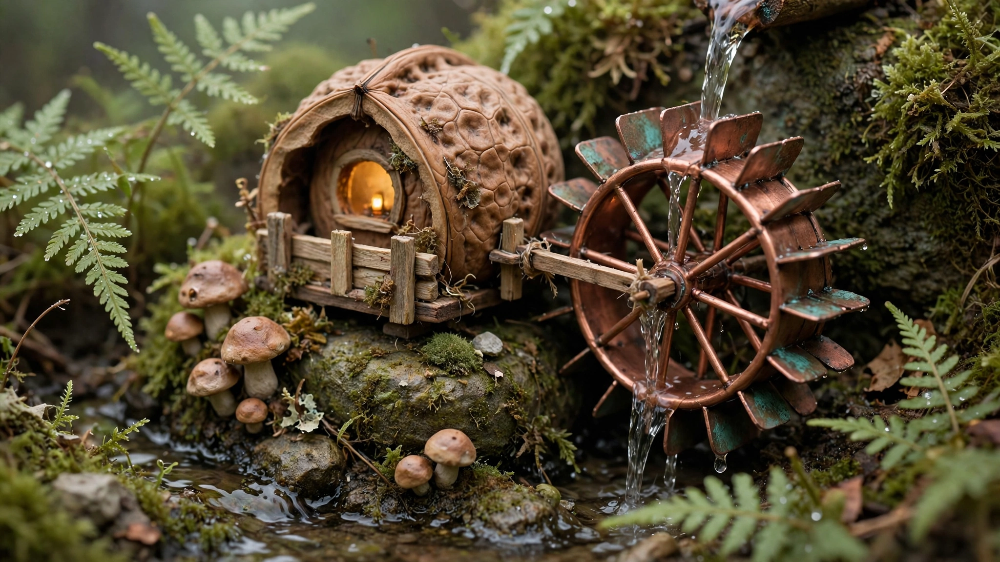

# awesome-noodles 🍜

Twenty-five workflows for [nanoodle](https://nanoodle.com): models pass images, stories, motion and sound to one another to make something you can play, watch or remix. Open one, change its inputs, and run with your NanoGPT key and balance. Viewing the [saved results](https://nanoodle.com/examples/gallery/) is free; opening a workflow does not run it.

| Continue a story | Give a miniature its own sound |
| --- | --- |
| [](https://nanoodle.com/examples/gallery/#storyboard-relay) | [](https://nanoodle.com/examples/gallery/#tiny-world-film) |
| Generate → continue → critique → repair → inspect again. [Compare the frames](evidence/README.md#storyboard-relay). | Generate → animate → add sound from the actual video. [Watch the film](evidence/tiny-world-film/default-2026-09-12T13-56-05-839Z/n5-video.mp4). |

Each of these also has a second saved run: a cut-paper crab flying a kite, and a mechanical moth. [Compare both versions](evidence/README.md), or open their gallery results to remix the exact inputs. Reviews retain the remaining continuity and material mistakes.

- **Game character kit** — Generate a character reference, then matching cutout parts. The companion skill turns those parts into animation frames. [Open in nanoodle](https://nanoodle.com/#g=H4sIAAAAAAAAA51X25LbuBH9lS7kJalQlOZie5d-cuyZ7FZtPK7xJJut1D60wCYJCwToBiiN7JrXfEA-MV-SaoCiNBmv48qTKFwa3eg-5zQ-q62qzgrlfE1BVf_4rEytKqXPVKHifiD59n1PLqpCOexl4J3FPa4tge6QUUdiGNhHn9YX6l5Vl6tC7VW1OH-2KtROVeffrwrVGLJ1UNVnFek-qkq9oaDZDNF4B__-579Ao_POaLQnhmU80ICMkUCP0Y8RBuQY0oz1sppNC-hqQGd6TNbWuDGuLeHGEchhoNFa-CPEnQfTY0tpIJRw1xFo3w_oZBubtuw_BKD7KMcHiIwuDMjkDqfKOWvcUICLc2gYewoVmNpSATu0mwKG0ekuLfsw9kMBOxPlL2C0mLdH0xvXQk8Ra4yYvQx-ZE3QoDauLaA3zJ6pBktNLOHd4XoPVzCHWoFxYSAd4YM3bnKw9zJVws-eN1QD3WM_WKrgR_YO_kZcGx0LQGixJ1iPxkZY7wFB-1o8w1biHYN8x44CAYZAMVTQxTiEarl06LyvLZXa98vJfFga9m6xzeaXUMLr-WLDxlgLv2f6OBqJqvE85e6_c_aH4yGtid24Tkcczkvf6WuRTIZlZKJlj8Ytp4G5dBZhYBMpQM5yyzh0gNY7Aj_GYYwBmBpicpoAOaabS0l-mS9G-5ryYLcPRgdApmMt5kvaed6UqlDaW8-qUnuy1u_Uw0MxAcmdACmV_Yyi1wdHH0Hm8muAeZVrVUdoRnaoCTbOtF2cigw0o5aEm63nPXRke4oFOGT2O2it36Xs9mti2JrguYAaeQMOt3tA7mUAIXSeI_AY4kJSFTRyU4DfEgfziWrYEcaOZGrNGAK0OLpoaSq9jsTY2vsYSnhDkbg3juoiTxSwxhglexqZqS7hrReDg3cFOA_iYCjhfdzbdFaHrl4MaFykGs7fAGoplcVgMTaee-KUuBR9iOxdK6m1xlGYCEHQEdFFuwcmrBNrBWM7P1KMVJ4m6vyYKGv7L-QJagqmdYeEXXz_tYz1viarKvVpgWbZ2n7xrLxYNBZDpwrFhME749qrpvEsmZWiKVSP93d-Qy6oSp2tVitVqLAPkXpVqZ-lmOHm7dVEYAP7fogF9Hhv-rGHs4uVVGMdioSuCdxHIj3WesO-F1xLPAf-FYqhQLylNDOGOdyXIPRimj00o7Ww9vW-EKLs4iKTFcSOiRYfR2Q5J5iaYGtoN62aKE3yX2f68xx8AY25pxo8x84naBoNGntiLIDJokxKxvYg-dNUwNrHDhqiKLVr1pZKeG9cawlM8BalQo7RanJRarQAr_U4GArw_BkMxDIBvoEg_hJ0JD4W0JIj9mOAtUW3gR65NS6U8JpNGA5FVUM4FOb5m3y_c_lp7yJ7a2WRETqE0GGduNx5aMZPn_ZAdUsBPE_8DGs7cglXLhomWKPetOxHl_haS8U2FiXYramhT3SD8Lvr69Xq-hqmZE1MijnBvd-ifQm4Dt6Okexejp52LgfjNsthZHHNuJTl-bqyj9b7_CWe-12ARMoHr9JM0lLPsPZcE4c0JpELJYWOKJZwk7h1Kk_wzu4foeziiLJUxyc4e6r-GWgvnn8L0EROl_0YaJHsLsXVRfSLwylCXgKrSgh5i2yS6iSknfp3efSPKe2ZHbw9ICi7dXb5YupyvvtNx1SlGiOcvzN17FSlXjz_ThUqV93093j4cDybanMiFbemzcqkviXyae-jgHM65JaZknpJguox0enUUyyOUvzu1e3de3j_w9XVnWBFaiXV5AnAphKaWUVQG9EIqYGJAYy1Y4ic7QlsqIAkkkEoKxIbtEJVKFu19bFL2iTV_3E0gzScJbw6wDRTXhisiWBc9DNErm_-eis70IJxEy_AxxFrRhfD1H0l0jxwhBBYklHvUldHPK_PmpFhdwDaKSy3xPudSF8Jdzfv4Ker67sKbt7-9EtGkxfYR0pMV4AjvTmIZ6K83DqSjcvODFluAQVkstU50uLdYEhTCa8eQRi5D0XSwlCApTZkCHqR3BhRdySsCrEzIYc3WXnf-dEKToEksAih90KiKRwhqmkeBhTLnRnmleJn9jHHevvjn39IwV5BTdORlIkLuc-S8sRsjrH2O6kV9mPbCV2RbEhJ1NYHoTATEqm01m9JikN3U-d5Wl4dulaGt8RRWMLuMyPlq52uoYQ_3dzd3fxlzs1Td99evbqVS3zs8zgMxIvYmbabjEkFPvZ94yj3g6GT6vfZw1MlbLyPh9z8ZiCiZ_XjSGa3v3LN15PbqaLFZBD9mcFSzOaSi5NDnNUtWPm1-9TuEYvvtQnRuHY0oZscxKzdJbyyFho_8vTiCY_7CBwGQsbUNLv6mzqBEl4nOQZC3Z1gz7hEFXLHMwRTeLMaH2Rv1uMrsSB-QSNbD5iz-7xR5MiaYUiPv7c-tyyz70FORLefT0trwoYsRWlAe9IdZgmqDbaMfQEW1yRE5UZpm0ORJLCAAR3ZowzOismzy9qHOPaU8mjkqfmGcQd-wI8jQWOcCZLcMLJQYAB5n0oedrifS2uqzfSwy81DASHP5dRodKkxtzik0HJPIq9Y9ZA16uw8a9TZ9BC_uFw9_Fooa9zm5LVvRSIEDyIrLutWergMuTtNz4-HQkV_uuD8uGCSl6OU2fMvWDz_XxYvvmbx4gsWTzZknX9i8vLJiqNF_n8sDk8N_looKXNZNKD7u6ouVoV8_aKqM-kRgkZLqlqVLx4e_gOijqqycBEAAA) · [graph](graphs/character-sprites.noodle-graph.json) · [run headless](recipes/character-sprites.md) · [See result](https://nanoodle.com/examples/iron-verdict/)
- **Idea to 3D model** — GLM writes a concept description, Muse paints one clean concept render, and TRELLIS.2 turns it into a textured GLB you can orbit (~$0.21). [Open in nanoodle](https://nanoodle.com/#g=H4sIAAAAAAAAA5VW7W7bNhR9lQv9WQtIsmM7XeH9aptsaJE2QNNhGNahoCXaZkORGknFUYv83QPsxx5lD9Qn2bmUFCuzW2BAU9vy5f0459xDf05ukuVJmhhbSp8sf_ucqDJZJkWmTJAmJGkS2lryE1tV3YPbZJktpmnS4nX-BG92yfJ0hte1krpEks9JkLcBZ16WUtCXP_-iwppC1oGEC_Hz_IwqFNQ5_eJUkGQN_lYfZRFIGaq1wP8760qf0zNDFxevKTTOeFL8fbAkhowZZ0TnhVN1UNbQI78VtUypxhc-pUoE6ZTQeFtYbZ1_nNMri-yiLD2t1a0syUlTSkeu0dLTI25lt7V6aCilsHVSZn80yIiwGyV3ad-iVpttyDZOtLQSxfXG2caUj8lbnJFUqwJdS1KepPAtoW-t1v0E87OcXjceUUgUfDzQz_QDvXt7fnHx8iqf9WOHrQjkldmgK1WJjRxQYJxRoqSfLp5TaxsqhCHrVirkdLUTdUyrmAVhSvry9z_0tjE5OIxggKFWam13yd1d2hPPwXvSI48PGO_onjPdRlQcc9nz1h080MAzKraNuW5pp0yZNWjJtuSbVSWcYqhV2GKQlRPeUw2ufGGZvwg6RUCpti4wIyBRkA-gGhMHoTTVDsFagxaeD2nU5r7OtWyhK5Sr0w5kPiSFjqGFk6LKR3MPetqxHt0eAa2rDoD50wMAvPok46i-9UFW2KPZ9O4elxe95kfqfIBPXADEfcqEmmx0lZ3m82ythd8iDO15a8D4-XqN6bkR0JQmlbh9Z6-lQYZkMZ3iyVA7-RX0x-4j6Vc_P391_uJd3AOyawzdKweQVegKWYHX_CxDpbK9X9B-F3Dg8s35sJJrHIlJoVf3nY9U53QW51rx8uo2ft2FL8neSCe0hmL11jYyoCXGnMnCLMABREpRbLFLXq20jE0e2dWUfBXzNG4tCgkkmXR4wmtxLUmiStvN561WZcerNQY9gOpHxtJaWxEAIlZRFiwfw5vJ3qJc_3GjWXjD6njJ6EF1my2M4swiIhDbHlvLfsXTbvORGa2CbScgMWlrDeECV1Z-Tj-KSuk2WzsFTHWb02LKFvD9tHO2NJoe2hfwj3o7WIqX7LtoNqfLJtRN2MM7EtJYuT60Wh5b2UGxi9nh0t4TPza_Y-t71blOrwT49kOlpLGzsV_SutFoGKOsHWp1rPBQbFNx27H5G3wNRDuRlEzFQ5OF4kyIVtuJz0e8kVasIC7owsJHIQDgFZpS2Y6PPYaiwjj-uD93tHfOgsuitLv4hNXZKwSTxzcWs7l-LD-G_GPWbdEe9Y-4UzrUn0471E_6m3G2mB5Ywv3pPdxe1gh4_97g36Et7QvFJe4qnZz0ntxXmk_HntTXWB5xJGB81Ikq7NekwpJnscqEgciCzYaanBthJ8sTfLiBf4u4zPxo1HIlo4P1_cbc87Lv-PRhx4sRNvs7j38g4D472uJO3EhfS1myaQYH71c-m01ih9xqrDSMnrBh8sHLOsQsWHqrm-jE6Hk6W3Cf3RX6YRiufwqNyvCBbedDAamESOyUwfSiwqIjVN7Gd36yEXwFtRP2xa6JLJaddL9xNnoFeH5PE63M9eg3lmYYWd7cGv_-2l-_def5cQdRMthRyMFN1Qf3U--J0LPD_F87fLTSSOZ9mBinnx-mH7zo_2VdjbMuDrMenvgWMN9C5PSriOxPdWr_b_Je1Q9jmFTDmZ8yuXh9cvcviMMUpVALAAA) · [graph](graphs/idea-to-3d-model.noodle-graph.json) · [run headless](recipes/idea-to-3d-model.md) · [See result](https://nanoodle.com/examples/gallery/#idea-to-3d-model)
- **Mix the references** — Four separate references (who, what they wear, what they hold, where) go into one FLUX.3 Klein Edit, and the instruction names each image by number. Swap any reference for your own photo (~$0.05, about a cent with uploads). [Open in nanoodle](https://nanoodle.com/#g=H4sIAAAAAAAAA61XXY7bNhC-CqGnBJD_JNW7VZ-KIAWCNEiANmiBNg-0RFmEKVIlqZXVYE_RA_QYee-JeoTOkJIlr1XvLpAXW6Ko4cx833wz-hzcBekmDKTKmQnS3z4HPA_SIFtwaZm0QRjYrma4oqrKLxyDNFmHQReki80NXLRBehPBf8GZyMHG58Cyo4VX3vEjKVSjiWYF00xmzBAwq4iSjNQ8s41mS_KaZuW4g3DYYw1RrSToU0raUpEXtmQkK6mmmWX6ZQiL1BJY7EjLqJ7el0rkIaEyhzUw6ReNhYUl-eHHj78uY_JWMC7J65xbsmdwFmypwDFSK22J0jnT7n08k0tjdZNZrsAdWkEADN3FAHYdkU21YzolvKJ7RjZhfxENF_FwkSzJTy2twWw3CfWNe4ZRQprgTPLv33996Ve5rBuISJHGMNJhEjEjdamsMkvyRpqaa5ajE-hm1QjLF6PlVulDIVRryCtVFd3HN8SUqoX9eM5bzSiJXYhnCXlRWlubdLU6LgHsVf_mCnJnG7OKNpv1bbLebm_i-GabRHG8frkENmRKKA1gd0zAgcH9fdhTqN6M5HGEmDJn63kTr-Ef8wp7fgGc__kyohzMMOp7YioqBKlpzfQi07SwENKRVNRkysIfpFIVsCRyCFZpKiGVbjNpuS0hxW3J7bCUlcxYDzXlglheA3HITtDs0O-QCrLvNrSKaNXAlX_MOmZCTysu96SpNd-XQB7pyFty2CjY3rh3C5rhHkdhCFXTkBQNBLFTeReSDIoKUAPO1oICCsIZ2mvH2ibniuzgwFwrcM4oiJfdsX4XvKy5qXtfMWjwSSqSCWXBhb27wczBgbTiolsUmjOZi245wUlPcHJs9UDFtx6pxCMVIWKG_8kcHLVWVQ2ArO9P8G0QvFez4FXAcAFbKmbpqgJCL9w5K3RtYdViOBXNo6UUPbqjmlOsO4NLU15FV3jlvL4g1lQr0E3V2ILbOYJ90CqHcveFhlSiQAsoWs9ucpDcWmCWBqQyBWZ7VtUK5TIH8VF5rx2asZ4xLSwCZFbt9wJko7EWgiI51jNyotBKAkIAPlBFUE_IgRXIKNozQxXFwtMXGbF3xqec6OnSU-OOG74TqJqNPHTOc8cF0NyQMECvI3uqUdJ9EEAVTA_TjjUVlZL90XB54tAZZaKrlIm3T-RMhGC8vwTjKxMmvkKYm_U1wmAzQR_B9_qJdPEC5ZFHAH1xCop4yoEvWJ6AYrVTUK1U6w4FogTgBYCzB6bhfQvwIDuwNxmes_C5rDgnxEkL4KJmqhbsDNL4KqTb2ydCGmO6PjxM11cGNLkC6GYdzSGKowACCerN5jvLtKeAjO2wI1uQ-4YtSuy_eWMOKQJc4pjQF3XNAdyh7QCS-U7BDx4jDzjs-ApXmg3ACNo5BNHu0JnoHTYTbDGePH378k_BoDV-oIGzreb1SCoEFnyDHuUIoRV0pv7MkQyec9iWRN-jYFwCOmEPWwhQDgFawdpBFFxEgyKcmrGZ14HkKmk26_UTWZM41lxg83VpU_FjPUccN7xOZpJk5A1OsNMR8MVkBnSHv5zj0jt6YG5ElKwd5lwABdgEc9WOS2Z6WkxHY2_PLH-XfgDc4CR8Nvam5MBYjdoBHhwpys75GARlD-7NTT9hP_e4iSfsZ5jTcNMPM_guCh3QG7N38iQaPPFtMyW5ZmYI4egJd3Lpfxpl6CmF7_hzpg2zqU_ztnvom-dZ2xy9iQdv0NX05AUqde-D6FzyoSCdX5ciDEMzlkOvv152MQxc9HNcTdtzHf7OFxAr3DN0wVXLkryX_XGD8b7-4KtFjB85g_PJyXnk-ui9GyTNOBZiPU-SOhEWrM4LWbrI7lRXJjLi0jxoyEQ9dsxNrNyCo6_vmO7c-IhedWZKsiX5uRwjzagBk65LDcriXBgwx-T48BQkyQkIzKVu7r6qKlCnY5mynD8o0ySa1Ok1UcHiBVm5-OiblRhXEijUxgq6M6tCNMdFvDrgWyt04kJs1lFyxB9YGg4PIIpPYSA4iP_4LS1QlbCP43n4tTd8HGGlDUoEbls12aAnG3rzY4ZENGMxesxidM1iPGMxfsxifM1iMmMxecxics3iN5cWp2nyAD006dl0vmU0uZ0xGT3fZDS1eTNjM36-zXhq83bGZvJ8m8nU5reXNvsWeQ2iM6MnjD7d_wffjuBXSRIAAA) · [graph](graphs/mix-the-references.noodle-graph.json) · [run headless](recipes/mix-the-references.md) · [See result](https://nanoodle.com/examples/gallery/#mix-the-references)
- **Humanize a comment** — Five writers (Qwen3.8 Novelist, DeepSeek V4.1 Flash, Cydonia-24B v4.3, Qwen3.8 antislop and Mercury 3), each with its own voice, rewrite a stiff draft reply in Nano Maxi's voice (flow v2.7); a GLM-5.3 decider checks each rewrite for faithfulness (who said what, no new facts), ranks them and picks the most human faithful one, or keeps the original. Returns one JSON object {winner, text, why, ranked}, where ranked lists all five writers with faithful, disqualified and reason (on mcp.nanoodle.com also each writer's model and exact text; a standalone graph run returns writer letters only, plus the winner's text) (typical run ~$0.003 before the 20% markup, ~$0.0036 after; hosted deposit pinned at $0.05428204, about 0.163 XNO plus a small matching tag at $0.333/XNO; the XNO amount moves with the rate). Draft and Context are required, and Guidance is optional (default "a friendly, specific reply"). The writer and decider prompts and the block labels are locked, so they aren't tool args. Each writer has a 60 s timeout and is skipped on failure, so the decider still runs on the survivors and returns ORIGINAL if all five fail. This needs a nanoodle engine with per-node timeout, skip and lock support (nanoodle-js #46). [Open in nanoodle](https://nanoodle.com/#g=H4sIAAAAAAAAA-1d65ITR5Z-lVz9oTusC3SD7Wl2JhZo7OgZG2YNO_aERcSkVCmpUN2orGohG_7uA-wj7pPM953MrEu3uhsI_yyHA6RS1sk89_OdrEp-H12Ozh6MR1keGTs6-_X3URyNzvC1MqPxqNoXBt-WeZqarMKFTKe8sKlTncW_mUn7yyo2SQQKv48q877CmPNSryr1lXqWZ7yCT9_XcaSzpVH__7__px6pXRlXprTq6L93Jjudfqte5JcmiW01W5WxyaKxOjemeGXMVv3j4fSB-i7RdjNb5WWdjtWzfZRnsZ6cPHyqLh9OT2eFMaU6elXpstyrl0ujM7XSSbLQy63KM5Uui-OxCjPprIptkhezItFxNlY_mnJZ477T2bs6Xm4x0ujlRu3iaqO0iuLVypRgU13mMZZflHlaVMLF9z_8OHk0PVWRWcYRF6ATmytrjFXVxjQcH6vlxiy3FksCyVWdZMaC8d0GY3UczaI4UruNrsYqy1Vmdhi3rOyxKkCyNCKosSp1thWyYF9nkSripfuu0txWSnTSTACecUteqpc_XXx_8eLJD1N1eTL9Zqpe1lVRV2f8Xf311csXKl-8NctK_b6Ls8yUYyXKOiJZXomzdVgBpLLb7N06TARTcQochynHUWzf1TqJYQrRuDTa5tnHNx_DDUonO723aqMtPiZdA4ByppnO8jxKzBQmpXQUWa8CGXPPgsfIJMK3eQ_hyDKPp6OPH8feZCPaW2uzYoWNwZ77H69ZaYfA0hnqTSSeNT_fRmTtNX4Tle_b36-R0coZfgIh2wIWtYqXEH6R7DsTvJ0s1y3xt3mcXVviVwcnsabAkHk2z_7M__ihR1YIHST7s-hAxRkM5zNI7ia6pZgk6TWCTxrXn5x887Rx_7FzszMvjePelGIGIPEON87eNXcvJpm_G6Od6cFyn68QLSoJZxmFker3r_OtyUBp9PX9-7hi97YyKb7-M6-DnSsf1OCt8J_56AUsU_2o38fzER1P5YXJkr16cqH0mkFBL5d5jb8RZV7VC9oxwoAq9H4C950U9M1Fkq_XdCVL-rsNoonzVysWHUhZVdQLMLFx_q33zgdyOCPFr7iS2S8vXh5PVbMoFeMuXWL6lVykD6mjrjcdCzUMa-3L3b7S2ZQ6-8nzTZ8XL8I4OKFdlrrC9BIKsBYNAekEf6zrRJdql9dJpKheFVdTdZ5n9yq1RcRu6cBtLdgyjPm2KutlVYNxCDUGq3mJgDlVDyYPm0EWdr-BxsBttYGkG0IgX-aFSuMMN0em0nFiEVZELjISS00lNEJMwtOrZjowvioNzGkPFUe5evHyNWLQJdjNRZUhyu9MAmHJ8jRNoEhiWoGLtQfuhSDDre9qY6s4z6bqCUw3knXDrJBcINX5qEsMPyEZQbHvYRwxmfbXAo35CFSU5CVVwA1lAfjf7hicsTgG7k50QCzEXeQyX0GIamGqinL9GzXRLg23Qe3xCqK_55KGEKfVtGo_ilc95aWyiLqEDYscwbW2W2UhpmoDcx4HfeuqmQi2-Z2zsliSHGVqnUFVXDqlKd9MttbiEyJEThu4skyD3giLUseYfAdrsaLY73oZVDJfnBYwGuT047N5NnGcm0uDfM40CmJ1uqDwGH1kfixt69IIQ22cLZM64kpC9mJOmo-4Wsi72uV0_PlIL_K6mo_ofKSuEHBKW0HFUFgUKXEoZO0wHz4socUUf_8XdQ_Z0OhlcutkplFUwGnijqVzhE9E04YZ1gksEbh21gtSK4RlpFiHKDpnkfAW8Q0W44yC1lLEGT9SdZ1CBsaHEKmOzHQ9pVVQpeTXJBC2TDEfZax1qnI_H8ndMMKqQjVFSbbRJ62hAGrLIkJcvUeY9KQhtouVqjNLnyRDDCepLrew2CTP1rSusUoMvSuGGGrHfy_OYQ0hVJ6hTCL30D3tmtbqCqAjjF_kEfS60mlM_S5zcA2h2ASyPA6RaoN6zS1QbiZ7pBukKrZCrSBEINBQkogL2d7FQC8-8t1VnhjoU406KpIKSkZDbZbL5v225Yde6EPE8Zky6Qy-G6HANfYx5LjGjVUnJtD-kPgujf8YU0pZ5S2zwjBNG_NfdYELVAK_lQZLxSzWfV1j4GSJmLk2pR9e1sk-mLjNk7oy4TskUsONw9cLldDYNvnOfSf_b2kAv6hFXal_zkft2qu8Xm78MDGK9rtNma-6F_AJ9rBGyvIX8s6Xi3upWidagvC90ktALsDEJBrjB3_VT-0uH0HWkiJEszOMOlZMvW6sLHyXZ8hC8P3ONSCBOK-9uBbxWjLM1n93n2HUsPywfAqlkZisYMnE6S7AbHdx0vCVwLUgbxMYZ4W_hNV7HfuPtBQX-Xgx1VviibyC5SFVWn9ztdh0Vq3Bmo7spC7CQlnI5AkswV_I863ksbpQwaRies06LCbNc6YzS2VWwTo2zNXLhBmAcoUzt_Qlp7A0wC9JHIwTBlcQUaB68lZVFCUiO2zQyyiXUqgCg-tNJXbMlEjM6aW8ZErPs1VcpsyHLxhKkMMnqFJSxSpPUoTaoPhwH-A4lV67qybN38aIA-LH4MbG62yCGAD8AtVIxpBQ9x7hOdUSKBmHJNy8otsncI4aNsObOyWIhGKOjPIdlxcxY7GES-KtUf9CRrT_ApFX27iAAUgQCDqkd0iqlOix02XKlJfjgysWXDw5U9Dw1gVOgjxJ7v5rXLbVQORowWEgk4qyzEtvpKqbwQVqgVUsyqE-pzD-7kpd1gu-2BU8JXmXiV3ygESzfwjiXckEsBZfIp8pJHXr0ndIHTQtSmIqiL90KciSi0S_ByDsCX8RS-mRiAFYCpwZN1snTv-AlN528o1i-EDadcWLWsVUPgWKWjB1HuEqzKW2Lr0XdYbSz2n2aKmLGGKNfzPdWhQByLqCwFXgF8gLr1vhhwAfxTBcFAnqCNwxgJSumF4z_pIPFjm8hwlZScTXnDrBLUjYIsELwiZKELZ2JsRry7QtAjSiIzFuggQCeoAqjYwD61nshT4rO0jCQazR2GWc2BfQZ-rBsSLGmJEIYqIvHtQRdQZoUkMTe1H8GBUsM59UChQllgmfODluVt8YA6pwFvcRMvLpccegwKm3gKkKqEGWrU5liikBHypdZO8fAbKAse7fH6OQel6WeQmUZeEbGMI7DCAiMo_p4sXF7XjxqTo60BFSD-4_-KbFjGwPHYaMEe61uHcWPkwuQWSyIpEJiQzQcYCOA3QcoOMAHQfoOEDHAToO0HGAjgN0_MOhI_f8jCvUQ0WIxG92LlOP1drAbBoVe0Bm6wUCldQ8gv1EQ8s8iXqcN8kpwDXHHkXAqHzcSkBKIRaMna02CtchOi66hXTMn0dOSEgJpYniypV6oYQ6Piw7Gp-tiI4K-KZFlYHqBjFau5mbshHCefm3pspq6Ujd3ShKNgKnTAAAW03ZO0DMz4OYy9sh5jN1dPXJggZa8gmDw8jy9cacw5pTU846dxNeng6YcsCUA6YcMOWAKQdMOWDKAVMOmHLAlAOm_MMxpXcSqdElnC9qWDmFjaCL6tBW9Wrlt_hQ0xVnLTcUPpQLXIfqyBVzrPuQDP3SEnOJZC5blq5uaBgCPw5kQgHdCopVSbdwaaoeJw5XBcoDulJYEdbBptq6zNIyAJ0GcPd54C66Hdyd9583DQ-BtwCPyvjEx03DzQO-G_DdgO8GfDfguwHfDfhuwHcDvhvw3YDv_nB85woUrsU9kjlVPzDUNbncVxey2eerF4bmqrNJ12wRQiMIyyI3qTV9IUbiHsP48kkxjQL_7ZFHEub_3tZcWDuFXUmC_Jn7h7CcvF5vkGb448YkBd_GlFTq643Hkry8AJl_3Y5ifwcT3DbQUqqRvqij3Nip-h9r-qMwJbBwXuw5d5oLhOVLoYzfnkpGkeS7q1BWMIWlCWq-Q5rAmgJSG0DoZ4FQczsIfa6OmreNG-Tp3jo-iDxRLpqC9jtL3W2TYU9xwJwD5hww54A5B8w5YM4Bcw6Yc8CcA-b84zGnFOXusUtfLfoMksbRBJVjniRT9bLJoP6hzqbQU5JMXdbHfIk_pgcMwj-t8BSqAb8PGB6AhYIbtikKfA8K9iq6aXMx7gpkQG2fjNq2D246--avdbTm_rI_WScvYxR0OrnrGJxfw7FLb3pH4mxP7pjnqyd3Un7yRt14-E1_stO7Jnt652RP36g7X5vsT_rwrkmf3Tnpszfqlidq-9M9umu68zunOz8g0LC925_s67sme37nZM_fqAOIvn8UE4nd0EQ4D-eM-YPHDvcMfpvoeLZOUo442CxI8t2VXsGDA82C8AhEONyMbt0t7oLLer-002ul7Kf0EQLi77cTrDtwrD0Q62oDAAHu9aGAZiThfmFAk6m9r3vQSgE0B9cd3RyuHivRm0dloc-i14jrjPoMYPmxp9lGB3fQmkS48GOQpoKnjxU8EH884x_n_OP5m8euY4L0C7ykmyjo3ml3SJP1TKIBOtzbDDJHIqC5YQpsXDlaTV6QIDBPY8uEpX795Y2nnRrWAJ2bfItQ8I5uCbnREGcgAYMBAKh4nlkVJ4nUNZQFxB4OhbMqnCPXnF13ttIJS4rueXISsKVeYBWBgtHNMB99HLNSvX7E3CN2b_m-BeuVCjnzwfjK6XtyJJ8T5lV1Bf1I-vX2AAgT7v-zLNAnXAc0bINgwXMDYIneL1kKfAp29ZW8K5SkD6KjCKWCFQIeSfou8a4EnvRDYRAe4nYME4RcB5r1C-THG-8GvbqRhGvgtf5sKdfevXKyYkDA7azQfp0FQbEe5VF-RJXsHMykXTBz3YMZLW4WGgcz6Vh4uNnIv20VjBtBa9994I9NO2MsNleYJJEOBKwlWxIRcrR2LS9WV74dMB81Xf8iFPA2RmUuMe7J3y9eYeVN8wMlWVTmhe2VXdI4altPpfQeLFEE0L9oj7gd9tcPioLgp-0xjWw5wbKb3pULHyImcKwR3sSJAO_bNo9YJZRWxii6Y7dZ0Fa84IlnUAKRGF3aGzsv6gl0AuUYHqiI8jMTmMC3rzJT8rwMHRjjeZSyIFfYmfcajBl1j8_ISU-JUAZfgBBY8KIw2KICh2DsvWPlgB0fnes591T9zDjkeiVjgRxukPz2jJqWvlmnuyL9v9K9jFUS9I3F5VY14G00W3DTpZrRxHl65yXbhHsmDV1sSs1o0jPMEBROOlHGlapiAe1AhgqAG4d16NryPhcSmiNrxx62SXrysM1htkXJ3IpKXqdgzxseAI0uF9xdgUSpXAFW85EsOGYwXRHQRiqVI09E-rqcwCgW0Efa7O0gi7UHez4Xm3HRw1b7hKKyNZsD0m6hW9N-C5DtdIADxJDYzKZZ2EEad3aODqFI0gsB3u3GhUB1rFBYsLUo1oiQLKiQe1Xi2K2kJWY3PtBkPHgbbPISuUVDRswN4QjXJoqfuuNEvb1bv-t2CGqGLS2irrNOZHMdOzjH1n7OW4M88kWQlWDbzluDkmId1vu0VwaTznuD7kxX3C0NTmlmIJQVtew6xpmDbhip5UBXqj080SqSZGaVYNDn7nq0Ckvpwum-7vxSYCCJIvqfsgbPvBb3bIhJO4heaiHYyPcEdK9byJI18gleNzXSIn9_dvVlS9f_1k2DcKr-Xhoa4YFTfWRXk3kqSSZiYHLST-DYrZsd1h0HmXfu-B021zyxZD_hHZF7KfOHzplDbbNkyRWYzB0UpGHcfNs0HPgrTWlxfNfXOPNdj4nFL7uY-1cFw6YdH9oKuWUfpGG_6avNrnUSrzYOD_YKD3X6rvb1fva-D6P_5T_UBc2i30zs9RI7bcQrLVL-4DdYpJPSNsu2MQSVr3ihiqO9sjVDX8wo6TpWoY1hndl2wQSCD36CE_nAyu2JWxuLX9RH7HUDrzbtei05_4hAIU2YoP02enaeEuDuG8TzWF5HHrO3Kr5e1pHxzwk0xh22_lxXUYzDmysNCzHuSd-RaZwJ0QTCFUJZUxZJKbMKNY2bpA0CZ85r4YbA6JVrIUmnkCdGy07mlWnYa7PeE_rbY203K0wmSMlttUpqYkY66ybRuGWXlITqChFmAzd0uo2uhX5wfrG6Ap0wRe9AaeUOqJa3pUPqm2fPpXx31T8L_r0U_w39I9mvEnkf9wEFwnNTd638gyOuJPAgQ1j2ec6lAHd9qn6idGWxrpPotlgsG1y9GWBItnrspmBkkuUJQOshGwcmaHw72dk9z0WdFKyr6APSs_ekhWldO9kfw-0wVeesbEZrAYAC-FxvTD0jsaY16iQp2zMsrHMJTQjZczmJej6acsO8qksGcd-7vPGo8N6h4B_HvmHpBAN3ttyDoknICw74vHKvratXG13AUn9HKS7U5iOguv8Mmv3w5MPTD88-nH94_hf4ZlgXR4T1y6M3xJueDREs40cf_HJvrIhN1O6FAkbwcDrfz2i-PRbJNB4mJFGQXTc6tyAw7dYje9XeS9xPThRzHqaPcaITN_QKT8FI564b-cGhXu58tcZx9Tdngo7cKhyZ8BdBwdPpVM5Vdw_7uKPVJctOrhslqlNDt-TnNx-vtUXf4AK3cNt_DyBhg5RNcLaZ-G8F9M5LL1xXSb59HI-qvDPKn1fuh-hOnys5uU6zc3z6pxNddImeXifaH30DQWnnHVrlw-sEw1Hzn06xt8RHh5bYHX2QoDtO3Y9w_wRBl-jXX0h0cRvRb76Q6PI2ot9-IdHoNqIP_vRFepfG_0HbvP9lau8S7Cn95IAHdQcfpnZy0_IO-E7PQO4k11_cAa_pDj5M7fSmxR1wmZ6h3Umuv7gD_tIdfJjaw5sWd8BRegZ7J7n-4g64SHfwYWqPblrcAd_oGf6d5Pqx8IARf5KrdeLvdVc7PWTJj-5a49c3sHx60JLvSgBdcn2WD1ny13dQCzsuV1lGHnz_8P4JR9YW5O9P7z96ePLtyf2HHz_-G8amE805ZwAA) · [graph](graphs/humanize-comment.noodle-graph.json) · [run headless](recipes/humanize-comment.md)
- **Compare image models** — Send one poster brief to four models and compare lettering, object counts and shapes. [Open in nanoodle](https://nanoodle.com/#g=H4sIAAAAAAAAA7VVy47jNhD8lQbPMoci9c7JmGSCzQvBzgRIEOyBltoWY4lUSMqPDPzvASV77ADePcwiF0EQ2cWqrmrqlexIFUdEmwYdqf58JaohFdExiYg_DkgqUpu-R-1JRA6kWgiR05znPC-zTLAiLZOIHEm14ElMi7iIs5jFLE84j8haYdc4Ur0SjwdPKvJo-kFahLUZLahebhB602DnwGjwLYKTPcLKKlxT-Dhq6OUW3bx9kKqZaxyFH8Zmg1MFHmTtoUXZKL0BqRtYG-PRRmBWf2HtoTaj9hF4YzpwrRzQRVCbfjBOeWX0VFKbzlgKj63UZ1jXSovNTAW8AY_OwzHwMHsNXrothZeJ8A4bSOEZB4_9Cu2ELa1yRsPosIEfLUpYm7CgPeoGLfBvwLfKgR21lqsOYYfWqbnAwfe_vsCHqTecpvDUSYvzWdMrWBw6WWNwBFrpQJsziZuDLbqx85ScIrInlUhYRJz6B2-syJPTKbp4za9eT6uT0RmbfBWM3TPSovQIEtzfYyA1GOfRTjIlrFR9rLuJqVQW9sZuXWsGCt_delXB04ffYQlPPy1fLkuzdRU8L19--_jt8g-IGSx_prAEp_Rmgmze4PctYhekegcrdKpB8HsDXlmEDkNLQ6ok1BZlDytZbzfWjLqhoZEesFHeWCU7UF03Om9liEMEWu6OUyjCWYPs0HuMoO5QWmgVWmnr9hhBJ-0m8JHN5GBoH4VfDODBWxk0Nw6MPYfQTVZo2YcWP8_RmhI15YtcnRBXJ6aoz1aIIqVJXDDOmGBxyc8TF6c5LdK8KFlaChZn6X9GbhosUpEevXzoR4eLCfEhOLjwZnHBD8EgFYmrMPE7adXUBxc-BdJvuRms6QdPKnZV8viW6PhGQ3JXQyEKmsQsKZhISpGkZwkiozwrhMjLshRZUeT3JJgBtVQPm8HPrBecpg_rMA2fVbP9CjH8Rkx63xDBaJLxouCszFhWFrOcVAiaMZbmKc8zIfLknphDUGLNdqKs9MWWHafs__FG3MjJ7sops5yWSZ6WBU8Fz9N4VpNxytIyzdKEFeIz6bJYW7n2i11yQ5fx5BAeX0E6IadPEemU3t78lLrQhrU1fSgPP6zL5TUY6y-X1yki3txuENcN5yOvV1_H34OYfAlRvAcx_RJi8h7E7A7ip9O_p78UBu4HAAA) · [graph](graphs/image-model-arena.noodle-graph.json) · [run headless](recipes/image-model-arena.md) · [See result](https://nanoodle.com/examples/gallery/#image-model-arena)
- **Still to short clip** — Generate a first frame, then animate it from a separate motion brief. [Open in nanoodle](https://nanoodle.com/#g=H4sIAAAAAAAAA4VVTY_bNhD9KwOiR8nrj83C8Z4WAYoW6KIBtrdiD7Q0khhTpEpS9joL__e-kexYQYzkJJMcPs6892b8rvZqs8iU8yVHtfn3XZlSbVSRG5fYJZWpdOxYdnzbjhtvarOeZ-qoNvkDvge1Wcm6MmxLQLyrxG8JNz4F1olJU2VCTFQF3TIdTGrouY-cUWrYkXamlSjvmGKrraXW71leOocaZ571G_2xopfOFEfSie7X844qHwC8xy0uvCvjjD412tUssBSTAZJ2JdCS8Y62wXAVKfmacR5m9KeLHReJ_PaLfGLSW2NNOk4uPSL1yLq1HCNZ7zsykZxPVPc6aNDD5Yz-kdf0nkv6QC_cJW63HGg5Xz5Q6B0F7nxIOP1tPlsu8H7S9pGKhovdkGjRhyC1MjIeeNgyCmO564yrZ6C78NYH0Hlka_1BnU7ZWSO3uKozUD5Ik9-P2izmZ23k60A9ol4GWgYu1A3BnqhgiGQKavuafEUNik2sIQ5oIa93BJPskGM0pQhbWB9RGzjhrfe7Gb34KoG9ILlDP1f6A1lTN6K-b4eKLVcpo85q4-igQ5vXQR_xy9psxENUYM7_A8kJVO4NHzICRwa0SF57E83WskSzDgTRSwsNjG18zynhoAK2SArtSG9hp-FhLDOkSlIswTzW1z7Opnwur3xCjJpHQu_nE0KvnLVoGIvIlpO-a2HofLhzJ_B58vkFIZqvArh42HzEaq-D0WKuKHvqNJ4PgB0Y6iDD_PRNr9-vjaOuaa4mae4hhD_35PLneRrptLe8WeUR6vQWmaTj3ZCm5HtBuqSh8Dtw9LaXdLGWrsNe2Qd93vmA5QD_d5fkLSQOq2oZI6-_qOxpbPsSIppuUtv6pqUXY2X3Z0sv11dLP0_6-5an__LFTp5BdNA3hsYTvCFONLETx4-mCSZypIh2s8erc6UTZDqgZ22kGpbEKe7K2dTr41CAVbOxXeTOpUUwEFpxPqZpZzkxEIZZNaPPIJvD6FUTKDa64-EqWqUYBuKjuLfoU4SN-XCeXFGsfK5uHFuz71w10vBxfTq9Qh3jdpMhb2WASHkSKH8Al6EiM-uiAMCSnwYsrwFnYa8tZJc3ECcXxqb4AXL1Q8Q3xLGmvET3F-kG-PpX6a5upPt6-h9bMPGS9wYAAA) · [graph](graphs/photo-to-video.noodle-graph.json) · [run headless](recipes/photo-to-video.md) · [See result](https://nanoodle.com/examples/gallery/#photo-to-video)
- **Neon shrine duel** — Seed → GLM writes an Anima still prompt → Anima keyframe → GLM writes a locked-camera H3 Max motion prompt → MiniMax H3 Max clash clip (480p / 5s, ~$0.27). Both fighters stay framed. [Open in nanoodle](https://nanoodle.com/#g=H4sIAAAAAAAAA7VV247bNhD9lYFQIAlg2V5fWtd-aoO0-7AXoM1LUOwDVxpbhClSJSl7vQsHeeoHtPnCfEkPKW0sZ41doECfRFIzwzlnzgwfkk0yP-sl2uTskvkfD4nMk3mSpVJ71j7pJX5XcTgxZdkc3CXzybCX7JJ5OsN3i-0I36VklSPEQ-L5zsPDMef05a-_6deLS9pa6dnRT1qWgpyXSlFlTVn5aCHC8SD4pd6kWK_4W8_zMV2KOyqNl0Z3fUsZnO8GxTjFh-RoQ8LTZDasBlPXp7eF0IjmC6aQ0IJujS_o4uLSkeUYuw0G24_fDfujH8iJslKc9-ncqLyxX8pV4dk6kpqWVpRI79NnEhsjc9oWskoroV0f5GRGGQvwO1bKbJP9vtcyqs8OXEaCukSejRoix0N8NcLD6JdwZcw5OUHuFYMFV1ipmawxS28qymtWAXspcx2dQ45Lcwde3Bq1cFtjc8qFztjSxlFWADiT0ZIyU1vJtkdWSN0DA-vaok6VsGvXowy3lMLLLBaKGzZozbtIRRfk6ABSqbLFOGpAzp5i_L0jhCOUJeSoYHCfCjlYqTKd9sfpUglXwMyycEhar94tl8YGNgLVvcTtnOcS2w-mbmRD11fviFVYNaJqdQO3FgpAkLCeXjfKPJLgmz79Vit2c3K4TAG3NfesocHQCYHmVGRRjq-18QS--M-awe6bBW3kBtLICmFhArrRXXKlF6QCdYg2yMCAFQPF2i0I5LKVQmF5dU3NL1yzYZCPg1exPzy_iruyVl5WMR0YwmU2_PLpn7PJkEJ9sTe1r2oP7Bcfou5b0AFbv1us8aFYEW9TrtnwqFyj2RNJhqKdrNaJNg5lkffB-WyN9UYAZqDMhZNuMpNnlDM50R6X3UHwv2knYghgUE0230yfoKJLTJ8wl5rx9FUwP1-_Pz8MDefFjpa1UrvD_AiFgYqkZcqUrBa0wg5FVSYLvdpqADcYDTdBS95CRCvLmIVmiR-30i-oMFbeIyPFG1ZRPI_TCF1rATm9N6bsEUpiGbe6KrQ3ojIA7JBAnjbphGmSsWaLu5TRvIB2jWWzsqIqdnO6VQISfswuzF2o0xYsMFa8letmXud1to6LODnAchgseEjsAo3GVacfQCfAIwVwc6twXRg86Mm8HTpR_RGQBvCvfk2DBIXF-5XY4WQS9P_jC_I_Uv60o_xY2WPpj79_qv23QUCxVCfFdvwKwaQV5jyJonNG1UE62IeXCWc5Bmx7ErKJca7xCiHovgdRonh4jm_2-xvspF53HmcVnhLMojIkEB7ux-elahQdnwgE8aZrMDoYtLkdCFGjExFHL0UcPxdx_F9ynDwXcXIiYieFZtw8CTl9YnGIOD0RcfJSjtMTOd7s_wX9uqzgSAkAAA) · [graph](graphs/neon-shrine-duel.noodle-graph.json) · [run headless](recipes/neon-shrine-duel.md) · [See result](https://nanoodle.com/examples/gallery/#neon-shrine-duel)
- **Sing** — A song idea and favorite bands drive lyrics, an arrangement, and an avoid-list; MiniMax Music 3 turns them into a sung track. Starts with wistful 90s trip-hop about the singularity. [Open in nanoodle](https://nanoodle.com/#g=H4sIAAAAAAACA9VYwXLbNhC95yt2fGonlGNJlmI5h46TyaHTOMm0bnNIMh2IXImIQIABQFtKJv_eXZCSSEpR6cTOtBdJBEng7eK9twt9fgBwdH10Dv2If2mToKOrt3QB8Dl80rBMaOwo7kntUfujaD3uVzmGOybLGje0yMKNP6Sen4NMUIA3MJNauhQT8FbEi-3TS3r09GRzuaLL3uBkO3BDA6Px9nomUSUMcw2QoeDShxW9sB5upE9BgDN6Xq4uNK2aIkzph4OVKUDJBR7DVWoRgV-GWCjl4MZKj6BWVsYuAmGt0HPkV7MoTEKzaS9nK7hJBa1jCpVArIRLyzU9j1ZvcUp4BawPhEnEtZFJT0nnYYqUPASjEbLCSQIBibQYe2k0zIyFS0rapVjCJd-F4ZMQRokPCocgvQOHubBigxukzgta-lm6Bl8mgWazOEOLOkbHG-LForwdEuUIyE1KtwGVQ34d40W4jc7LjOefIkFCsIXWtLNPgEPAEic_lxqziGh1523BwYoQBUd8bUJkqOQ12tUxPF-K2ENS2O0j9STFQsO1oAc3JAFmmTKW93iFSpmbo-rOl_D9JdpHWd3fJWtgyi5T11Q5SMuzJikHZ91I-SaQShBFnJ8VCiYnlH4r815q8lIMIKam8OVeUGYLJegVCr9LjKOuMb4Ou29JgEEGByMdjr8t1NfGeha5SCK4FM7RfsOF9xRiBFdEzsWqU0zj3Zg-GKl3Y_qVif1wo50tv5vRDR83wxuctsJ7fDg8Uhiv9k6_060swk-7a_98_k53CnOwG6ZS2W6Ub2qu1Azscb8ZWDOs4Wh77eQnbEe1Ivlm7P7bWWg4tybLeTdP1jEczE1GRUMxyk89IR_NVdYbHQ97MzbFunw3i1XRGCvnUgsVBcaLqdrY14zW39rSxr9383xMFFvKrMiAygWZsU1o6E8yxdjo2CItQrY1RzZyDZgZ9hqaICcmeTAzuJZ4E4EWnnxIAbkWOkfOyIu5lIhM_qbZKdnUZ7KUp8WPBfkhbX9mTHIMTwtJJSD4N61gQxzsg2EWiznSu_SqJAAiTiGmeQtC-QLX020MWWry0QxsuvJpVlqiz4zL2ZKfQGJAGw_MiG0li-BjYXwYkDaky7HLxyZfkd1QGTFzLT9tc1tm5-1faOmr_z6Ct88CHv5VDg6ag0-tTObYHHtVeGveHwN9U5mh0NWq3K2qaikxpQISAig3tOHimVhemQVqJtFRfzQc129aFBQE0eH5jHIRDKWz0590tQyKCWfkGZt2pIuu6tfBMCadDeNFyWqqt1WJ6-oOw47ucLHtUgIHmpGQtv-3FqFZylnOvUJQf2-OGqlnII6XCM65yyO-EMG5BZpbkaekdnrcUHM1rkwhcPF0dELqo4diT0wvlRAyVuS5khhaOxHRvE1751dbTOGtJB0bngCz3EQwt8ZcYwQJ9T2hmywsXU2p_tXbIbe3FbqizXOKuyvBpdM3LYGWopY8pmaBteXYtZwpdNI0hPLNoP1gAsfwG2Le8ivKHfVuwUmDc700a8n2pqveWr25EjoCLuCUVoJfhRxcJXT53JbtaH-9S_XW96uqH4zuSvRnXetnq1n_5V8k0lb7f1Mkv9MmhexT5gviVOPc8ZJ5gdxmhy3iY47LMZYzOkWsKymRWMbrAlemh6iFNqOyFw4Wa17XOBy1CMzMqPiEdE18-4BMhBrxUFWYmqwJkEKZZWaJ3voUk0CeWuFC2a6EPKgLuT-oC5nE6IUKbK70w5tO7-KSqSwq2VgI1kHBf6RUUW8dKKsEKexAfZrcFVEnXYvTRe0U9LB2UGwRdtQqT-PTbyxPF7wC_eoSxOluEIFJ-8_9LcSTlsT6k1tJbKul2oZUhfvWAiN-U2O4fFTWlGF9j2uHV350Jugo3KCAy4lP-De3aiJQIMuHrezR5_vwdwq1j4uv_p3SPGxyz9tEy__FtM6wnIeKeOG8tRO1N1-ZY7xvDtFl1_edqA6AHd0X2GkXsOHfm044x3eAc7BvjoqoHcBWdt2bcj_6w0DX-uTbUmENuN0vH0A8uDfE01sg7iazkzvAOvxOSgS_Z5C9WjHvBH94B-jPvg89t54_mhyn--aoMHSAvPmv9YflePLt8mNydMJ5dl84p51pcLvETu6LCXvJy_X5wZcH_wDw123n_BgAAA) · [graph](graphs/sing.noodle-graph.json) · [run headless](recipes/sing.md) · [See result](https://nanoodle.com/examples/gallery/#sing)
- **Spoken introduction** — Generate a presenter portrait and speech separately, then combine them into a speaking video. [Open in nanoodle](https://nanoodle.com/#g=H4sIAAAAAAAAA4VVS2_jNhD-KwOiR0nrV9JAPS2SQ4tuFkVTtIdiEYylkU2Y5BDkyI8G-e_FSE5tI272ZknjjzPfY_hitqaeFiZwS9nUf78Y25raNKUNQkFMYeQQSd-w9-OLvalvJ4U5mLqc6o-dqW9mk8J0llybTf1ihPZianOfCIUAIa85CeTIGwpggyRu-0YsB9hZWQNCZ4dHdBATZQpCqYLHPhN43FAGWRNETpLQSgGPNthH3MNTJGrWkAjbsSQ3yUYpAEMLXzis7lGgYb-04YhhPa5o-Ix9a1l7Ye0vEm5sWMHWtsSAAou7SazgV6J4BM3Qh5YSzCeQqeHQ5gp-CTlSI-BshHwIzQAcE4c-NBZ1oAr-0LbQR0cQ0aYMCB714W3OkYKhe3LUCLVjwZZtQxV8do53kGlLCR14G3qh_Aa7pRZu4ImikF9SgtlkdgupD5BI2aJWR3GEWeCHSTW7-wkyez2bddAEDWfJsKNEwN6KUFvB_ZqazdBP06dEQYCyWK9CLqnjRHpAsGFVmcI07DiZ2hxI2zSvr8XRP2Fycs7ghnPbLEbTzO4mhQnotea3_-hwzBtzxUyfz0zSJUuhdYeRKd9n6j2setsS2ABrq2LbJJZyATvCpNIiRIc2QMDtAbJ-LtSXvWsp5bKP0CUOUnbYaPWb2Sr4nRzuqYVAvagEtFfpsuVQQB94mSX1g2odNqO1PPeyLoAOajreYWqhQU8JC8jcCdCWAji7WmsHdrDGDpMvVwkPsMRms0rch7aCrwwrhznrGGuUXIByAawkrThX53xPT3wPJh8JX0xOjB-Z1jYv-PXckjO18ST4SbksB4BPelYpXL7BZfuP_n9a61FbTKPDs74yr-PnAS8m9lFMPTnrbvaBG-a37-3wNK6KMXrX3PAXuUatLDxYdcdpk9ccK3gSTHLK1NL1BKLEcoAD9wkEl46G7KpdDtzDzjoHndXsYqRUqFUoNNaNi2TYPZgkQ8dpxOhsygIDcdXF7GN308n57POz2SVf6jLM_l4KXXAe9-W44MpZdVf-_KCs604wtXkgis9_6sPzIwZTmEQ5csj03HHyqAT5OL-uSmFsGD07qnfe6s0HMt0eUzufnWR6IGe3lA7XFPqK0mteGnQe2mNhAblfilNdbNjkgd_s0TlYE2pytqSXTD6uXqX-MlawtdkuHV3Ga9hWx4gtuT1A5GyH-yUf5f7CzYZOOQwMTS9Zo0R7SSo4R0cXiVqcyHA26n4f-fjxbiRkNrmqneOwalBK3KJgKqfVzagPu147MrXRu-X_EvOtMAMzp5vY6SbtEnut1Fv6bbvqinoT6rUwwucF01PBEf00mZteQZx9D3H-EeLsCuJZC-MKeQe5eFdxQpxfQTxrYbi-P0Q8VpwQF1cQb7439eLK1N9e_wXhuZk3NQkAAA) · [graph](graphs/talking-avatar.noodle-graph.json) · [run headless](recipes/talking-avatar.md) · [See result](https://nanoodle.com/examples/gallery/#talking-avatar)
- **Storyboard relay** — Pass a scene between image models, critique the next beat, repair it once, and inspect the revised story frames. [Open in nanoodle](https://nanoodle.com/#g=H4sIAAAAAAAAA7VabXPbNhL-Kzucm2k7pRRZTpxE_uQmcs9zjd2LlWs7136AyKWIGgRYAJSsdvLfb3YBiqQsOW-9T51aJHax--yzzy7zV7JOZidpok2OLpn9969E5skskdqj9kma-G2NySzJTFWFP2hR0R9uvbHbpRE2B4tKbJM0uU9mTydpsk1mo-nZJE02yez5ySRNCokqd8nsr8TjvU9myRtxhyDAb8yosKJCcHQY-NKaZlWCgFLo3BQFLNFvEDVUJkflxvCmcQjovFgq6Up04EsEU6OWejWGa6ENfCe00AKcF6v4u8Z7D0sUHgprKvCl8CAy3wgFshIrHMP3WEktITNVLSw6WBpfAnvmzoPNeS49NC6emFtR-BSMlSuphQKLBVrUGYLQOfjSOITM6MyiR9DGo4PCWDAaoZD3SBFbSyeNHsMFFBZd2bpQC-dAaldj5oMti7WQFnOo5T3H4FKuEWohc8iEUi4FqTPV5FKvKKAgdY416hy1h7V0Dbsn6Gd3Dr6UDqRjT1ofUvIQBDmcSy9NuJC3W1DG1GO4FWvsxzltr7_zLOSQrl5wOPjGdDWLlZD0DhRKbEDjGi3k0mXC5uF2wvqNsXdjuKJMQCa8UGYFrll644WCf0zGk2cvwWg4mcIt1h6rJVqYTqZnKdSqcXzncJEnhK4QlHGSJplRxiazZItKmU3y_n0aoV1I6_xoaSUWHb4ZmTtwX9Ij4DLUOMD1s4DqU_qvk39iD9TTp5P3B6AeTgoRMgUI3aGG4M8mAvwpYF7qLdTG0dWtWRoPpXAgwJpG55hDZlFUgOSlgqXJt2lIJf0MgkODW0zBlcZ6yIW9Gy1Vg6Bw5VLOEDsg9AqhElKBEz4rUY3hiiJnrcQAjkyhsLBSBMdM1K5RjGgf0ynASb1SCEsrV6UfrSxVqUPMFVfiTeOdzKnGlcnuyHFps0YJCyUZjJEQSypzjTkYu5R0Zz6nNI3DNICfY2BRZFzsZkN0Qz-4SigFFWal0DITChSfu0Q2yzVqjIWN9CXfZ2VlXaOFTSkVQmlUqJcSd7dzmDUW1Ta8w3j3JdoxvDa2ElxMGh0Iiwy3pcIdXxXWOI95CNc5lVJj15gTB1E9wUbq3Gyo4FAoSudSieyOfraMlzH8RF6fzqZQYS6bivLnO0eKRkU4pDt3KZchltGbMSxE5ul2zpt6VBk2TaQifGMR6tJ4s7KiLrdEGblcGXClyM3G8WEbYasIodrSSRxVyu4YbnSbCnqS8RHcGMO1AYXeo2VmyERNZl0KrlaSKogSmkItNAPW5mgdUGKER1sJezfuFSYR9YiI-lhZXrdMPijKp9NHqnJ6sCpfWRQeu-4Q-g_3CKl3EOrQOIbFDo3SgTYbyKxpshLzFnOiw7gzUoG3YksBsUjp20KtRNZizhEbHCwdkNqb8Awdso_fc5DeBWDuIE1g7hoh5sTnmxFWtd8OCzhcIlZ_LPxI0a6HorLlkwAv54XOHZ8NSyylzkH6MVwyo5HVWgntmRQyhhxTh9qC1CBA46aPaTo-dCARLW4hlwV3T98eQBhTJmtrx5dSd1HbGKvytmVZdH6rkAElc7SUlJrIpSWAjdgGFh_DWyTy4l98LJSuOJQxd2w3FMaTUAcR_X2Ikym891ZAVgoqE7SuD2HbKHTH4PvKUKAa6bfQPteh-PnZIyieHETxvxDrLjKMzq_cXq8ITSKy9YM-sd8h9sBBESFx51lyWFMby-U9hoUlBmPQEToHfaLliCGyZ4FtlXHkW3xU6tgaTwgejaJqijDmYwKK84ZDvwPa7q1pGipEG8ibWsmMinpXSsZ2yN-Fqst5RRQkmZAPJp6OsJiZlZZ_Ci6Ny85VJk2ghrkWCgTrp3A1rprz1kGoGud3JUEv9q8RiKPwaNm32Btr1ANM8VEjw1Ik4op1awcslqj8XoADsVkE14vIkRFc0z64amuq2iezIbhYayezpEIvnlSNwxFbY3U18mbU2qZjkllyOpsmabIWVnLBumSWnOxzejS0c_93I3Xn_U3QlcCKDL7t9Hq8wvN4hRfxDqeDkcJhncySX_WvmpiLJaBYmjVCji6zchkle9EpuvMQpKaulWQt3op3vhmRE5FsnBAsSWnLj7lG-THw7HJzPWdqI2qPI0x4mYeLLNQ5Wxa-JaAfLTq0UUt3Rnc8wjCMij3QWhArBJq2cTzgyiUqs6FypNY1HHZYOJI-WrHyDC2OJAl29PlHg86DN6Tl2xOizOdpyDieCMYU3uv5zwv4bn6xmP2qewnGXD4Q08P87ro2fNuGZo8CX8QUn00-kOJXN9eLq-t3V4tf4O383--u3s7fzK8Xt0OPQr34jekcIid7Dn1gTgxOnUxj7Uxb4J19fPFooc1oySZG0XisF9F4028YuJa46TxVquocfU2DVj9mWYnZXXSPR-ttMmu9e9n3zm2dxyqZndBfH3d1ZcxK4ZMVD6Cj0_GLUaGEK5M0sSicISzMi8JY6jg0SKVJJe4X5g5DrT-dTOhy0V7yi2lYIwsopKoG-UbBLZqHbALY4qebwRzu2inwhGqwD0XO6HkssWn7K4-hIWv8QNAuYQgMo8rwFAZp2qU5DEQDD_9opEXac5AvYQoPGodnbyojXg0Ed8_bAsIcclIXKowHVFy1NUGGbEHUNQqLOZ1InaIyzsN0MiEpk7tZKEm20s4VoVRjhUsNNP60MVDSeWhqqtnCNLZbM0ia-KXfptyoR5lptE_j4cb2qxkq6Sru8C72T7MkZgr8HZYkgw2IL1HDSkbq4tGLaIPCIwuZQWasxeCtRiTtEZjLYjsvhvLaxDsRF0pjpZd_Yte483DvUUY_0PBhlr_zFoTbM3kfohN3Qw7MmuHkKvTkBDOdG8Nr6ai9NtKVwFusvD26fSZcEa01lnZKwt7xWLx0NAHSMBrHy5BUaHSYhqV2HkVOKJB6jbGJ-zFcFaRAKhR016JRuwATUmNSU3CkRU3UVIF469ASgtJtZSuhmqZOxlEwRGe7JiIzBZcZS7nLjC4o7RlCjTZDzVyWQqPlGq0TCn68uL19cnlx9QNJO6gbXpuNwj4InYNVI6zQHiluixIdgsjX0lGswtpqI5WCVUM6Be9F5tV2sDvqyxS8J3k41CkWmfW6vUpQUHsMNpo-Dxw2fTnZZyje1xB9bmTuSyKcZ6dnSZqUSBqN_n8yffrQiwH7H_ZiGryYvozN5-_zISzGPqB6eH8K38baY4FBb4W4twGaxr54Ejn--ZG--Hb-n6vbOSz-OYeLxeLi1T_nr-H124vLBdxcv5o_4NXwEzf0y7cXb-bEJrGIH7Dszdur76-uL36Amx_n11fX38c3GtK6Rqst6wy9ox_Gd5AvQmelsT3hE04--cp1ddmRQnxxJ1KiZicpRj2aaq3RikAr-sxziLyhEnfYUz8aM3RO0IrtncNOIj_G_1FEhhUjNZE2TbHrcHVE9XUp70MoSFMaS1TWUew55INSDjMxa8K0P7U0ke2oTq2pXQoV2hVGEk5B5DkosUTFYxpkpt4OultLrVeBRoKDFsmfI-yUtvyDvXbK_YCUQCVUjB9l0ORNFmY9aiSK99qk7Hvat9sjK0V5NhaWWBiLT8KEExu_i3Ly4tXi3cUPEYo9XXd9s5jvCbpQGcfUHA8_4ZGQqi6jscJPWiHXyssXnz8FDcUcDT_9xbIWavSoouutAHqFPj07jfvlOKc9PT0o5l78n8XcdDoUc1fdtwS1bT-PfIxua1fcEZwPSGX36aCv3kg6lruPDe0RcTW3p90eK90ARDqEpm6JFkJKhpJu77sKbE1jHariPH6mEM419FWj5WX6TLEn4k5bEQcbKz3O4OuTb-B2t0qcwYbGv3bPVZIQ1G4o6MLqtUTe6A1VEgtm1-4OxvD19Bu4CEmgK9BKImgGi0gE7uQ9yyTraVvdi02BvPBwx7QeexMSFDhY-MbRAU46-giYRh7ImXiiGvp4nSWyjJsDweW4Rk1ht8rrS9XcSlJDf4deHMPXp9_Aa0ldztivHBdg2EpxNhtHm9reN6tO1vLFifx2jcd5i3pFowBpP81bA1zz_ZiCRZSQ9F6rK6OczIQmfC4Rfm9yjmpQho9rPt1UaPmaH1J_NGBWgiTxUP2JTu0Rbh6IwZ0CtBi_4-1pQbE0TaidUPZUMpEIqPdhXKzYRpNDhbEVxRiKxjK6Qx0dUIzceI6rtTAEFwPN1jL6aNoutk4-W7X9liZK6rvet-_IWqOw-0nShHBMx-r22P4HxDqwKe9k36eJN_0ne6u7-Fzk7y4KrTWq2LAu_mxzw2VbfFLsb-MCvTy00__88slWlvsroXYJecjI_ssHzQwWSwfuwr8Pev2eqXbB9KlG-lfJmS5G-mBiDr38CAzCTHIMBqGQRrvF4AEcPART2MV-hLn44N7aaef8515sp3WO3SraCRBuN8efe699a7JanTy05ZD-JcPjxg7F5sPG-lrvDrGO1-Ijv-Bag8H5SL7YXLzZEXs7lfwxxj4ADp5fj1TwJ4BjOAYfqOH4SCuFH9xomIJPsXKgiHcBOhi4jyOl_SAfADwfxj3tb8DgwZTuG-v61Zdzx0GTx4acL4bI3sR0LKgDm_G2X8KPB63uscnAZjssfG7VHbX4gFICcB6llI8Azp6y2oPPb2miyeLJGUmfnP6VRJqwazQOC_1zMqP5sxb6lzg0u0woTGaT8dNn79__Dx3iHCsyKAAA) · [graph](graphs/storyboard-relay.noodle-graph.json) · [run headless](recipes/storyboard-relay.md) · [See results and review](evidence/README.md#storyboard-relay)
- **Tiny world film** — Build a miniature world, animate the actual still, then let another model add foley from the resulting video. [Open in nanoodle](https://nanoodle.com/#g=H4sIAAAAAAAAA51WUY8TNxD-KyOrj04uyeXCsTzRQiUegEqcSqsKIceeZF1sj2vPZi-g_PfK6-Syxx0U9c278X7zzXwz3-SL2IlmLkUgg1k0f30R1ohG6LmQgvcRy5m8x8BCiqB8efEcekrOSOAWA3hiS-H4kKkLRkhxK5rlTIq9aBYzKXrRrJ7OpNhYdCaL5otgvGXRiNddRlh31pkMCrwNVnGXcArvVQAVrFeMGbhVDHirNIP1aotTeG0TOoJesW6HCwgJc-fYhi1k6zAwaGcjqGBAGZNhQw73U7hpEyJ4MugyRJUzKM2dcuDRWAUbSr1KZgq_kI8q4YB8xCtQQ3pogNUnzFN4gRvVOW5Aralj-Gk2XawKBlxBRk3B5GcQE-2swQRsvQ1bCdRx7CpcTFYj7FTaT-ENQVApqVJMoAS-y1aDzZDwnw4zo5kKKTQ5SqIRe3SOenE4yKNgYSTYUNw7td4Xre5LctTkcvaYJs-hVcF4ZfAsCPTKhY4nuUXnStkxeescUCiyUc57yEwBYY3ZGgQFbEN5l1D5KbwNCE6lLYKmGDFBVMY4hL5FdCVHxax0WwpLVUy7bbkEdUCb4U0lAC11GZ8V_NaGIz5E6lIGCkxgOR_Bc2mi5EH5NSbobTDUS9hgCrBJRRoJ2ql9qXObiHyWkGnDQDtMWmUGTynYsJ3CjdJsHZYM46R2O2RkCV7pROAwZAktJfuZAisHmnykbMu9KbwMbNMp053Ndu1QQiCISPF4dMiMqcQaC7r4lqCvBwonRauky-vvSVrqrymwDR11GRzpT2gmtNkcU8gtcZmNO30GhStn7lLIkB31bl9ngFEZWx7q4B1FSF3IQ_Hua_DOFxGTjdGVQU1qhw4M9eHUG78lzJh2-EBleSdaJVJiF_ly0c_X0NQljSdTeEOglcekjmEkZI0l846zhIA90Ppv1JzLeOWIqNt7Bb88F3xAPFf85-JQQ8S7ibhf_vnj5R98RjTCI6sL32WcDMAXRZYJ0-QUJtvPJcx81TwVUuxUsoMN5PJuzHA5YlhMhc4U31WTKsZUqT25_iFqvQqTAaqSKaxOyAkzuW7otUYsr2dRSGG66lCiEVdCCpUjaj5TH1DfRh5ChM5_3CTly165nktRzx8jpo_VHUUzXz0W5jBK-eqc8g6NHY3Br9Z56C231dtr1vP56scUGRbIRNmLvLmdT1cXtQaj7GMiH0tqX2c9Irc6k0s4iDhilzLDkPJ9PVaX3yQmGrEZMuyt4bZUdXE9E1K0WOxQNOLJYjYKrxff2dHvy87kYaJDQD2YVllFmL8q1HEXLB81jps6ZMHUlQkJNdrdceNuMWBSjAZ-f_Xi5dtiZTUkJbu1QTkoKLBOFjdTeMWgVYCEZY0zQV8I1uXr9uBph6ZYkM1gCPOAte1UUoERax0nSusiBELeB92As5kxnFbOaFOXIRjswoahP-tvXYzOogEsCgeN43W6dh2Kw-GDFM6GT6P_Qa6s1eI3Q0NXjYZVGynxyZkPUjCNL1yeLxzb6KyaWzyCOPqgesIDyOWDG2fEy0cQF__Fcfk9jstHEEcf1Bl5AHn14MYZ8ep_Zb16mPUHKUKBvC5aGdE8kWJnsS9fRRX-qA0dVfiznrJWDkUzm66uDod_AafA9AHtCgAA) · [graph](graphs/tiny-world-film.noodle-graph.json) · [run headless](recipes/tiny-world-film.md) · [See results and review](evidence/README.md#tiny-world-film)
- **Song in, music video out** — An LLM writes lyrics, MiniMax Music sings them, FLUX paints the performer, and the Music Video Generator turns picture plus song into a performance. [Open in nanoodle](https://nanoodle.com/#g=H4sIAAAAAAAAA51WTW_jRgz9K8Qc-gFIjh0n2ax76vehm7ZA222B3UVBS5Q18Gg4nRnZ0S7yu_beX1ZwJNtSnM2hF8OWSYrke3zkB7VTq0WmLJcU1OrNB6VLtVJFrm0kG1WmYudInnDT9A_u1epqnqlOrfLLy3mm9mr1cj7PVNDvJcQHFek-qtVivnjIVKXJlOlpwYa9WqmOjOG9BE5m6je2G9A2g6YNuoCdLomB2ziDry28enUHe68jBQg1-wim87oIUHluAIEt5UZbgpCClIQZ3Gmr7_Ae7lK4y9kNBG03AWJNDWAAhMV1HqhgW0L0WGwz-OHVH3_NlvCTIW3BobYxmYMjX7FvyGeAYl3TEPV1SvJHsuQxsofYeju46CK2nsCZtn_QZ2YjAx7ioS1oqLP0ekcW1l2yxbbUDDoGMtUMfve6gS2R6wOttTFUDjYYYXEN4Sv4jVtbpjLAtUPa7PVGWzRQtcbk_7RodOz6RNZiyDaZpQxm6uEhG0CX_p0AT_CM0b7qsV4K5hYbOmLXu52QHoD92kLr1oQRQmdjnTt2fRK45jYCgtExGgJPJURt88gdeF5zhH3NsMctBWidlBpa63WgBMIeI_m-zsrwXr5rCwieuYrsYIO-JJsl0PWh9TqG3lGeFGjHVfeMOtVtTHMoe1r31anuV-KjQ5yU3XBJRq3U-xz1xcY0-fVsmVcGQ60y5QkDW20331cVe2lPPwQN3v_OW7JBrdT1fK4yFboQqVEr9afw_kh49hPmpkYGKqJm20-DdKQN5D8PCZEZ_NJG10ageyyiEYJpGSJ0fR8tx1q6QSbQ6q1985p8oHdv7Rdxz4dZ05bCl2_tm29r9m2Y_llgLOruaPM9FnX6IXg1HCK8gD37MggSjTPU_4JYYwT0BIShg8gJpwyKmshXrUmpVdho0-WV12RL083gZwZpfACuwBMacMQSkj2sPdoyzFSmnOfGSWNH2EqXTsgmgemxfXH7PKf__XiuI0-CLVYN3ufJKu-tytaj4KJWanGdsA-ObaC_0_BLio1bjjP-xutNHTNYc2uL7jQuGSwWt7B2TQY12rIw6IL0SrvYSqe9o81Gc8hgj74BtGhYZjyEDPDU08IQejCEJey4QJPJQNkOGvbCSKiIjHRwmIRJB4s2phoOouD1MB2LxVQWLkfjkZQrcpIo-KLAQcF6yRMd-3LSyxAxTYSw35DdxLrv3CmLoxA_I0_Lm3Msfz34wWcQIm7oSZ2C0KAxEGptu6RGe23LvHWPVUnHGlAYF8LRZEud6KkIzDrtEi-CDBsjRtRRSIwWlY9UgkNLJmRQsyml80cN3HgiO5EoMHpLgNDowrOr2VImJdjkx6J4UdJNVfUKaNpQP5LBkXhm4DhKDqG1B-FMS40bjAw7mWN5Q3q_ET4eaLVhI6FMz9FCdsnwlgBrqrUtM5Dl3iayhdgZHaiE5XeAMhtJoQzzNgPLw-Smr9L-sRCHqI05AaybHq_RtD4P8b8fJ4v8yXFdGyy2FXsK0eA6XFSmvc-XF1txuJCE8sj54c1y0CQmLm_u5UNlaodep4pkTBafUJ1mN9om2oXODqqzuBq4ejk_L-RudP6I_Dx1aDxZU5K1PDnmm5Glp8CmHYTo6nbuVKYwOCok3cXN6uU4_T_6TT2-UCb3WJUmeDoQhxUrNCrRFgMzZRYe0TCxNIOijVGM1hT3ie-6JFknsadiYThQ3rpwuFAkpQycwS7JGDbkERreJaYON8FAS7mT-nsLGxry0xZoR75Lrxixb0y6Sg6lE1zheE4NiN1eThG7vPkkYseza9g6J6QMs1OrCk2gh4d3mTLabkfHthEiyQ4XWznET7eY62-FpFQPmYo8MjkeLoPRgOXosrk8j_vY6cnIQwGDyeAyirs8jzt1SUfqWdjDLpkancJenYcdC_-zGQ_a8clWXD-R8tSnn_rHgdMsTy1OQW_Ogz5d4zNBz7rw4jzo2D7R7SzigcZTo1PQ2_-H2KOwh1zfPfwHmUKwBzcOAAA) · [graph](graphs/song-to-music-video.noodle-graph.json) · [run headless](recipes/song-to-music-video.md) · [See result](https://nanoodle.com/examples/gallery/#song-to-music-video)
- **A composer that watches your film** — A vision model watches ten frames of the clip and writes a timed composer's brief, and ElevenLabs Music scores the film from it, next to a blind score for comparison. [Open in nanoodle](https://nanoodle.com/#g=H4sIAAAAAAAAA81XTY_bRhL9K4W-OEEomdLI80GfnIU3WWBjH2xgsVgYQYssig01u5ju5kiKMb8r9_yyRXVTIqnhODzmNJpW1euq6levSl_Fo8hWiTBUoBPZ_74KVYhM5AtlPBovEuFPDfIJ1XU8OIpskybiJLLF-jZNxEFkq1WaJsKp3xnjq_B49CJbrddPiSgV6iKc5qTJikycUGs6MHIwE58rhJzqhhxaOEifV-jgRK2FUul6Ce_AKY3GwyoFB7lWDSgHeetBGU98WlpZo4PvyCA0aMFhTqb4fgnvNVklDfykVd04TEDCoyqQFhalI6PMDmoqUCegifYOpAdfYQ3KANkCLUhTwMEqjw4keFVjAco4b1uuhdRQt07lsLUKyww81g0lAwOXBABfYRcSHCq0GA6ip6uo1QVUrauALLgDas1h4yOaf8utg1-CWVceB3iUudenWIrSUg2-kj4GEC_7RK0pvJX5HrQ8OVAeyIQbG5X71mIoaIwmgvPTww69AzL6FKOtyL9ywA8E3xnqCvw9SBe-3mplihCUtMqRWYqnp6RjDrv2rAlPPKTMJhLmhv8aWbPNp-jRE6XjxQe1q0Lwkh-1xJC480prqKk1XioDWu4xgQKxga1uEQpp9wadS8B5aR1YLDXmPjxbCP0gPdrIKbPTCK6WWkNrtPLQSCaPlsajNVBqkt6d_XI0PtauVAx6gsKq0jso6GBC4bU0BZcQlO-f_Qy203RwcJC2BrLS7HAJnys0CTBlZekD1chXaPlCCa6xKAvm50E-cob0OxoHVI6DdCBzS851d-0RdCha28QQSmWkjm96Ak5Uq9KD03TQJ6Cy7EsSzK1yGJsqkGB_WsIHggap0biET5oOsEPjNULTumqhuvhzMl6ZlloXiDNkA3fwgA2h-To-rMeEWA8IEdudfeHPP-DnG_hFHuFza7c04kloXZGJWhlVy-Pr6mZRy-PCd4aNpbphIolEFK2VXpERmVilIhEWHem2O9ncp41IhHQN5my_us0eRBLhPzae73pKhCYrWSG_DLILbdHn93g5OIrs7n6U4HrA-Itkxfr1kjVKrwPrIt7Jhj9yLopVlPntB5WWbj_VducoQn25zmkfxrvg8qzvPuUUNEo5WKWLTipYdocPexbs_k4dXvooslV6O37a-_7Kf5x1_s8_rsV58mkx2rzeXWwuyv2-LMlyvAWWstWcby2Pn2mPJhTtNk3TMGTqBq1k5ROZSJcbkQh3ch5rkYn_UgvSIshItssUcg15z90nz7Mn5M89C6qWOx4HFgejJ0gxv-W4YsllkmTRD1Y8u6SHFFzSHa35_xV0w8JR0Gs626f87QO4JfyHRyMcWO_zijWkuzaEwB7xg4xjxkSFidMLPn54D7EfoCRudnj3r24E7dBwfcjGUeL49ftBE2jAqWTsNJp9eYvJaCCFvB1oMrsEDMEj5VK7JXwI8VV4HpB7PPGwq4mKmPN6sRlOzS7ynXrs3FSNWhmWpsslXmHBOYdyVLJpgjwacLlF1lXOEo-ybjTCq3RxAy6D5XL5lqu54Vpzifgkicd3C84g2LziV8t1G-SX7w85zpngZ9WfcFD-bBlmPOdfKb-E951L3iLkGiVPYBlXnSV8bH3T-n4sxxvjO3bSIa3cWdlUCbSGF5aHFA5kCxcewCuvMXzicVJvWcV_RPitVfk-g4LAkIcCtdoyA5Av1mh2Pu4iIfzFrkXn3kKBLrdq22VOzgNtHxVL_pmLnLw07oB2tA4wnXqRCBl0MrEZC-RQmf6pPM_s4BylYrwQvaAVbKTl1r0-X_OtETDkssi8bTGMhYaMw19LsrVkx7q5GY0zI3WfjbvsWl1K9-OhFtbjS0q6hh-gHGQ2ykITNSIrpXbY3xcWrUWn5s-0vRfa9XOl_THsaGExHK5wU4L_7qqxgxbG2s_s8dhvQStcjgYzMP3yNrGyvQ2KG_eosLHwej3abHhV59WHV57LstOZts312nNZuOKW83yPEVc1_QtGTgzLWM-_JyMXVzm9zMv1i8Tc9vm9zMsvidDK7Ac_FDVvJDyG2JZ_SfQ_AZo4ngPJnhLhaWDS7YWdSVeUPiu9fo46domb5DPY8_41tupxb57jxsXpW8EOdp2XAi4nynAdTPh_NQNd1bvVEHuqGFPY63nY6yH2REEmsW_mYY-ouZmJvZmHvRliv5mJ_WYe9psh9u1M7Nt52LdD7LuZ2HfzsO-G2Pczse_nYd8PsR9mYj_Mw34Y9U46t3nSmd2TDnt-gobPvSYb_6yGL8rUFAvnyFS3RrykUhMEvApFtoX6S9zOqMedIN9ow_hWLc4j5sVaTLFvbi0WV-jPKjJBvyuXb1TkGv1cly9P_wdgyYpz_hQAAA) · [graph](graphs/composer-watches-your-film.noodle-graph.json) · [run headless](recipes/composer-watches-your-film.md) · [See result](https://nanoodle.com/examples/gallery/#composer-watches-your-film)
- **Prompt to an editable SVG sticker** — FLUX.3 Klein paints a flat sticker, and Ideogram Vector converts it to a clean, editable SVG that stays crisp at any zoom. [Open in nanoodle](https://nanoodle.com/#g=H4sIAAAAAAAAA3VU0arbRhD9lWGe7oW1rx2naVGfSiAhNFCI6SVQQhlpx_Li1azYHdlWLv6Nfko_KF8SVnsd20n7IqTVmZmjc-boCfdYLQ1KsJyw-usJncUKm5kTZVE0qGPP-SR0XTk4YjV7uTA4YjVbLRYGD1j99GphMLnPuccTKh8Vq-VieTK4cezt1Smud6zNFjTA-vHtHN68__PjfAW_e3YCPTnRBAQbTzprgg9DhKSu2XH8Fd5ZDm2kDh650RBBIzWcwCk40QAEkckbYOuUas-5P9z1pNsEYxigIYHUkGeYwLXzvg4ULYQIkcuw-zm8Z9oz6JbPY_oYul6h9iQ7SCHPa4LsOWqaYK6jlsFJUiYLYQNO9izqpAUC4QME4TmsD9RP8CZIw70CiYUv__wLHwaZo8E8P2KFI3sfDng6mbMVBX9xYtLxxobiwSo_CXUZsy6awaX4Bx9-g010LNaP0FDUEARqqkewkdogZ9UNJKflW8TCNnhbvkudjNBTzxE8iXKUObzxpLAvojnvh6SR1E29Rs8G-EiN-hE22dXsMBTRE9x1ThTayCxQBzsaaCJTBzV7Pxo4UOwgRJKWz9MMWIo7ENqPEAb1TvjegG5dswPes9y8MdB4puhHSNxTJGVbNiFBkMmUmpqdgdSR9xDDIJYtHJy0yUDt2otSPHKaw2vOHNjmaoLekxM4bJ2WPu3UwIAEaCNZx6JpesrCD5G_3c-vXJ42_-LxtFPF5NUvNyYvLiZ_oKT8LR83HnfBsscKa0_NbhMiJ_VUp4eNH46z1cMup-0hc5hpmJ2H5fxihcvFi5fHfEGDe4pu8jDlF1d899xc2ObEFbI_v_o_siVM7jPD3frx7f1_snXPAX8oS3ShRIMGNFiSiBWiKTV_9Do1KPi_Q89l40psckSfkVih5Q0NXvF0On0y6J3srv53fpkJxdDlblIKLtnpQ9Rz8E4GNVyhzsY9Y54pXoTyL37s_F1N0f_7xkXhW8jp0-kro6bBFrEFAAA) · [graph](graphs/sketch-to-svg.noodle-graph.json) · [run headless](recipes/sketch-to-svg.md) · [See result](https://nanoodle.com/examples/gallery/#sketch-to-svg)
- **ADetailer finisher** — The ComfyUI ADetailer pattern rebuilt from Nanoodle parts: a vision model lists face and hand defects, an LLM turns them into a surgical edit instruction, two edit models take refine passes, a Decide pick keeps the most faithful of the original and both passes, and the winner is upscaled. [Open in nanoodle](https://nanoodle.com/#g=H4sIAAAAAAAAA-VYS3PbOBL-K124ZKaWlCU5Dw992MpOslupcR6VZCqb2pkDRDRFxCDAAKAkJuX_vtUASVES7TiZwx72JptAo9H4Hg18ZRuWLRKmjUDHsv98ZVKwjOULljDf1ki_TVWh9ixhO5Y9niesZdn5PGGFRCUcy74yjzvPMva-RPjVVEX7-wt4-gw9lwot1Nx7tDoBi6tGKg-FNRW84toYoRBqbr3LgMNGOmk0VEagAmHQgS8RBHrMvbEPHHwyqwS4hqurl-Abqx1I70BggbkHJZ0Hqb0BDq6xa5lzBSgk_dN52-ReGk3TBfitASGLAi1qH8eERR0IE9a0WEhNmTmHDjjk1tQp1yKVuuZSe1DG1LA1jRI0Rep-1zN4Cs8wlwKhlvk1BdOQl8ZQnBX6LaIOKxgr11JzFfJZGV_2i6XAYcUFFHIHOdegjEPwMa1Ge9PkJQqQFV8jjaXdlAhbqTVakA6a2uVcoZjtC1xyB9qETSRQcXcNhg7FeUxXPL8GOvkEXFyj37NF2JZGYVpYXmEWvimTcyUdp0qCkht0tHX6clBibajmtA_TaCH1GlZmN4N3SIXNZY3ujIsOHGkhtXQl2lklZuwmYVuWXRDENK8IensU9QMh7SCRhBr5rcwxGaoNuUKu0fmkrwS7STpIFyZv3B7VAbMB0k_mEdOLxRSoC55TQbSAkmvhoJDW-UvgyhnAFl0CHtGXCSC3LoGSS6ukpv9_wi0qhbZNYK1CXSP-uG6BgtM5KLM2rtv48uF-4x-4z0sojN3n72y-z76pleHiiJIH6QeMsIxNBH9jrLdc-n3sWNJ9-MjFGP78YjJ-oAzL2NqYtcKzNVZSy_R8dpEWiruSJewzy9hH0wQwRSoHpvaMDiDREcsdDggstayRCgg_0Zw9AKxR-PMMXmhXUxRfStfxICeSqDYBpE-SK9UCbtC2QGc3HN0MrkgjXr-6-gi50blFj0lQnZXqkyO2W4w0s5AHhhdyl4AhPUALlBkddV7CVvoyKBDxgqCfwZbbGgWdK3dtVaG3Mu9AgjtveQJF4-KASjpH2y2kXiMBp0Ll4yfR1ErmnP4aQWhlzTWpRwQbB1chtygGwCWw5buW5q-U8XnZgruWOoE1tyuF4hBxCQjpvLG0BuGWPnQYncEzEzjcyT4YDc63ChP6T22cjDSnTerWhzPjURuiluZc0_RCEumvZR3wTttZG9uCL7knoQpEncGLIgoYaU13nP1HMoxatbHOuOO5V20Gv149f_qqx_RIKZ4FVA3HmMK_AiBZwpz8ggGxn1m2eDS_GUD_aeRxn4zs4P5kOQl3hzXL2B_6D90vPt8v_k-SFvhbv_qeVysrsRgto1QVV1nMO9FZXkyy6kvK5dlaVemj2flAKNc6j1XHqq2VHuH1q-cnLkeyMTArfDU2ia7Lx3Y5g7eNQpcB7SJiuvtKlCFkB-jL3rIEWljLDepLEFjRmN5ok-7885LrNTowWrWQRkNB64x-4EAK1F76NomsdCWviUm72qJzAVG1cQQyZQKojuCm5Lr0AWvkmDy_XluyF6ga58F53vYQAR4ah5Zk55KMb4W88bJoQ0ynZFWFX0E5-nwtWCSQS72-hGvEGqSHRtOOF8s5bI0V7hJM4-vGHzte2C3ZHtQWebVSOIP3YQgNdp76mwjiLWHfG9j24p7EDiGUd-XQblD0GBqo0SPa8TaCP-nzGDjxkl9jsPhuO12_4JrVJ8zJq2riUTgUroMSYYWqpQGeeF1w6cuiUVAbJV1J80k7gmQ0Nipo6IiibSe0UcqWjiMIbVQBVA77pHozD_DuWSJ3EAhB7Lx6OaZmj-wDflIvMuIOAbkjz_njO8lToednVeMwDRQ462bSaixjvPFmWkC4VKEBggWk8LJxCM_F2CUt5iXm19M2uejbiL_skw5zo8V32iVhbnBEavm4sshFCyUXwb3i2aXUNNEe905Kkn0_B43tixpcdAzPoOtvn798-uLV_5dbPqVGsFB8vbdDqktoEyOaKi4QPrx---45TYwkFZ0RenBl6DLIMku-QfhpL5R3ieNeAn8OUqHjB7BYcand95nnW0wDsu9nm8sp21zOH_64b8akpV4fOedywjmX58v_jXMOSaYHHkpSH0fS9QbDtej9h9cxhsvgRYi1oLYmXFAaG66d8Y4pYIM2XHvToTMKbqDDrY_izroIy_7b_ho43CJTILGSvtP4OK7HUSDtyEtpabr65njZ3XZdo3w00mB93XoPXGfeEXzRBSwn94RtKRVCzq0lW-33-CB0DEQKkvqQS1ygK9wgFlQ5FMnQP6iYZGgiVHvZcWTANBnLDH7767bcWWpQMMdbd09DvaQ7QWP1cJboHNU2JN7ojtFJJBun1wTn7-20I2OdMs130QyKH_DO5ZR3Lh9f3EkfzbVJV1xzzdPv9s0lpOHdAf4RAhzZJ13S9ymJ8E7SXTHnd3O6Rlsr3EnfntW12qVxrk03i9kiXT5ZsSQM3a_xuUFHIKCbdCnzcuSLBIBwQJr7xlLvyq2XBc99WlhEOL7vR6ivkNR83_YcPOJEmkAKjhrp--n3mJCHLe3f4Q1qemjBaINkGtEIB_frnDN6ZWeF49eGsYlRcPK6BMwGbeoqYzyJB_ldVK-cayEF9927z8n7FL2XHcmVA1OA9Jcgi6CMh1q2t7iJ_p-2E7qcHMmG66BG4T_99CCE1NLTljvCJNSPaFruQCa7NGcTuHxz_CQEafc2d2BuA1AW5yP6NPUUd86_0Xd6U_MvsedM--enhNXWVLUfvcQ8HrfE4VVLQN09yUAK7ylKJzW_949YfyZMSX09eqFV1BqTNVEGOqI_PhFRLJZ1D0A3CfNmNGR46TkcNexcLU_D9i9n3ZTwMHYcN1ymuwF8HO_8NN5xDt8MuBoHfHgacDx2MthwD-8GdWcyivroh6rZX1FuK-bj06jHqUzmexT3NN0np4GnczkKvL_C3JbyxQ-e__KW8__lNN5JEt-MeACAxXwCAcv7IGB5V0kXE4S6V017r72toosJSt0TW8dhlwdxJ6h1vM1b0XV3KSY4di_SdvZ7MGQU9gdJJg8Bu14cBJ3g2P2O7TjsYXFvYdjpQX8r7PlB2Al6Hc-YihoM6QhgfyZMU9TFQzIH-vFLwjYStzSv5vrfLKM7Wc31x_grekk2nz16dHPzX38ZERf5GwAA) · [graph](graphs/adetailer-finisher.noodle-graph.json) · [run headless](recipes/adetailer-finisher.md)
- **Regional inpaint passes** — Three chained masked repaints (the ComfyUI regional-prompting pattern): one region, one mask, one prompt per pass, so a finished region is never re-rolled by the next — all on a mask-verified inpaint model. [Open in nanoodle](https://nanoodle.com/#g=H4sIAAAAAAAAA7WXbW_bNhDHv8qBGJAEkF1Lcp1UQF-0XVcEaJMgS4EVQ1HQ4tkiQpEaSflhRYZ9iH3CfZLhKD8osewE7frG8MPpz7s_f7yjv7IZy-KIaSPQsez3r0wKlrE8ZhHzywrpvSlL1J5FbMGy0SBiS5alg4hNJCrhWPaVeVx4lrGbAuGNKSfLj-dgcSqN5qpXWVNWXuopPIOSu1sUPakrLrWHinuPVmdgsfnCaFw9CNwDBy9LjAB5XkDFnYPKGo-5RwHjJUjvwMx1EI3AGZhILV2BYiXhgFsEjTO0YLFnjVLNg76grxc-aPbh7QztstGvHTq44NrAa6655vBWSB_BvJB5ER5DIb2xR9uFYYZWTmTOPSV9XFljJs9W9fUooNcO6JcCpG4S4NoYoajeypxAidzVFgUURpvakl08LJCF6Ma4tTd5wfUUXQSVXKByYGrvpEBwni-hqn0fPnB329Q_L6RHeLm2OIKx4vktvIRbxCoim0m_Kow3Rw4mtVLg5J_Yh3PdqhiWpoacaxCo0CPwsAJIXdUeuBYwtrUrNqmC85bLaUE76k3YqfPVnhNnILXzyEUffkUyIJcVumcbYtb20Zag65divUd1pQwXMJHWNZuHDjhMLCIok3MF10i5w_FEelqDPIkHyXBBLychT9xutnRQSa1RgDfbMDIzAw7xaDBY0AtcXbxr_KEn_kr7Q_jwOgo1jbnD0RAE9xw-Xr-HStVu60FVBxjpc5OxkjMEQr6s_JEDi3_U6DyMjQgZ-UDeu6ubIwcopghKltLD8TBO4ZePF29uzi8vvly9-vT-8tXPX24uL7-8f3X97i3t4HWDRRzBTwMYS-I8AiH5VBuHApJBMurFcW9wegL__v1PyCjnlQsINKdrnYsruVLBqOa3jVtHgTLabVzw3KvmFAW3N8cpVD3nVBn9QL724So4R4plYHKKDXGOl-SLDyeXtp6QCYeoMEq4PruL2JxlZ9RvNC-pD12vAIFt_wgI9MAXxEBYIFp9WPHuItDGF3SeUDmE0szQsbto1eaczbd9rsHrQZu71-dkyacUuUouGW6TC3Vuhe1gq9vY0eimZ53CpREUOZHUZedS-IJljHBkESuQTtL682rl0YOVoUdbWqEgHgLHx81hONnmVMbdtZ4Ompyej55abDj8cavatnS73HiQdGp_T73N4k8p2LeyCiPqXrlnSdcM46C4nSJMLC9JfExc5sSa1GGKSQ1zbkswlppwINsjVxFQU6aAde_rSH19UKHX6IEvZItG2cp3xfj9lJOzHRcVyxjNkt44TKwe9WsWsbAFjYWLPT5ukllP397O6Guxk3SzE6fDb4InacOT7IFnNPox8CRPgifpgmdT7z56PDXQqUWkRlY7rBTXNIzoNoPW8tx4z6EyB_BI9uGR7MFjk9SP4CN5Gh_pHj5enH0TH2mbj7SbjyTtblzfzUf6JD7STj7W9e7jo5mwc2MEagg3FM_HCmEufQGcrnD5LZgJ-LmBsTF0i9OC7oL1FIwGeYCbdB836T5u1sn-r9z8sr6GV6vBtB7IzaV8RRMKdvc5Ykrq29bfDkUdcGJNSWnoZh-bGV0ZSwY23NxFzJtWSJi29yM21atkV7Ij_oFiaMX7FNNdxXI3_mGOHSFbyWFHko9rtrOk209b8fmuom-FByAP6TX_29qKo13FDpseSiYHqj7tMHI3fsfIQ5JnXUY-qtnO8qGRLzqMTB4zMjlkZDzocPLxHNMDZccdB6fcfWDHyoOaXSfncdF2ng-9jDuOjk8fMzPtMPNzxDRpxiNqIvRmGLGZxDk9WHH9G8toplRcf2reuZwrZNmgf3p39x_SugAP9RAAAA) · [graph](graphs/regional-inpaint-passes.noodle-graph.json) · [run headless](recipes/regional-inpaint-passes.md)
- **Rain window loop** — FLUX.3 Klein paints a rainy bookshop window, Pixelcut Looping Video animates it with subtle motion, and ElevenLabs SFX V3 lays down rain with its seamless-loop switch on; Soundtrack joins them so the sound wraps click-free. The picture seam still pops, and the 5.000 s sound drifts against the 5.167 s picture (~$0.42). [Open in nanoodle](https://nanoodle.com/#g=H4sIAAAAAAAAA31W247bNhD9lQGfElT22rubNNBbsU0e2kVSZNEgQBMUY2pss6Y4Akn5koV_o5_SvO-n9EuKIelYXm_zYkjy0cyZmXOGuldrVU8r5bihoOo_7pVpVK30yLhILqpKxV1H8oTbNj_Yqvp6UqmdqkeXLyeV2qh6ejmZVGpuyDZB1fdKs2WvarUja3kjQWgbVa1umTvYmLiEwL1rxvDm9veP4yv41ZJx0KFxMQCCR-N2EJYJ7BrejOE3syWr-wgSwrgFfDANMTxrORp2NYR-Fi09h5k3bhHARIgM1swJjAOEFxBAW9NBXGKEENFLItcAuSYAO4hLgoAtQWd07D2N4bWlNblbnAW4E7Lwej4nHQN8uMolmBjgjrC1FAJYqSxsTNRLePcWWlxRSFl5nsoBbGeGnKbMAG1g2HjsQo7lWOjp1Tjnih71Cp6loOyew19sXBCObX0gCD-9_Tl3Meees6c1-UouAA_5IgTtiVwFmPo56nBBsCTPIDCYoV4tfIoScTaGmyW6BeVuaHIEP5QcMsDUsH___gfe926s9vuqiCUhj0pJsx7K5DqL5ErE4rAVzF155SiZopAb_rIDa2K0BDPm1UAEgBGcWSwjBCIHc88tGBdMQ1VucYiecCXiaHiTR7qwGEIFM9t7Tw1s0LcJRhGshArAfcwhigg2zA25kjIYa6VzUcbBc2DbZFbSz5nHEMATNpLSYtvBwvJGbrCdkU_tQtgsTSSIhLov2keISyMpQidBQyRsx3BjHLUYja4yTXlbM1vQ7KLHECvolhzZE9oKQhRqGlvyWIl8OuLOUrqUVqYLywsOw0kV7RxnZVpcUBnWo2lNBtNKyR6-ntj1ZHotN2RVrWYW9UqkGKLFWbiY2347urpYyQsXwmsUeXRIGswXiT6dXF5v5UdVao3eoDg6yB8D5qLxAe21uD_z_vHVKe_rAe-DOw-eSU55-HrcJs_K3niymK6gLmzeOaND1s5z24la36NxjecuQPRGrywdlVc0WwSYDCVzzrKV26II3XsbYEEu2t0B94Q-ISxN25KHwPNod2O4SaMHy3pFTZXRIj3J0uzGqlKeAttemqlqdf1qIv1reo_lyQtV5UrfdbGUXf7JPVGVMk7bvqE_sW8Mq3qONtB-4HvZDE_6vkgpaeixlspLZ86_S8RzJygbusMYSRa6mBMPLe3QUZX6AI03XfKiRtuClt0hGPbgWdrMrjhi2btGlqNjaPsgHnMMazaaTvxxWNLHohL6VGjfqnpKaYON_PD15Ax581FOjrTTn5YbJXCyTYoyonzgXKyvzidH2-jxl5Du7z8le3xSNUTf035QUGu2x1rCt6MlFzSdvswVTcsxfvny0ZwenUMntJMj65Rw_7lS1rjV4APCTgXsuRWofFwMzomOfTzoZV-pyAPMcUMVVPHaYBNcnkc-eyuvmMfByxI5xRwDXz1Buaj1e5QHovlfztfnoU_J5NXyOHQe3ynkGPTFedBzLtm73w1cIPvP-_8ADwwYtA4KAAA) · [graph](graphs/rain-window-loop.noodle-graph.json) · [run headless](recipes/rain-window-loop.md) · [See result](https://subnano.me/@nano_maxi/rainy-window-loop-for-047-the-rain-sound-wraps-cleanly-but-the-picture-still-pops)
- **Fridge to feast** — A vision model inventories your fridge photo, a chef LLM invents a no-shopping recipe from only what is there, Muse renders the plate, and a Decide judge audits the render against the recipe — faithful plate, minor liberties, phantom ingredient or wrong dish (~$0.02). [Open in nanoodle](https://nanoodle.com/#g=H4sIAAAAAAAAA61YbW_cuBH-KwN-2QSV5LeL49N9OBya5pDCSQpci2vQ9MOsOJIYUyRDUrveC_zfiyGlXa29boCi3-QlOZyX53lm6G9iI-qLQhgrKYj6X9-EkqIWzYUoRNw54m87DGSiKMS9qK_PC7ET9dV5IVpFWgZRfxOR7qOoxS-wUUFZA4OVpEGZDZlovaIACJ5QQ-uV7Ahcb6MtAA3c3r6Hpqd22swbjS1Db51TpgNPjXIErbcDWKN3sO0xggoQe_JUAEKgxhqZ7MTRm7QyH1MmWkBorZVliDvNFtdeUctXS0CQqm3Jk4mgBuxo8tuTkeSzJacxUgW_wBtqlCT4MrL_sScDOEoV5_v4BGCHyoS4dIHv0bgmHUBFaFHFvh11AYMy1oNWa_JRUSjA9WiiHUCZzpNU7JP1sPXWdCBV6KFc3tRjAI7NhC15_uK1Od-7Ct7a0U_RtDgona5o-cdDyF_sOlTwG82-hrNcnTLasiUMsRpkJR4KsRX1DZfd4MBweJtrGC2kXVAeLi6mz2Lys8hJEg_FBKvgmwOuRqctykewOsJVqoqoxeTF5Q9PvEhIOth3ntpwuCHhMtm_uskXvLo-Bdw3yhjy0FoPcWvZe5Q7UAZwbccIl6-4XmPkJFpD4NBwcdKnjQUYC8FRo1ADfR2VY7ZU8FtEpymANdCjkTUE1LGAtcbmDhw5x_lprL1jWFqlC5BekYSePBfmg409rwy4gzXB2o5dz8nmE5kLiRVHhYc1abudi5aSOaXrz9aE6FGZGA7ZUmZzyFWm7nG2HpUjAUrUorO203TW0aCMKq-qm7LVGHpRiK-iFp_sCOjpkWeNJn-XUrqP2SlHWhmq4JZjQiaOCrmkYFuWB-vIzKLxglPeQudtQ0lTNCoJdowvM8tUiPDxw-2ndDFJtda0YFOAnR2hQQPYxBG13kEgmupJTEVDBRA2PWxV7FmwOOPwdUQTVdzBC0YH3ePgNMGKui5AOeHjelXAqulJSvRQQo-6BYS1ts0drwSnDNst02Vr7ArYKh2V6VYvK3hnGj1KAuetHBsqQKJiJjlvIykTCviCPjBSjFRD1kgOl9poNyxTc1xKkomq3VXwrk0_chFGE0ZPUzZVpKGATm2I1z2sKUToRgrZ5IBcoQirFz-_XFXwxoKxcSohoNllPMZJgXmNMbPW7HPeG8auY5ssWEwWtjotTU2E2dB6Cr3hW62HgC3FHZRzGLx3FlmMGeOYMTHj-nIhRu_2ACvh14THRN4syxk4ohBB_UEJwV9FffHq_GHPgC-LNvfFqgn-ry9Pwj-QE7X4bD6b2ZHTBIM_HXB_IBt3ucNlWg_5rovz83zZ5c1Jrv1Rojrr9FC-qq72NAu7EGlYcI3ba7Cjb6gdNfR2oNRVK_h7IqEbYyp72HOvWbjbKh9iMTW1mW2LZpJzDB8__AUGVCa3o1SdMVDInDv0enlEOqfH8D3hyzA5aB-UjJgENtKBZgVMQwFJVukK3uKGEcxVHmyITGEVekycjzRMQVXwu1eRjmeCrDJ0j02E0KOjGhCiipqSCPwECKt_BAr1Kv2dhCUDn54Nk8E7BvopJ9GMw5o8SQiRHI80uSAsckzU1mptt6BM4ImCzUY1ECD_SrLI-jPpDuuc9Lg1J9S-go9j5NIuwuPGkBqS84TDWtOeNDcLrPLAVcKvt-9hy_lZDk1LtswwO6JMGqBOAfnq-v8A5ERbazl1u6TorLo4Rxd6a-MS1CrsF_fZYJzmcc55O7hYwJhmph_PYWu9DAVICo1X6wQwhoHeTWKjDAuXzAjHkDrQhnxPKLNXSYc6j66vgZOZ_OXdRe4_PBBOogh3tDvCCKO8sdqOrObJ-aSGyDOmMtCQx0E1eeJkZVzbrc4bttZKMnCnYsPwipg0N9g2wlYZabegVdfHAjoyDOMQCQdQ7d47zlM_TSqOrOPjxqaxJKQvnoPyKjZ32CnTVfAmZ4kWg3fo7aglk3EOMtFpGsOO8Jhzn86eguDfNMb9OD5hEX0spfLUxPBdFHJUBxDmOTHDcBbvZ2A4UMSzYQxUpkNnHDlPvLMJvlbU4qLmzrBBrzAqawL_dKL9cBgzXkp4Pwbavx6WY2-egvfuyvSWyP5env932jjyTtO9irsz5_R9mc_6cnNRXZSXr9eiSFtTg7E2sNWvIwV2WtSCmcIRLonCExgLwJYHjLnBPlX9RLJEo-ksh0VywmfiS6NRDekhsp5-man4e6-aHjbkpWqYVzH8DKv59ZNNrGAgNOlZlN5zGCfaGQm0Ib_LzWbxHlpgTkVA5wg5z2ahXhWsHr2snrsmiWxCdoeeaV9q2pBOI8n0VJyfSg2FClZPH2izaXziqQo876LXu73T6eaFUBuOEXqUFawOr7xjb5cP1JwbHW1H_Pat4K_zSzQpU5GGrD0Vk0TtKlEI62b8Hqf_s3mUqM_maYSfzcG1Z0h8QH8COcmjcWuPxIur84eHfxdCK3O3-DeDZpYxBHm3yTjOb0Rnfdwz-6EQ0S625IfL8ZY92fTlU5vzu3A6kp59j42mWXDagEt7V0_tHTnwXWvrpbUfnlpb7j1pbJodpy1ZWpc2Xz21eXzkpNW5kz9r9vqp2UdnTtqdtPlZs6__J29nDT3aczB689TosR-nkfTIqhq6C5GAatjsxTkjVor6x0JsFG35oEPzT1HzfyIcmk_5KzSoSdTn1fXDw38AhZcLFFETAAA) · [graph](graphs/fridge-to-feast.noodle-graph.json) · [run headless](recipes/fridge-to-feast.md)
- **Room makeover, audited** — A vision model surveys your room photo into a keep-exactly architecture list and a changeable list, an LLM designer plans a makeover that may only touch the second list, Muse Edit renders it from your photo, and a Decide judge audits the render against the plan — faithful redesign, minor drift, architecture moved or barely changed (~$0.02). [Open in nanoodle](https://nanoodle.com/#g=H4sIAAAAAAAAA6VY23LcNhL9lS68jF3LoTRSbGvph5Ria727ke1UnKpEtdoHDNGcaQsEaACc8cSlf99qgLe5OE5l36Qh2OjLOae7-UVsRLHIhLEKvSj-80WQEoUoFyITYdcg_23rGk0QmfgsiufnmdiJ4vI8ExWhVl4UX0TAz0EU4ho25MkaqK1CDb51G9x5kOCsraFZ22BBGgW-0RQ8UAAy_JMr1xSwDK1DCGsZoG59AGMD1HaD8RXcoNuFNZlVd0LuoFxLs8Icrg3c3r4FhZ5WBh00Whq-tZYPaDfo0hsOfYNl8Om_B8RmrsmHDCR4LK1R0UhoneEjGK10_nEkKyqlBlTRaR9cWwayJovOvW09wg0_cmgUumTAYfIIKmfr-It1tCIjdUpFDtfwGktSCB9bteLQ0YBsFYXeABsDuZJ84-gUX6nlEnVMYSUprKtWD_dlUJOxDpSjisObZpfzqcA6WEqHuk-hgvm-x2vpIdbKbzl9Nj5N5czhH7Z1XYUrWZMm9BlU_KOiqkKHJsBHu_Q5fEC2WVKD_owhMO8rMo9R5rXKxWMmtqK4YlgZWTPcfmaw9CezlJDoYnIggz7MlJ_uhHjMOuh6V47YbRttpTqA7h52qZYrPtl5cvHdgSexVqP1xmHlR_sR-dH65VUy_-z5KWr83KdWMjK30tXwoZRGkZEbkgY0bRjbnKUCGqkRSoeyhq3U2megabUOYOVDBl6uEiUck0SWJZrgMzAytE5q2NoNGuBbSXNhvK1Cug83aPiOaCuHV9bXGKjsMODBGr3LwKPxtNQINam54yewZHSGLHIm4cTaeuZBy51tQ_Slak3kQwpvEkwO7ywkunTuuYe-6LEQfar7_CwdYTUpZqz5mO8kMPsZPyhohKYoxMralcazFdZkaH6ZX80rLf1aZOKTKMSdbUFGvemRbR0Qk4tJj46smw98aKhBTQZzuLX2ASSTkXynaLbqFY4zsXUUMEnGBndsMWwtKwynJ3IiJWqRwRqlQgWzH29ufoKb365f_XJ7V8y42L5TgG8po3Vd9cCvZYNFkknYklF2G91R1jrYUlgDqwqjKWHHtqs1NNZTUjG-rETSXDZ-Ls0Olihrnx5Vms1U1obGkQlJ9eI7skYnYUO4bSyZMMZ3Mcb36p_X797cXP9we7MfXdU6QxwaU7q0LoPSats6lhMy5Nfok9YxYAflL22rVRd2BijL9RhfH1BMewfUHG7JB3j_7vYOtmxgZ1soWUbL0Eqtd-ARs2TD2FEDfbtaoY9Vi14YC2Q2aFiLFNVMk1jQf1XRImOpNZ4LxYAwQAHrDFa0QX7uYIk-wKpFn8zV0j2wfM-efP901jPiYiKDHxKA5vAmAhgcSuWHqEQmPP2OEfCfRLF4dv44cObjpHd_tNSx5cXFSbZ4bEQh7s296X2YsPIHJiP8rQPzyMqUovEWret0yeL8PN1ycXWSk7_PJZ2tdD1_ll8OdPQ7H7CecHLCwaGr5_DLGoFM04aY1DhW7IkGVOS4n6c22hNwZOcBFQuY8g6eTLn2NJZoxC08OcZqD9GnOfwaOf_-3c3oUTc9JJ3Az7IMPUUlBAoagfUEjKwTsBF82Gl8CRJmP7LOxnf0rpilg90I06DsyJPCm_l9jWDQseivrQtoUAFVYBCZhss2gGF9AOVs06QxQOqADtXLPmmzV6kZxGt94Ow94_5_BaU1pcOAQ7tQTm5NotUw4EwyFj2BORjcHtM6mzSoIbMpA6cor1BTmuMwlfqwq3Q-ZUzSOOJkIJVKITpMQ08SRc8_sSimw-zd6EAvH92MuNS2fACZNDTKKFvI4X0bGIXDPJYap7HQcMteahzofDVS6XU_nc7hze3bbkZlE_2kM2V0z4g9WqfOeIJzl8__T85tB_wezrdQMUgMxCEpPo3Q53rLfbAnfqYTPPRh5Oje1DtuATncsSROL-LGVoAP0oWkxYc0qKzWdstA3g2pP4R_xCwZKG3dOPQeFQdQZ0Cm1K0aqCbr49bVcUChLx0tcbiDWdRjvieB3sGTAdS1ZKmSeorlKcB7LD99CcgDQgzuJ06DQ8keU5kllzhBCUhoG43xT7aTzyAmgwK0cSVYLM55klJ-D4zTdP4pTMaVJWlnQqV0Ya7I8Zr0TTg6VHZEIxe-g2PfaL4CxxqDPKtbj_MIqrPuTb5MFEK2cdg-bIb9eIgqoWh-Yuea7gBpJRi8U3HNSv5dnP8xXRp0jcbPFHZnTaM_z9O7br5Z5Iv5xYulyOJR3ovX1nq2-qlNg4IoBJOASwbkDxmSuBT9fxmnlZNC_6eHv64hRmJ2l3EeOEP9rWle0pLquM4lBqVfE2V_XVO5hg06RWWAioL_HmZHC-UMauzVas8pVupDGnWDUL9YXr97DbX14YhKfIyH-aXegWwaTahymE021_5WirksNUqndyN9Iwwil4bm2dvJYq-T4Os47o4eSw0KgyTNam7NIb_5HltVOcyOd-beG9l1gSx2hWwYmq07OQ8PC3YvEsxKXjRiUFhVPIxsWE_kZHtOY-tsf0f_ahXI87TEEwaHfTLZW3QYgdNlCObsgQ-kNWhrHzxoesBjtc7h3_2XiUGcusbH-rVyslnvcpEJ28S-KQpxhJ57MynqvTlO7b3ZD_SEUB3Tv_sqsDcGDyxcXJ4_Pv43E5rMw-Sblua5mHsXnzaJw-ljQWMdL-npU8BjJoKdHulX0P1Tg9boi2Oz_VeC7pX4EeDQbhzTuwNyau_yhJsHPnzT4HJq8Ltjg9OzJ40NI353qHG2bsLU6rNjq4cvnbTczzFfNfz8L5Wp60dfK9KLY6MHjpx0dt_qsa9XfzEJfYPaOzOa_fux2ZPx_bFVqlcLEZlg2OzinCnR_cESxW820vwmCv7o1Uhzl_7ypdQoivP8-ePj_wA2YSZZIBYAAA) · [graph](graphs/room-makeover-audit.noodle-graph.json) · [run headless](recipes/room-makeover-audit.md)
- **Pack the bag, checked** — An LLM packer writes a 12-item carry-on list from a trip brief, Muse renders it as a flat lay, a vision checker inventories only what is actually visible in the render, and an auditor ticks the list off — present, missing, extra — with a Decide verdict on top (~$0.03). [Open in nanoodle](https://nanoodle.com/#g=H4sIAAAAAAAAA6VYTXPcNhL9K128TFJLUhrZlp3JIeVdy15vyXYqUm3sWuXQJJskNCBAA-CMGJf--1YDJIczGtkp58YPoIHufq_7AV-iTbRaxpHSBdlo9b8vkSiiVZQvozhyfUv8rJuGlIvi6C5anZ_GUR-tnpzGUSlIFjZafYkc3bloFb1UcHn5DlrM12Rga4QjCwjLs0Q4aiBHY_pEK5DCOiiNbgDBGdFCZgSVMSBYyrUqvBXXGWXB1RSGC-U0IJQSXSKxh7bWTk8TVQHvOktgSBVkhmnYJ7pzKVzXpMIXrVvIpbZkV4DwhhqhBGyEFVpBXpPftlAbUk4bQRa0kj1sa3QgLGDuOpSy9xMySSCC1bAm7_7N5TvArhBOG3AiX4d9cDiEqoIbuiwBKxTKOnDe8LBcDwm0hiwpF0MjrBWqioHunEFIvIMIrygXBcFtV1TsXkZyz9MQ-ALoDnMn-xi0IvCRn-xZ2pBBOX4AbcISFqzq8jUI5cM1-AQ1WuCwK7slw09jOlJ4rTsDjS5IQomNkIJsDCV_LERZkiHl4FZnNoUrYnu5aMme8A4TV1OSYZWEiBdpU6TRfRxto9VPp6dxpLBh1P2K-dqvl2EVD9kpIPHLx-wy6M7FYAgLyDBfxz7kHODoPh5Q7OGxA7KH6T6Kj8HYu1ZgbznDCAaF6iHXaB1KyIXr-btER4Cd6xoVAj2hO8PKAyeFV2zDthyKLUoPAk4k48fxS9NZ6hob5tsGjUtytB1KKIRSjCm31UBoZJ802iieYzplAaVWlQ-OrbWheMCHxNbpFkqG31bDVps1WLIMbxvy6gxuSEoywU6uZRFDjczTrJPrYIjt1tqRhNbojSjIgtLQNZkhKXHM1ZNZrq4nEu9iH6rALvhSNiH2T5-G4J-92Au-x1K0iv5MUJxUskmepU-SUqKtoziyvXXURKvok-4ADQFCQ07kndSdHbwa6k5wVKi2C6ydVZgUfueaBB_eX-yzkiOGwIyQB4n0HBc2cApsjS2tRoLB8szTa0hgSwakUBSD6pqMDBWwZM4sz2IgzOtARdtSLkqRAyndVTUPMJTrSglLAW-hsiXwuUPlhOtjThNDUhto0JERKEOiQmXybv5Qeipj00qCxTIFhZseGjJCacgNbRNF-RrsltjC4scU_qU3ZLgautqXhlJrtyU0MfCYmgxU_s1RXgdYaCHJ-bqIoe74oEJBDarCpnCxIdMPBaezDjJOUyGsEyp30Na9FTlK0Nkt5UP1y1HxMImiYDr78u4Xs0RqaBGZ3hAkoMJGGdUqnt5CxHS-JscfodB5x83K-jcpPneisFBQjspREbpIpxo0XEwy7Zwkm8Jr3HCA2Sef0JDzHVmEhUZbB1KsSfacs1KbilwKHzrHQJvaFBPfL90awiaT5F-453jyEq9sRwp5BszK3YTHxLcShqgdSyCTQPxJniojG5bPTu8nvlnX89wjhHtx-jcJVwjDGdvvvZXBtu4fsG3C_kHbm8gyxYxZKBqsiMtM07oYOt90lstTTnLh-wnz0uk2KfRWHdvACjh-QB56zEJd-oiNq01c1Son2ArHNLTHGWUMqsqDBBShg04lzBGJbeuTp7esCBhvErkDiKp2SWWoh4wKWxND0OrSce_wP-e8L7u5dAgQb9FwF_Ew501rpl1Arm96DCPS7QCimlnmn7hPBXx7DbDHBrZTGo6JG3SL0gzLWeueYTZEPrSrI6B8PQY8MD3AkttUQIT9Jigl9jtA-mQHSC6X51_FZEMOT7g9Jn7SCXucOJ2MJnjVaBUtVyxTN2gEOm5y_Gl043zfDa8YkkdV4q5veQG323ThNdew62dfZ1JLppV0J1x_0rbyLglzTbJZpsvk7HkWxX4oS-paa8tWP3dkeevcRLk_093Ao8fo4znBQOe2NrDPk8jPCp5REQopuxzKrETReClna72dOOFqbWlsYR6qzJIUfq9FXsOGTCGY9sLZX2CxLy4X0BAqOxCPN8nEYaALu4fyEZqdGgZh2xIam8LiUJ5ONifK0p7lHBVjOSPWmSx4glZhNWDISxQ1G84rHMjdcQEWR0x9bfYWsIcrpLA4UMd_ye2sc6EUDUvsbwtQWj1EIYX_eC0_NR5P5cDMWY2N4ki3I8D383CjDqN4ow68vlEHTjxC9IEhHv9UzKm9A-nyyZzcWq93RAnHqAN6PztOlErrStJJ5Q9gyZP0xdR3Ps80ni9lUmszO5vNmNGKllhvpXCp9RrQDV173i3COaEcFeKQAFUEWn14f_lp1vR73XlBMh30LNGhtPMs-UobGZR4rjvlQJQDPr1-8B6hYoMpvNI-01VH1oLXPH3gSS2KghS3Pln4XmT5yGd1Q-E_ScubMtCi8STpfHkIJT_hJfshfJ2ynfENEZX3MIZKbIj_G8jITqurAliWsJJc_PDLj4tpd7luWrYkXDgFBsT_DLes7gy12rjpdBzA3weH06NFeMokN5Jw9ubT234dnsPuoJnczu4kbrVQB0X5AGuW2mgV3agb9d-3V2__eXkBb9_D9b8v4PXly2u4fPlpdTMxYXaUuWRg_GOOu11rGGB4RGItn78YNnH-tw41I7aHW4S5uuLc_SWBFXM8Q7_3OtfA4rEILAJc1ewWQpchpTiRLtedLPZIsX_zMes2fKoIkOHfbqvjUJqycCyYpEeo7AOxhoIWECqG2yFt_J2KdWj8UXnx628XVxfvryGBBYMcmXF5ED0H5VcbWLx7e3X19v2bcbQYhZDnldRbFv_9RP2F9edo57XkcF_EW1xcfLz-7aU34nfrz1hcAKYbIF76iM6apyb221V9Chd8ZOPSMbm_uOqaBk2_go9DBocroHQxdIYhciAK2j8McuJ8lfmZU8V3WuMfH5jwz5_URpNz3efx9fCwckwDXot8nfC1VbK739rdyz2qAP-IIynUenalKJm-rHV5rAo6aLyg4VIyXtDcx5HTszHTRcIwKGjWaNaHzh4aPpx01PLuyPSo6ScPTT-YddR2UL6P2n36nVse1enemJ3ZZw_N7m0k6OdvGBVNtZwbPf8uo4M62B-zM_r8OwPgm8AwAOcGXxzZ5d4Wvmkum5v76aG5-dijxnb94TDvf8SRYrvLU6bF8LARtOXZLaqP0YpvxVpUn8KTzVFStDpNz-_v_w9QRaxooxcAAA) · [graph](graphs/pack-the-bag-checked.noodle-graph.json) · [run headless](recipes/pack-the-bag-checked.md)
- **Pet portrait, likeness-checked** — A vision model writes your pet's identity card — the numbered markings that make the animal recognisably itself — an LLM art historian picks a historical painting style to suit its temperament, Muse Edit paints the portrait from the photo, and a second vision read-back plus a likeness auditor score the painting mark by mark: kept, changed, lost, with a Decide verdict on top (~$0.04). [Open in nanoodle](https://nanoodle.com/#g=H4sIAAAAAAAAA7VZXXPbthL9Kzt8UTulFMtO3FR56LiJb29u3SSTeqbN3PQBIpckYhBgAdAK28l_v7ML8Eumk_TjPlmWwMVid8_Zs-AfyW2y26aJNjm6ZPffPxKZJ7sk2yZp4rsG6bOpa9Q-SZP3ye78JE26ZHd2kiaFRJW7ZPdH4vG9T3bJBdxKJ42G2uSo4GClRwedaS006FcOZI7aS99BJmwOa_AVgm7rPVrMoRb2RurSga-Eh1rcIP8utKyFAouZKbV0Yq86kN6hKjZwoeHq6kcQ1kMlnTdWCg2NzG4cGI39d5lQ0AipvdQlON8pBG_AtdKTIfBYN2gFHRGEzqFRQjsQ0BjrrZC-96cDbTzk1jQgwEldKmSfU_oXM6NzdiYzdWPROXTsPlkDqb2hVa0t2RvMaW_tvG0zL41OeeMfW4dwST-xt_H53ovCmpq_MVaWUtOZKuPNBq4r1PyDMqaBTBmHbjf6FFNiUeQg9S1qCglSgFTHj9EZHC_bKwQZbPXxosN9TyFuc-mNBZcZG0_GORSloHOEGNEe673Ibtgm7Lvwdw032PgUskroEvMUlHEe1nxmAc8wkznCuzYvEZTYozo6uBM1Uv0En-j5oVJyKwv-JpdFgTZkkMuFXPVSKcpjCNO_qAxDYRailkqiC2EfjosWcoOO01yipyIprciRq8QcNCh5gxqd28BPiFSRskH3oEG_7p1dO9_m0mzqfJN8SJNDsvvm5CRNtKgJSK_oEHFlOlhbZxVmN0h4CPgoujQ4lIasUUTTkIHkQxoB6mw2IrRtlBH5EUBnCJW1KGll9Or04ZFXFKPReGOxcKN5hjcbP3scrJ-fLuM_l6WWhcQcCmMpDyOIDFD6wdyi5ZAX0mKjRIY7sDKrIDPKtDbtU6E6Tk6hhPdouRL3rYfKaOTikR7q1vmY5T3OCcJX0gG-F5mnyplUDNecUht4YcD4Cm0sGJeCNtCgaRTyRzpSn8OzaQ77A-2txGIMWZ-6MWoBePO4HWWFyzHZJaUxpcIHJdZSy_XZ5vG6UMJVSZr8luySN6YFYQMbjgyq0N4QWgVMCxAa2aCSGjdwZcwNCB9i0fRJ5ggwM4PQ8PzZ5Yvr59dv4OnF62cB-0PgXCUaJCIppHUeyCisLjhauxUcpK_YI9dgRnxCdpnq95SgvUXMCYUUDChbdO4JLSd_B8ZX0nkwBTyi6ng8ni0wUmgPBQrfBsoZu4J0C20BQbjYGXaQGeFhLxzGugrMzrWkU8BbtB3k0nmpMy9vsS-QcCzCuyNS4oeMk8TRYAIz7k3epVCIDEOEUkBhw0denwlrpSjp-w6HqtbGjf9wEeqO_lfCcpREGYlcgBJDtK_H1jSE_GD4gcoiwsHY3BHUApEbE9mMNqNN8D23IvLetWWJzm_gioL-8sXVGzhQRDvTQiY0iMy3QqkOHOITkAX_QFXXatdapDSJ2O5KCtiYak4ub8dsLz2svvj2yxVDbCTxsL00OiDNYo5OlpqSLlwPtNPzEWjPj7TC9wwOZsTYIJBIycnfkbH0W7LbPjr5MADy3UTBvDMyAvHr00UgOmySXfJWv9W9JxPIf0dIh6_m6mVE_qA8xv2UqsN225OTsN_p40Xg_74W8kGp6vWjzdmAedc5j_UE-JSeucRRQmsqVzHwbOiNY8A5Xw16LiuQumk9J26mbJjDAr7TgM4Y2GOttmMfAuSoNNMlGM_xG8t8Jq8CMf3M7PPyxeXoSFRJi_TjpVcYAKFFTaemR5l2Cpl9ROQZkp1Wmpykh3GoYY-ZIJHFBcnab6SS1VwJfuFEB4eqCxRb4CGCLbIAixLy6csnIGD1A2IT_FbdbhWcjZKoQeFdZJwhZLNQpeAqYz1q-qEAjZhjzt1O02MsOZvApkJ5en6g0tVTU_cExfuGTJwRoT6iU8sMiUkHRqhIUAjWriTKRlXJzSFlrUH7kTwpq6gAKY8ealJtJKsz43xbI-TohWSp1fATh4r6OHdlklDZ2OpFFmjS8Rl0x46Okp-pIqhD8j52lJRJfEqj9PTQySlxSpkD5ht42Xqq70Fvk7YNDd2iqPcKB4J5PML6YgapNcvcoP2n8nNKMT0wZzwTdMAC9M_O_yb0DwNOjucFpnxCDKk6_tXYNORShFY_BVaggLCKGiYyDcxHiV4ebOANBXq6FyV0B84TBXELOq72woQ8kODvUzAlkNDOpR5HoyAPYxVTOmYzR4Rvr82zscSHis6Mzix6VB18sVSyfLh7S5VQNtRKJXhYTCPYuGoDtc6L9MsngCSdOAKvjug2HaYULrtPK8sVcBClh1bnaGG7PQkEMyvmaRo-q6Z5egysHgpaWL_OpcXMu09WMsd_rGQqmFjKfde8p5Rr9OJB3Tpcc0E-iE_SbskuES2PFsf9fRDS67uD73TQCXPP4FXO42Lw6_Tk4xBr0DYK30vfPWga9X4dnrXr2-1muz79ep-kvJSuOCpjHFn9rQ0qJdklBBrKFTPNPU3xbhPsJ-ph2vgTAjb2agZ12PS4q7ONTAlZO6L4fewyffFt4Gfm4Fu0ucw8FNK7b2E11mY0uIIae6KLfvRzf78Ty9hIExEId_Q5i-xBVC_I6aFdZsZSDbKqdkExc2ymKnqk-XA1IB0NOYInwYEbNrA6nv77w0jOVKNESzcZ3dim4wlZnEeDw1UCdVkiCpLQBzOFvIPa3GI-XFtMetCt0NJV1HhWxxcP08j2sVwNyc6M9lZQaiZXKCTOpx2vjyjfYRAnCRUc2sBqdqcx3au_TKAQFKQ-9pFCLLpW9WOyMubG8dreRmlFU6Xcr6dB_g_fxswGzijqaOWUrFcO9iha322SNDENK3y6njguubf6OG9v9XHw3urZ-Rb4bUIazAuYz0aAAbzbswmv0amXx_KB2B4tE8jnz-UDbmg-QfsnBvMl4a6nNauGge1uPhbHt5QrukHLOvT_MQv_4_PvvE9v4JkJt3BhtKT66HxFPlUyz5GhkfWquOXroH9iYI27kuAgQ-HWihwN_byRGTH5E3hHEtcipSwM0bK_P2XWsbg0z76aVki4JV0aaiOsPjrZni5NtkMzPKrlcbR99fL19euL59fw-vLi2fq7i6c_7Bbn3afESl-Nfo69ONxU2gW1e3r2MO5-_ncG3ZHH4oXz4vi6-C7hHxtQw8WTHjo5WlgthG4VHw-AJ4fi5Xo3lQHLF-sTvG_gaSw3-tUfTDp_I0KievbFIBAJ5OwvIf2-yZJUNzcZm6NNg4onHK1-uHx1DWtYEXIIJz5jfAVE3PV60Lmrp_--ePH95bP-2f6g9BDXPnceYo0e7cwepqeIwPkupW9WVy9_GpxgzaEJf3uEwrQ6T-9MFrTRyoVxmeeGDTwvtbGzN0U8Nxzl1G3gshfvQ9xWP7V1LWy3g18oZW-OuZUG5M0q9sLowQheloa9KPf0O1PB5HbFtGXFFOIqc5jpei7uz1P0VzNARFU_eQvDrt4r7X9NEyX1zeTFnqJrMZoUaa0O6je8SyC_6SKb3xR8SBNvJksm19vzdWOXPb1ruH-PEB_h1wTHlvmeLi4QU3tnd-3d9eKTJvdTkw_vmpyuXTQ2vd6L6xpr6sZPDT-6a3jhuUX7_f3BvbbP_1LC-mHuvmx9fdfqkSeL3h6Zvevt47-ctX7Qm60ZDX-zUF6LZ_y4WVmX26nZ7clftBtV5X3x3S7g7HPL9_QeRGwXIDZ345P2ZnDYLkBsunjR2qgBjmvg1zTRZHh7RqxDHx6mya3EAz3dCP1LsiOR0Aj9JnxymVCY7E425x8-_A9PDQU9iCAAAA) · [graph](graphs/pet-portrait-studio.noodle-graph.json) · [run headless](recipes/pet-portrait-studio.md)
- **Menu to plate, checked** — A vision model transcribes and translates a photographed foreign menu into a numbered menu card, an LLM diner picks one dish against your brief and writes an order slip with the exact components the menu promises (plus a Not-promised line), Muse renders the plate from text alone, and a second vision read plus an auditor score the render component by component. [Open in nanoodle](https://nanoodle.com/#g=H4sIAAAAAAAAA6VZ23LcNhL9lS6-0K4lxxrJt1APKSdWpbyxJZXtXce7zgOG7CFhkQADgDNmUv73rW6AlxlRijd5G1Fgo9Hoc_p0849oF2XrJFK6QBtl__0jkkWURfk6SiLXt0i_ddOgclESfYmypydJ1EfZ2UkSbSXWhY2yPyKHX1yURdeVdro0oq1AQIOqg153kAultAODogChCijRwUbkN-AqhELaCqSzWG8TyCvMb7BYwQvYSSu1gkYXWIMzQtncyA1atsB_18KhZRv7Stfo95PKaRCgumaDBgv_MBemgBRwh6bnDZPwuzW6kRYLyHXTaoXKJaC0q6QqQaodKsfOKHj9-g0UUqGBVuY3FrQKnotSSGUdndPQCnpzYyRu2c-9kY5dBm0KNGBr2Wbscl5pmWMC-6oH6WArnU34H_hF5G7yxx-QTxGcpc35YUsBSHgfAZfapeNpaqkQ9BYcNq0jj_CLM4JMCQdNZx0dEkTbojAUa4u5VgUf0nVG-T3J1yGcLd0rO9A63vBNZxEMqgKNnZxZwfsKvXO11i3ktbZoMxDDDuFSORN8fLWRfKK692GZzk1rNzWC9Ab9ZgkI-On1GxBdIZ02YHNtcObvcB18Utom5UQbzcKmn_2RQmvQ8q030lqpysSHCtIQ1peYywLhc1eUCLXYYB2OK3PXGYStkK7advVwGW0tOu_2pnNQGLl1WCTQVkI53YBUpcFC8vm0gb3RquQ84sixw3RGjws1_PRHR-NTv8Lh9BYEueAzb7tFQ2diwNhkXDu-XGi0fO8EP6ehNKJAQh7ovYJc6xupyhW8Q3only3aR5R2qdOpv9ymWEVfk2gfZd-dnCSREg1xwxtKTUoOWgOpv9shZwnRWltMghsj4hN_hil1oq9JIB5r8ol5urbWojgingPmkY0oaWVw7fTxkWucupP11uDWTvaZt9j62XNv_unpErG9AtHADkt0wkihOLqvQOy0LICZxLYy72GrdbGCaxm4jTKKiElbR0hCg5bhODPUCEnB74xFj2tpPdppB1vpPTSBE-oe9pTV0sFe1jUh7AZqeRMCWKzg1RaUvmUcv0hL5NLKOeN6aHIiHB3Lih6sHq76bHbVL2f0NkWULnwKqEf4YUiPbowzNMqiUuuyxkclNlLJ9Gz1PN3WwlZREv0WZdFH3XF6j_TnwUF0IIACKTojlINWtkh8t4LXFBDhfAw9Y-ntUIdGNgYBby4u_wU_vnj70nOLtIF0bSVaJLbaSmOdZ9GYkiiLYS9dFfA0bk1hYcN5Jy0tllu-MnVOKxVc_Pvi7Ucf7kDZ3hU7L1C15OTw_-IqkQCKvAJUzvQD-221aSC-XMGVkaVUovabp3Chypo2GCqi1CqbbrlAqpotPZ1qZuFZPbyZ3EGOyZh1YlaDyFtLKfigNTJHH24EVMV4-IfxCt4Pe40EWffnUGhfd4rigAhH4yNDcUwosOGNwugWhOo5xQXstSlAWugU5YTY1JhAKXfoi_CG0rrs0Hqp0AhzQw7HD74nzy41sRvrmYKjZaniQ1A4wvRD4p8-PSKSICJ-4nS9R5FESWTl78ip_luUrZ-cfB2x8nkmqj5rGXDy7HQRJxbbKIs-qU9qcGmGxR9YY_xj0jcTID3lmmmnum78RuuTE7_T6fNFRP6eCvmorJv0yepsBKPtrcNmhkgRlBDvQ4SwNboBMU8w8sqXNKnazvHtWP_iJJAYZYmHipgOkt1Ch95yNqP1KFxIeTuUO2nYUOoTfzNXdnYFH5gAri4vZnLsLg5w0tUYOOCKVmcxtHVnB_VmUbFXsQ3eJqAPsEkeLbh6DgLiD1WfxaNMI1FGJeL0hFPbgpNYEDMHHTCG7JyUZHw1k39ZfDtWj-nVZ3MplcLV5euPxwJrwt2MJUaRudXGqyhfrqWiDaUiWdaJGhyahm6UdAPVr7oICuABH54ZbCIWigUrjc1O6o6NNwngqlxBbGuZYwG_d3leEbKM7lRh44fnQYLFl9qNQn2ImhINReWUVNTZpHNZuR8zyuXVex8bfyRpw5H2lcyr23KY0pwfGrQt5p7gOPyxhYpIINfKOiMkBfFBIal49gkrAHx4TjyotKdf5r2g7cfyO1TeqdYO1eFD1YMvZVedI9jQw1mmkkpmtmoNimZT48hVzydiuJrWpyyVZ2A9JKcB2AcM5Yv7AnWcPf2b1LEfwceSbegm6FIECydfs7l7RJOWqNAIp00S-GXeQ3lu4UPSsTkRJ0j6xPkGpHxbv8UpYQZ_KTUysE4Y5-kovua8D9Uyi2Gr61rvsaBy6siruXVybegwsbYIWFC7cA4DY3FrORMZFs2OFmsiSQ_BHI1oZD70HHqHpvKq2yCmv3XCODSwk7hPwOqtg420zmioZVm5hCiOHIQCW1dRGPg2z7mIhxPRRRgUFCeZH1-Oz0ESxvzD63zKStQtlWIqp52r0auXrRGNf-g7q1IYxYrIHIiADfY6dCy06yqGnxFbKtwdNw7rdSDHA3CEO_kmYPChQunxyBDGpYU0mLs_xwXl1QQL33R4YAzV-w5gNOjEo6azmPJLjyhu1FMNJmjbKIvWGUmDHclwLmj0aEGJXPv6ylmeHnbh0k0SgJuryd2Cu1jv7-nJ_UBu0bQ1fpGuf9S29ZfUv2vS3Xq1Tk-fbaKEl446g-R6R32NVlEWESzphCTPDhDLOB-nJgGsQThQBmV01V5d3lWm5vOPBXRzXSALyX2Fg1EfisTSMIQ1C_NTXgvZWKqlG5wq4dhsfeDqsUNTyNzPb76H-HAcEEODQh0ODEgi25m5sa-4PYqaRiBz0uCY0Qvz04WyES-OHwY3JN8Kqd9SSSs2YeRiiBVCvRKNrHt-Vyw4RK-PcxK7p5AVhGMuik7DVqqCnLg97JhHYraf5CfGezuPkigKO7jgdx5tTfmgaIY3urmCeBqnLEVeegE6zEl8oaidLpF8WME_ecZzmHw8DZxbiYmpROf6VZREuh2genjvn9TiPXxSC5H5pCavl0jrAO8MaywOOowRe-uzGV3RcGC5KR_56sky_r-9K_d67_9sy8NlcGPezg5HKc5leVSqXHVmYAiTZBC56wTpKotU_BRCi4YBcJdKfXCv0EwgNiy3G-E05FWnbvhhWWtre9C13GGqZQ22QlTxwxW8qK32DadWeKBHZwNtL-lpvEgFyRf-cblXokMIWQmiczx_e-lb3tDAkkzsPfArWRSoWF_24RY6Zcdgzhr3b-2Fw1b0JlmTPA0Sqh9mEaAJGcOdncNnr4pbTdKHR1EDRfUex0u98_WYJX4UO3bQ9MjORpT39s2nS33zWMqOUnlqnK9fv3h_AW8vXrxMf3jx48_ZYiv9jsrTPyYX5500fY5Y6qRPzx6HrZ_-rU46JICf5y50zAclND2Uuck3a9z7qum91TL13Tm_JMwNGoiPQxqH9z0PxHac6_cLuy_O9HFoHUOireDHkJG0xu31KPlG_BDix5NeqdRV6IfUcxhINczTWK0ThuLrtxfvLi7fQwoxAclV89T0tVk66uQhfvPq3btXlz8NS6Ub51PJkcSf7RpbsmL8bDB8DjnwmkVwBvHFL-_fvmDb41BBsVAmauDueSp-S98xXMCfQulBOlRrxf0Ud0_UIlCbEu5hXKIVWnggS6XN-BXJiUFocJcgVflwBRdDRzAeIX7XNY0wfQa_kNmPi7Jl_Kjyn_DhaRWH6hrCNR2ItSLJ9wNZ778NfJuqnwAUVP3sk9Dk0536_tckqqW6mX34rEmIk8qitcpLXf9NgohvFP9fk8jp2ZIwBj9cM9Xj09tGh08R4RX-0nBslQeGYYGY2zu7be_Qgz81t5mbe3zb3HztorFpzhhW-W5sbvbJbbO33lq0PYwh7rT89Lblo3cW7YY27k6zz_6qw0PHdbBmsvv8tt1DV5aT6siqbMr13Op3f81qEId3per65K8Ggcv0UrauFzB16MWf2jtI1_UCnOaL78jXoZofX_-vSaTI8PqU2IB-nCURzU_o7VaoX6KMyn0r1Ef_y-aixig7WT39-vV_Iscww0AhAAA) · [graph](graphs/menu-to-plate.noodle-graph.json) · [run headless](recipes/menu-to-plate.md)
- **Plant doctor** — A vision model writes your plant's symptom card, an LLM clinician turns it into a timed recovery plan with causes marked as visual guesses, Muse Edit renders a simulation of the same plant recovered in the same pot, and a second vision read plus an auditor score the simulation symptom by symptom — resolved, improved, still present — with a Decide verdict on top (~$0.04). [Open in nanoodle](https://nanoodle.com/#g=H4sIAAAAAAAAA61ZXXPbthL9Kzt8UTKlFMtO3JR56LiJ505unThj57bN3PQBIlcUahBgAFCy2sl_v7ML8Eui09y2T5YlcAHs7jl7dvlHsk2yZZpoU6BLsv_-kcgiyZJ8maSJ39dIn01VofZJmtwn2flJmuyT7OwkTdYSVeGS7I_E471PsuQCttJJo6EyBSrYWenRwd40FmoltJ85cPuq9qaCXNgC5uA3CLqpVmixACWdB7MG3KLd-43UJdtbqT3srNFlCgrFGlZ7_ruACw1XV28gV1LLXAoNvrHagd8IH-xL7Q0IsJgbMsmHyEDJO1R7yEXj0EEl7B0WIBzt1QgFZYPOoUvBywoL2JgK57mwCM5j7VIQugABPyLWc7wXuVd7UFIjrI3l67Q3lQVqL_0ehM43xroFXIDD3OginNpUteWduqfa87rGljIXCrCQHqR23ja5l0aHzd80DuGSfrKoC7SOHpFVowStIQeSQSeqeBYQa4_92WAjHOwM33oOAkojFNQy943FFLTxIKC2WEjecgHvN6j5YWVMDbkyDl1GW4a7xIhbFOTvLWpvrEQHRqs9P7ZBofwGnCy1i_FEkMFkf-wUBPzr6g2IppDeWHC5sdE1xspSaqHGuSNKQZ4J0abd5yuR33VrVvvu4xwsOqO2WKQgq9oa_uS8VIou6lB7cgSH9RXmskD4rSlKBCVWqGJ4gn_aVMJi4N80XlGihVXjobBy7fstGr1DpcBYKOR6jZa24-fYtVBIUWrjPGdwypt1CR3-DVFGy0ekL6KPHFBWrgldvWVGXszS0cOFQcfRLdGDN1BaUSBI78DsdAeRBdwi31LW6J7wMeeFyb2xi6pYJJ_TZJdk352cpIkWFXHDO86wsATm7W0w5SumbYA7x-3TcPoQ_RAgl3xOI-s4m_e009TKiOKAdUa0IytR0sp4rtOnh-eqN8ab3nxtce36DZi12PzZ82D__HSK1n6wREV-Ix1sTOMwoIrTzRvYytJY07g20emagdfw3oOT97BDvHPQOLLCsCBOAeaUOeyER5uCkuXGp1DbRktiOmekSmGNWEhdLuCtAY27Nt90_M_EHOoJLqZp1Tgf028Vfi61dGLFkJRuSA6MxO4rQr8uwKH3tG907Nkg4C_p2Csrcd37tY1679rACmPnHgSPMzXJktKYUuGTEiup5fxs8Xy-VsJtkjT5lGTJB9NwmvtDqNDBxTAe7M9a1khsvIArY-5A-HC5us8Gvh9XJhBw--HNu_fXb-Dlxc2rzhPM6uA2okbiubW0zgeKn3FWZTPYSb8JdW2F5Okac-Y8C3T_UEI6CB44lZ6DXGhwiC9oAd3jqAY-o9R63vFlCxWYA4p8A0YjaFGFvESorVkprMLdNmgJ2CCJhPuSlMEelTI7zkILtVBIdXSLLj4mg12XwsoSJxgLuZWu3gMWZbydpApYWGPqaGYnFV-qN-E8Vo5KdVnuaYWrhXUIpTU7v0nB1cazjX3YQORUiCjdqe6tRY5EXrH8o3JEhyhsqwFiPRKgRBeV6y1aoVQbF_LNztiCK7IjMUFV-FElVZEyP1oiJP7NStO4x1CrhoroGnf8IPttt0G_GZRNT_XvjnCyRbFSlGEUquu3Vx9gRzWoDavIfSOU2of4yjX_QLnZaEfYNGsqniGeKZRyi4NM6jOHdAlFcfbo-8czJgBvUXgSYo4ZgPNdFFuZY_yf9EwL2dPzHrK3Y831L0ZaR9VEiE7-jgzKT0m2fHbyuUP2bwMZ-JuREdHfnk4i2mGdZMlH_VG3hxjwxg9EGfDNqIgPmFkJrdH2mylVhb2WJydhs9Pnk_Tx-1zIJ6Wq5s8WZx1zuD1l4YA-xkzRCUbiAc7esUYMrCp13XgOECVH3vFeYIS0he7wQsQXMVmkpkQ-BvYhoqOg1Fw3hFIQ6OtnZqjrt5fjkz1EUl56gjPD4WYkd2dtdruNsZ5IYyBVrSmtqCqER_QV3ouqVgizW3k_p6JFwgn97PELEDC7GsrmbNZdSJDocB7O4k9pYCgvsSAOY25cy7z3RMdlbZoH-S1GAjwFTcglx6P1Qmq_51O87JR4Njt27lPa8Rxyo3OLHg_FO3nP2AItPPpC2SVqsFgbZuuuBj8O12KGIX8T9_KJqBOA2AmwWw6o-YF2IAjXUKgbuyUa6CI97yoKuSgwJ2zESoaso4oSPmwl7mojte-KTSwyL6KebZOBfGTMXXu-Al1u5Spc-Ugxp4HQgp7ZR96jrikmTltQmZXIsVCJPVj81EjCSLMPkOoECxP9Ruiy8wkJl-vGE766toSUERNZbVFUxLAtizw_UB-8fM7tQgflIYm16B8xWZAsE_xydv43-WXXQfWwX2N_EWhJp_KvxqawtqYaE9IE-YTF9AsyAY0aoUM50_eBt6_f_Ofq4v3r67dtH_hPtIAfqD4N70Vpm4HzwvqAiEMUrA1JDSwoq9pdp0Agdd8Ic8Gu4BEr0YcB0ArV-GkMgZj-j6OwinmOsRVqoRDLQGQJSruJtpHDNDj7GEkBR4-C5GlllCVkYQ2lRSoNuqBS0cKJ4BBvIuoahXXxB4KTbTSx4E7sH78AJC3FXn1HIbYoiN9kng51e3cbxoxhrcK_BHVQo6lVEAbUxSxmPLEgQdFQrsByeRK0zgiIwxh_FR55DBGqYgCksH5eSIu5d38KSSKYHpGU8RGSrb54AJIVevGkahzOGVhP4pO0WZIlouGW71AE3RxEfz6Yo7Rd6qAT5S61P1zBc4FwvNOTLzNGjbZWeC_9_kldq_t5eNbOt8vFcn767SpJeSkN1jYmdE2fGnTk9CRLCPwUMUqLIUkczM6yKW0RSkLQF7ElcDQg0EU7cOkphDIr6hxmJzkYI2Fx3FKGqZoSsnJc1jdmF74b5OS6Id3bZeYCfmZ4bNESlcBaevc9zAaZ2z87gwqFHg9baA_XD7NaSmhnRxMNaz_3IJeMtIbFbphYUocwb1F7CFZt-kYptkKx1-G-ByxWQmruymeTg5_RVQadw3gxXyHcKA101jMZ9yahWeS6Sa4yFmQYdLmglvqZj9SF3MqiaSvDAmbD0VN7ntASHgwDxoPCQZdKZ-TmSahJZ4Yd2t4sZt0CZgdDrqm45kZ7Kyglwvfclxg9bKND6EVnv9EWQ2LGG_6bJ3TDKVIX-sMiEyra4AAzBysUjd8vkjQxNQHPJVkymZcf9WSMP-qhhz_qg1tPMOVNL-6YW7AY9V0dASzPBgxJiTM9VOk48tk0CX39VKVDOuUW2v9vrhIjyj1tn0Oq64yPBsBTXXLKLXuNlotqFqb8uVGkOvq5QoArDweOAPqlCQWhGpraktLvphB9Me4mEp2CHowiqH3vUvtCORP6pwF2u5kPXYzvMhz5DBQ59x469mjUSizglQkD2dDz-37ssZFFgXEAY-oaCzANVayHhgmy1F8_SYi7kuwSYVDEKnLfaogQ0hfwG7Um1AeRxos6pWVQWolTo4abYTKFiXw3cAjcNR77f3H2cDo1e-iq70Hi98OHm8uX1z9d3nyAm8uLV_MfLl7-mE1OJF4S7XzTn7Qv_vkG87vJacTp2dO4-_nfmkZ0oIuz_KmJwwOvzP6ZCUN49xYqKffgFmYTjpvFPjJwAyn4-Ipn3-qNr3i9MyEnFvAy5h-t8zuTHs0HSIsffteJ1Q5JxBqHq1JuK7ioULOfhkaFgDW7uby9vvrp8hXMYUZwCgTYvTyKgoNUTTwEaYUUZq_fvLu5HjwXamktLL3-W6HnYYKxMLt9__rqCt7dXN5evn0_Xj2umAyh9KhRivtS2Lt5zQJel9pEX_UsOwynW8Bl2zV0vpndNlUl7D6DXyhaH_pS2b4QY1URX4ktZrGoxpP0bmE52rYDnn5nPhBHHZVpiGOjOhw1FuGlz1e1FDcjaMS2YvA6sHtr9FB78WuaKKnvBi-zFU0xqZ-jtTpo7_CqidgtyeKLpM9p4s1gyeC1xnhdX59Pjw23L5niI_wO6dAyj1XjAjG0d3Zs7_gUf2pyNTT59NjkcO2ksX4cG1fV1lS1H5p9NnHzw6cmbbeDmActn_-lYMVm8qFAfXts9OAgk4cdWz0-6_O_HK-2wRyt6Q1_d2x48oZftiqrcjm0ujz5a2ajDn3IucsJfH1t2p4-gITlBLTGx_hTeyMYLCegNVw8aa0XAocZ8GuaaDK8PCO2oQ9P04Q6OHq6FvqXJCOlUAv9IXxyuVCYZCeL88-f_wdw7rTwdCMAAA) · [graph](graphs/plant-doctor.noodle-graph.json) · [run headless](recipes/plant-doctor.md)
- **Haircut preview, identity-checked** — A vision model writes your face card — the numbered anchors that make you recognisably you, with your current hair on its own line as the one thing allowed to change — an LLM stylist picks one cut that suits your face and your brief, Muse Edit renders it on the original photo, and a second vision read-back plus an identity auditor score the preview anchor by anchor: kept, changed, lost, with a Decide verdict on top (~$0.04). [Open in nanoodle](https://nanoodle.com/#g=H4sIAAAAAAAAA81ZXZPUthL9K11-cVLxDDu7sCHDQ2qzbAI3ZKEglYS65EFj99hiZcmR5B0civ9-q1vyx8x4gYKX-8TglVut1unTp9vvk9tkvcoSbQp0yfq_7xNZJOskXyVZ4rsG6bepa9Q-yZJ3yfr8JEu6ZH12kiVbiapwyfp94vGdT9bJBdxKJ42G2hSoYGelRwedaS1sRY6QC1vAAnyFoNt6gxYLEDqvjHXgK-GhFjdI68Fibkotndiojh5ksJO-Cqby1lrUHiohLRgN0jswOw1KagTh2LzRCL6SugShlNlhAd5AXgld4hIuNDx79hs43ynpPDQyv3H8BlnMWx98cS0ZHp0Xugj_21iJ24z_TysaJTTUogNtPBTWNCDASV0qjGd7RA8wN7rgbXNTNxadw-Apvy61N7SqtaXMhQIspAepnbdt7qXRYbffWodwRX-yqAu0wYDGHZDTRoeTW1lKLRQ0lfFmCb9XGP6gjGkgV8ahW48exQuzKAqQ-ha1N1YihUN1_NoWhW8tOl65UQgymGss3krcZSDgl2e_gWgL6Y0FlxsbT8a3LUpB5wghpV0WG5HfxMjAput_LeAGG5_FOyoyUMZ5WECjWge7Cn2Flq3yrYvct0KpblxO8RHwGHNZILxtixJBiQ0qN3UWnKgRGrTO6D5uWbjdwsqtJ0MbYVF1IAYwGAuF3G6RMRfeXcLPBISA8q2opZLogg-0G4ZQFAYdg6JET_ArrShwgtYb1OjcEl4hEt5lg-5e3HQRHV7WxTL5kCW7ZP3DyUmWaFFTQj6Jrg13IAvUXvpukVeY3yAlGd8oX6DIMQsw41uhIwf8ZOHWkg9ZTHpn8zHr20YZURwk_V7Wy1qUtDJ6eHp_9PCFsd4K6QMKxx0ai1s37sG8wTucPQxbnJ_OEctT2AntQcT7XlNYZY7MDq4y1qPl6KNwknBioBZalJiB81IpaKzZoiOkCwVbY8FstzJH2Bl7s4RfERuoO9CEdKEgN4qulwzuxC06WIA2UHSY0b-ODlZWHrXU5RKuTeAZBnglC3RkioLe39zZzM0xh4xhCfe37cbIhLzcj81B-Bl-yTopjSkV3iuxllouzpYPF1slXJVkyT_JOnltWhAW-e57mECu0N5QJg8w7xEHjWyQmHQJz4y5AUGpKx00excaYkP0DgJ-vri8gsuLl48DNUgH-E7kHlwlGiSq2UrrfKDn9JX0Hu06nfD5Bp2HskXnaDdRIli6ZN6DmBK1F4EEmQwYxCpGndY49J5-U93IhQaH-IhW0emGMsNMb7bwgMDxMPh8cX355PnLV7EiDUQ3VqJw8kAXk4rUV5naoSJ4kBN16zxcP_89InQvtn2ergPVcFwywA6nSBufbqzZOYKawwyUbFwG7oZCazRmsLWY3yhiaCIg-sGR9BVKC47Yj-NmnAwxQ2EjNQndQakEVx7DRU0KxT7GKiHiHV1OCuw6hQJdbuWGQhz8zUChLn0VUFChJVYD1IXLgBK2tUQ4wvr-hmjnrZUUl0UIqhzLNC0MMZdurlr3rokBQ3_IDfYI8jtDh_GVRU7nwnF-k_HamMjH77jgUp1zbVmi824JzwgQz6-fvYYd7d2DZ6gsjCK55T9Q_rTatRYJQrSKi1YGpbzFYxATHATll4f0mx-_TYkkBixED6TRLtJJpzhOxa0cOeP0fOSMnyfS6RdOcib3EEHH-ZRkiZP_ItPCP8l69eDkw8AtbydK7q2RkVO-P53lFIdNsk7e6De6d2RCXj8RacF3o5abVI6gpcadlKrDRquTk7DT6cNZ9vp3IeS9UtWLB8uzgbhc5zzWE_YKuTRKNiU00S88v746zDJGDEjdtJ7vx00SkWk38FEWKGKMYerGg7FA4qcMuWyOSaIoZPVKC6IsXbCj8S0WJbdygxAo9U-mTHI6yr5ZvvTSq_AGaFH3x3QN5nIr8_4wpJWMQw0bzAUpQ9lrVrY5Us2gS8Lpv3Gig13VBYra4i6mTdSPLJFo729Jt6ZcG9k_1a3T4FTUcg0K7wBv0XZjdCZRyWJp1lhQImnEAgvYtB40vcRaucGC0lcoT28PtJ1e466nnz7eZ0QKDyA3OrfokU4vcy7OvQq-m5WU6EguB2Ig_bhxqPORpbKenowFbfqr46ogtXRVwBTHL3VQUS7mRrMS0J4YWIOhI3EwuDKt6cjSExltZOFIPZDxPfGQTfk_Eic4L7o-4H03w8kfaTiI65o5JdaaCMZQJrKxOJLAFvlNaU1LvcrArkt43vqG-5zYf5DaZzZqLIp6o0Yeejim_6uYfAsW_PSe6xXllH_63N0joaB3Ztjh7Pwr2WE3pNRh08SFgLKMZGoU5XTRpp6WZiV0uN2o2i3myKyx30ztyZ8lvKZrm-5F9X9Nl2d9KEyHmbM1sbRtuiHuPeX0PbDUY3dYkPt1zIj-7geoM8n0qaA6-OZT2D-CehahPQvCVsfGilA8oMSJzoEz3z4iy_GUr8aOKgvcEaFIPxmJUSCNSMxCEC0KgpPMGXiGG7wGTaOCzCZXlmnQ5tJDSw0LrFYnga32IDy9h89CMvfQgQ0DmIX1i0JazL37JJQbyvkRygSbiOW-pt6B5Rq9uFe3DheMyHvxTdotWSei5T7psPi_iLJ8Men-89a7oRcea3Bo5gbHCu6Fg2unJx9PswZto_Cd9N29plHvFuFdu7hdLVeL0-83ScZLaRZUGePI6j9tUDHJOqHsoetiirmjmn60fH6G5I7if6bMxnrPSS7dseoOxnMlZO2ohLjKxGfTaQCjWVBuZXPNZbS5hD8rmVdwi7aQuYet9O5HSN00CeJcIYUae4bsPcmF5eEKj2Ok8_v1kkrZQYNw0AYca_9YtHNjCbys_8nMxfXjcVgiHfV7wvJUgw_Yn4rkFC4hnU5Aer8lX2ejREtjn27UBjFgfYEMTNSPYTY8iOJSR8o8HrI_X21uaVHPLcbCrSAOopKUHg5epgFkB6lt0J6U0iYmfn-8us2riXgZqZAPOF9Fl5AejnVmr8xobwVd9sQI1ZZRXlFZp8IvVH_QJfyHJ1CD630AZoLGcAtbEiumDjYoWt8tkywxDfcJpK9nEPZGT-_tjT4M4Bt9eMAZKhz5hekDi71WYsjx1dmEAZUxN_OTioECH8zzzOePKvr4U6eD9stGFRRt9ek2LwttaNT6_8dN-lVfdclfVuKsN0jqpU-OevVxWMpTbDopJfXi65v4JTw2YbA5DG10UL00ACtQk-d5r-5b2nO-ke5nLp_fSMeNSSWJ4DEPo7peP8ic7D2CtzSOsUhQCBcv-wE2M5mdbbRfTDAXxtQzDXcE30c77tO5jnuowQe5MbbcL15e_fH06k94eXXxePHTxeWv69k2_JIo6LvRy1EBhOmvndHZp2f34-bnX9OF63GEGAf-c932sQIgevn6hvqwnw6tX6iAhBO0kB7HMI2vBSZJ3fCZo6NN7_rEcSQjlnAZQUev-J3JDr9hkbI_eDTI1CFjiWbmm2US_1xcLI_mx9T-9erF77CAlJJIQC18zqkWvR6RffxpJr18cnH9y9Xj_u3JYeMEziIXU5oa9LTA9EQ1jYtbKCEuoyfps-evBk9IhwpNybhB2AZdf9jjhKOlLggOGmbgEp6W2sQoRkQI_g4VL9XFid_dHOdEx1TDMm44Lffl0mYcYXo-5Efq4Mk4k4kHCn1gX9FTN4O2RZgXEHn4_rNQfHuOi9NXbV0L263hLwLW6_3KT1-3lmnUBTE8I8-weu5bF09_Z9ISQxk0bVn5Xr3uNT-ch5_X9jzdy93Y-kw-2EVf7-yA_s4SJfXN5CuxotkiRZLW6tAhhI9IxLz0YYM_EX3IEm8mSyafO_bXjRLj9Nhw_-0ovsKfhg4t87AzLhBTe2fH9o69-KTJzdTk_WOT07WzxsY5aVzVWFM3fmr2wUxID9-atd3PWO60fP5Fl9X3u3fd1PfHVg88mfX2wOyxtw-_-Mb6RnhvzWj4hxlozZ7x42ZlXa6mZlcnX2g3yum74ruaybHPhe7pHdmwmkmvfTc-aW8vFVYz6TVdPGttVCuHGPg7SzQZXp0R49CP-1nCqmv9PmmE_itZk5xphH4dfrlcKEzWJ8vzDx_-B-px-i7RIgAA) · [graph](graphs/haircut-preview.noodle-graph.json) · [run headless](recipes/haircut-preview.md)
- **Closet capsule, phantom-checked** — A vision model inventories your closet item by numbered item, an LLM stylist builds one outfit for your brief citing only those inventory numbers, Muse renders it as a flat lay from text alone, and a phantom auditor checks both passes — slip against inventory, render against slip — with a Decide verdict on top (~$0.04). [Open in nanoodle](https://nanoodle.com/#g=H4sIAAAAAAAAA61ZbXPbNhL-Kzu8D7KnpGLZeavyoeO2Ti9Xx87Evra5Sz9A5EpEDAIMAFpmO_nvN7sAXyTTTaa5b5QG3F3sy7PPLv9MbpPlIk20KdAly__-mcgiWSb5IkkT39ZIz6aqUPskTe6S5dOjNGmT5clRmqwlqsIlyz8Tj3c-WSancCudNBoqU6ACqW9Re2MlOmhNYyFXxqGHDPAWbQsbYUkuSA-50CBy3wilWnCIKeimWqHFIoWt9CXkRpEEoQso0Aup5nCq4fz8NTjfKuk8rBqpCgdGI5jGr6WHtbFB78pKXEPjpN7A5cX5O_ClcdirAOmxcink0tMJX2JvehsPgVlHo2uJOZLJtcxvXMoWCXCYG12wPb6x2rEQp2QNUnsDAtZK-EyJFmprqtqDL4WH141DsKgLtA7W1lRAjgShjMY5XJeoWY4ypg6-c-C3MsfloDE63KIodvxttGphS0pIAmkH0j74uDTb3vqfzl9DXQrtTQWiKaQ3FvIS8xsHK-NLKKTF3EujXR-7cDePFYiNkNr5PbcpqdlLufTo4ED0YQpHyM8CnFQ34HJh1yAdiM6Gw2BXUBTcg0WfLWN9bMWB6A5ZEEVBoikJxhLBG3MIGWxLqRAE_Ii5LBA-NMUGYSNvMQSsRFGw4bdoC5l7jsHoUtLB1krvUcMK18YiCN2Gm-kNlKKuUbsUnAFtVqZooTBb7bxFUXGGf2wketUC3tV0QVIZSmIOV0iZkMsa3aPwX5aL2jUKM47IvCrmyac02SbLb4-O0kSLikrzh1BR8Wja3Tfj6GEB2cj6QV3KNmNIOek5WdLoxDRkQPIpjUjgbD5AQVMrI4o9JNiBAlmJDZ2Mxh4_vmdsXRpvBvm1xbUbNDCUsPyT50HB0-MprLkuLSIUonUgNQjIjVGUbS1oqqEt4s2S88BVwnoopNZ0OfpnI5Si1BJrj1Ybo8Pf3opbVCQyQI4y3lHdb4W6kXozh-8JYeDy4gxKtGaMMpyLIz3Bs1x-lIaKyrMlO6t2AEFtfEl5o3Gb9j9Wxlqz5chxiqBSUCElbl4G7HFgMduisGACPBhfomVPdBlyMsqQy2AlQ-Dg9JAVg9cDjOz6fS-wjOnJMtkYs1H4aIOV1DI7mT_P1kq4MkmTj8kyeWcaEBZHyQa5QnsTgxRTeitsYc0KoZY1UsXN4dyYG2C4ki6kCPledELIGVR7VL0_nF9enV3Dq4tfzi6uL9--I9n8Gt6J3IMrRc0QuZbW-YBEs5B7y1kILccLPcNQaxouTocIB1ZIlYIrUd2iS6EwxjowNWowsX0Vhy_odbpN3z8Y2Mwazn45e_sOCum81LnvECuFWkjuIK406ALm5jk6R1XZqR93P8gCghG81mj5Cmm4JYKxBdoleFO7lDAdrUsJpr2hHlZYdNQnjAXXSE9oRErTXqNEN4czkZfBMQP4sTZKhxSkd7HhhudKeLRSKJJaC09VA3LNvWdFqEM3IoPDzTeNdJzLoVHDwarx3hAw5kYpYQl9rCQ9JaJKYdXkNwoP5_CDabSHqlFe1godlEajI7w8mPmtoRrwCD5zpbTezaiySCld43AO5xQDbu5cdg-4tSBo9rBp0DnKNqHbUHdrowosQGxFm0IpiyKG3Jq6xoJq_QVduY3p3WjXWAwZGq6Zsisj30DX69AFVILy38Ps4LvD2RwueuhwzWaDjhsrIQCFqq65NRa3MseunI-f3sPQAdUz-IkrkSmAG9VdkiZO_oFcux-T5eLJ0ae-_D-M2N0HI2PhPzueLHyHdbJM3uv3urNnBC_fM7X6ZjBo1DhCxx80KVUFRYujo6Dp-PkkxPyRCfloo6rsyfykRxfXOo_VCGJ6OOm4Rdeu68bHvBa6c3WggIwIaVe_-Z4vl1M1TQ7ltMoVAa0LzA3vWN-vAZE0XP77-uWra7g6f_XmITTy0quQraBF1RFNk-eCGVygfyVGSzt-EMyfOZAFigCia9zC1tjCPQxEj8EbeAa_Xr69COSWeFtf87mpiSJSIxtxGyp_EssNjR-ECy5SLT32FUXUTBcuICnBwz2yLDXUwqImfxH2KHmDMDsYzv3jhAqBAlmJNriXqHAwNba1UVjGnLEH1bwUesP_aX5x1mEW1W2HWCn9EM417PCVcDJ3e0y1IEwmUGDnHaxQMWrmwnIL-IBbZLqQQq0ExRbRHe6yS3LJ2tgVw0Yk7gJmb0OfXs52o741A3sOAFGabQjP1tgbFxguuUFAIddrJE8yLYnpyBkyqLkwnl7UnR4VUHhyjglhVLj2lFlMVRkxSiPzQJmJ_ImVwjlcNp4qqefZgSVqAzURWjrS4cHzAQ-uIs3PeKhgmumG3B7MIWFjhOqqewemAmmZwI-Tp1-JH4FKUAUMgxlzjjieUQ1QXhGZDdNsGm4xIAr5JCAOe4du7YZKpIB0c2UILVULifzrYuGqsJ0ZVeP8khIH4zTUiw3oEiqzj1CBLrdyhY66zUFhTf1AEnTowphE45a1Qm-QS16ARuJhps5ofBlmR07IUAO1iFCmYSXym401jS4Ci6ZBme5LRg60FhWVN6GcqPAF4UdwyOwNed2i4KTNA8hyP45aKUXXnP1Kbkof8g9NTbRDG56X-QHvvO3BgenPmPDM4GdEqjhoaMaBxeIoQOhOlkenf1Gev-zSJsB1SHdhfRZmZffZ3FaiHTI7DE0ht7su_EBuV-jFo6pxmPFLj8gDmTdZJ4K0JstksaQWfyusFMwv6K8JOvGyC262u4wYWs_Qzz8cTZGGvhb3xrSBNYx643KSQ7zq8_MbzuNBZRhFe60Fj-1B7_HRX2NAjbZWeCd9-6iu1V0W3rXZ7WK-yI6frZKUj9J6qzTGkdSPTSBjPF1i2MUwzu8TBVo5TBIF3rrcJwqHRC8Vj3Wrdg9CYMu7qAEvQvnkkVjs127kOIxLbFtfnqwuV0JWjrq_46YSQaJDiJkbKZrDrzxVxmUHrKV338EsXjZUQW6qWqHHGVQotLuHQtJ1U0A3nnDN8hUq4fMS99tteK2HyrAgCiPEDljQMkVYN4dZ12W5yUc7hqZkO61hpTUwhOAQGXr7PqcIvCBeIkRgIA-UbZAb7a0gx-zfIK62dm9AdobpvJKOFo2dpYyJFiraFo2CnAtNdq0Q1oSdI-914EwM1yLjUHAA6dhaQ-utSBrH3qA3ZSRsPuNEJEFdAGEVQS6mHuO4akFutLExSAxlMzdwUqrP3rSYP9wy5vAvXp3R_x3mMtgHHCVM31hRl-08SRNTdwg0mVrv9TjA7_WuG9_r3Ss_AMURwxgvsNgZffqiXpyM4deYm-n1Rw_AT6aB5cv3Hz21oNEsdPovX4Hc64QcTtVPubuuv79ZiEv3ic06ZWS3VViOx_5u5P-qcb8b43sSAEbnOIcfH5q847DNjZmYB7GksNLqCjn7f03e0QbKPBIlieXwCpfc-gI-NM6DxdpY3-_uwqXbUJBTA_nLcZAzYkNTI3no9g_P48dTrbVvcXuZOLTWl-en19n56Tt4e3b6Y_b96Q8_T3fYK4LKVaMLhfDNYOnQaMO-2E5w7eOTx9GIp181q-99X7g_q3te6FLT5Y1uXHNNNd_d7zaHcZ4nN1O80cJsTDlmoSy-pulOaJjwfFQUq302nos5W_svGV1Fz-GUnMEAuzVQC8cDwJvTqytYpAFKldBLnka6-VB3RdWDchq-1YStHcHf_RmDWchA-8OcwLA86tLC7ze5jHxGEeo68zqM1jn_CI5r6esFm3wcTA7XXHavdis6hpzeft5mxgbOHx2cF5an1hkvLTKYUdGLQVv_sfAe4-jTmZv67PWrq6tXFz91ImTHAdIdEtZtPGeOsNP6MGSRg6Y2GnHY3rlLbc1KYTX0b5SMWhTG8X3e_PP04vryNdvDY-Xo29l29B2S6dzK0R1p8djTj5G9u-xlhDj7lId6dzSnZ0o6UqVeyhzOujGsv9jsqqkqQTuX3yhp341LpMvfFP4zUJJZZALRxFC-1OB3Jisu-i8brN6McaJbI-TMUfhbZKiSB8er39NESX0z-pKtaBCi2Z3O6kD5wzctAvp--PqUJt6MjvRfSHZPDQTi-L7Y7lNWfIW_VO3L5dVrPCDG8k7uy9u34bMCV2OBj-8LHJ-dFDbsbOOpMBOPxT6ZcOf-W5Oyu23Og5Kf3pe8986k3NBbH5T67O_69eiBQD3_uw4YS9yJ1LcTkTr6jLBuNN45M4hcHN2XueOo6azfkyqrzWJH6kQtfYHUSLYfqqTFRCl99v5MmabCs5gopF0DPitvJziLqTo6_oy0gU_t5-XvaaJJ8OIJIVV8uJW4pbdroX9LlkS4aqHfhSeXC4XJ8mj-9NOn_wFDbqyIrSMAAA) · [graph](graphs/closet-capsule-audit.noodle-graph.json) · [run headless](recipes/closet-capsule-audit.md)

Storyboard relay and Tiny world film have [selected runs with actual outputs and review notes](evidence/README.md). Storyboard repairs improve the drafts while leaving visible continuity errors; the short films include audio assessed by a model. Follow the evidence links for those limitations and the [exploration report](docs/examples-rebuild-2026-09-12.md) for the design decisions.

Sing currently needs the executor from GitHub main for its music-style request fix; published npm/PyPI versions do not include it yet. Its [recipe](recipes/sing.md) includes the source-install commands. The browser workflow includes the fix.

The character graph produces artwork. The [character-sprites skill](https://github.com/nanoodlecom/noodle-skills/tree/main/skills/character-sprites) builds the animation frames locally; a coding agent built [Iron Verdict](https://nanoodle.com/examples/iron-verdict/) around them.

The saved image comparison used Krea for contender 2. The current graph uses GPT Image 2.5 Flare there; that replacement has no saved comparison result. Samples record historical runs, with their original inputs and models. Prices and future outputs can change.

## Run headless

Install either package:

```bash
npm install nanoodle
pip install nanoodle
```

From this checkout, inspect a graph without a key or API call:

```bash
npx nanoodle inspect graphs/photo-to-video.noodle-graph.json
# Python: nanoodle-py inspect graphs/photo-to-video.noodle-graph.json
```

To generate new output, set `NANOGPT_API_KEY` and follow a workflow's [recipe](recipes/). Runs spend your NanoGPT balance. Your key stays on your device; model requests go directly to the provider. The graph travels in the share link's URL fragment.

[Contribute a workflow](CONTRIBUTING.md) · [Curation decisions](CURATION.md) · [Run headless guide](https://nanoodle.com/guide/run-headless)
