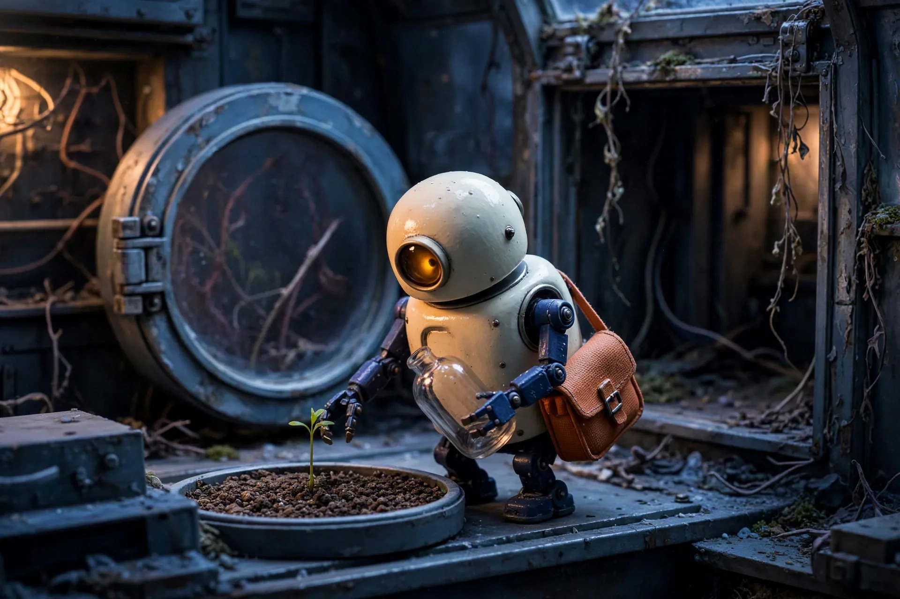
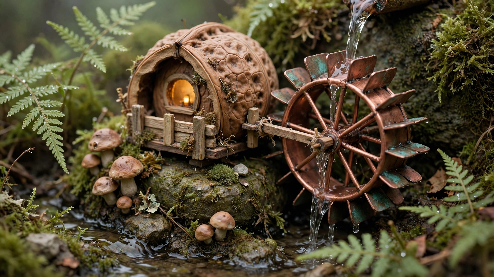

# awesome-noodles 🍜

Eleven workflows for [nanoodle](https://nanoodle.com): models pass images, stories, motion and sound to one another to make something you can play, watch or remix. Open one, change its inputs, and run with your NanoGPT key and balance. Viewing the [saved results](https://nanoodle.com/examples/gallery/) is free; opening a workflow does not run it.

| Continue a story | Give a miniature its own sound |
| --- | --- |
| [](https://nanoodle.com/examples/gallery/#storyboard-relay) | [](https://nanoodle.com/examples/gallery/#tiny-world-film) |
| Generate → continue → critique → repair → inspect again. [Compare the frames](evidence/README.md#storyboard-relay). | Generate → animate → add sound from the actual video. [Watch the film](evidence/tiny-world-film/default-2026-09-12T13-56-05-839Z/n5-video.mp4). |

Each of these also has a second saved run: a cut-paper crab flying a kite, and a mechanical moth. [Compare both versions](evidence/README.md), or open their gallery results to remix the exact inputs. Reviews retain the remaining continuity and material mistakes.

- **Game character kit** — Generate a character reference, then matching cutout parts. The companion skill turns those parts into animation frames. [Open in nanoodle](https://nanoodle.com/#g=H4sIAAAAAAAAA51X25LbuBH9lS7kJalQlOZie5d-cuyZ7FZtPK7xJJut1D60wCYJCwToBiiN7JrXfEA-MV-SaoCiNBmv48qTKFwa3eg-5zQ-q62qzgrlfE1BVf_4rEytKqXPVKHifiD59n1PLqpCOexl4J3FPa4tge6QUUdiGNhHn9YX6l5Vl6tC7VW1OH-2KtROVeffrwrVGLJ1UNVnFek-qkq9oaDZDNF4B__-579Ao_POaLQnhmU80ICMkUCP0Y8RBuQY0oz1sppNC-hqQGd6TNbWuDGuLeHGEchhoNFa-CPEnQfTY0tpIJRw1xFo3w_oZBubtuw_BKD7KMcHiIwuDMjkDqfKOWvcUICLc2gYewoVmNpSATu0mwKG0ekuLfsw9kMBOxPlL2C0mLdH0xvXQk8Ra4yYvQx-ZE3QoDauLaA3zJ6pBktNLOHd4XoPVzCHWoFxYSAd4YM3bnKw9zJVws-eN1QD3WM_WKrgR_YO_kZcGx0LQGixJ1iPxkZY7wFB-1o8w1biHYN8x44CAYZAMVTQxTiEarl06LyvLZXa98vJfFga9m6xzeaXUMLr-WLDxlgLv2f6OBqJqvE85e6_c_aH4yGtid24Tkcczkvf6WuRTIZlZKJlj8Ytp4G5dBZhYBMpQM5yyzh0gNY7Aj_GYYwBmBpicpoAOaabS0l-mS9G-5ryYLcPRgdApmMt5kvaed6UqlDaW8-qUnuy1u_Uw0MxAcmdACmV_Yyi1wdHH0Hm8muAeZVrVUdoRnaoCTbOtF2cigw0o5aEm63nPXRke4oFOGT2O2it36Xs9mti2JrguYAaeQMOt3tA7mUAIXSeI_AY4kJSFTRyU4DfEgfziWrYEcaOZGrNGAK0OLpoaSq9jsTY2vsYSnhDkbg3juoiTxSwxhglexqZqS7hrReDg3cFOA_iYCjhfdzbdFaHrl4MaFykGs7fAGoplcVgMTaee-KUuBR9iOxdK6m1xlGYCEHQEdFFuwcmrBNrBWM7P1KMVJ4m6vyYKGv7L-QJagqmdYeEXXz_tYz1viarKvVpgWbZ2n7xrLxYNBZDpwrFhME749qrpvEsmZWiKVSP93d-Qy6oSp2tVitVqLAPkXpVqZ-lmOHm7dVEYAP7fogF9Hhv-rGHs4uVVGMdioSuCdxHIj3WesO-F1xLPAf-FYqhQLylNDOGOdyXIPRimj00o7Ww9vW-EKLs4iKTFcSOiRYfR2Q5J5iaYGtoN62aKE3yX2f68xx8AY25pxo8x84naBoNGntiLIDJokxKxvYg-dNUwNrHDhqiKLVr1pZKeG9cawlM8BalQo7RanJRarQAr_U4GArw_BkMxDIBvoEg_hJ0JD4W0JIj9mOAtUW3gR65NS6U8JpNGA5FVUM4FOb5m3y_c_lp7yJ7a2WRETqE0GGduNx5aMZPn_ZAdUsBPE_8DGs7cglXLhomWKPetOxHl_haS8U2FiXYramhT3SD8Lvr69Xq-hqmZE1MijnBvd-ifQm4Dt6Okexejp52LgfjNsthZHHNuJTl-bqyj9b7_CWe-12ARMoHr9JM0lLPsPZcE4c0JpELJYWOKJZwk7h1Kk_wzu4foeziiLJUxyc4e6r-GWgvnn8L0EROl_0YaJHsLsXVRfSLwylCXgKrSgh5i2yS6iSknfp3efSPKe2ZHbw9ICi7dXb5YupyvvtNx1SlGiOcvzN17FSlXjz_ThUqV93093j4cDybanMiFbemzcqkviXyae-jgHM65JaZknpJguox0enUUyyOUvzu1e3de3j_w9XVnWBFaiXV5AnAphKaWUVQG9EIqYGJAYy1Y4ic7QlsqIAkkkEoKxIbtEJVKFu19bFL2iTV_3E0gzScJbw6wDRTXhisiWBc9DNErm_-eis70IJxEy_AxxFrRhfD1H0l0jxwhBBYklHvUldHPK_PmpFhdwDaKSy3xPudSF8Jdzfv4Ker67sKbt7-9EtGkxfYR0pMV4AjvTmIZ6K83DqSjcvODFluAQVkstU50uLdYEhTCa8eQRi5D0XSwlCApTZkCHqR3BhRdySsCrEzIYc3WXnf-dEKToEksAih90KiKRwhqmkeBhTLnRnmleJn9jHHevvjn39IwV5BTdORlIkLuc-S8sRsjrH2O6kV9mPbCV2RbEhJ1NYHoTATEqm01m9JikN3U-d5Wl4dulaGt8RRWMLuMyPlq52uoYQ_3dzd3fxlzs1Td99evbqVS3zs8zgMxIvYmbabjEkFPvZ94yj3g6GT6vfZw1MlbLyPh9z8ZiCiZ_XjSGa3v3LN15PbqaLFZBD9mcFSzOaSi5NDnNUtWPm1-9TuEYvvtQnRuHY0oZscxKzdJbyyFho_8vTiCY_7CBwGQsbUNLv6mzqBEl4nOQZC3Z1gz7hEFXLHMwRTeLMaH2Rv1uMrsSB-QSNbD5iz-7xR5MiaYUiPv7c-tyyz70FORLefT0trwoYsRWlAe9IdZgmqDbaMfQEW1yRE5UZpm0ORJLCAAR3ZowzOismzy9qHOPaU8mjkqfmGcQd-wI8jQWOcCZLcMLJQYAB5n0oedrifS2uqzfSwy81DASHP5dRodKkxtzik0HJPIq9Y9ZA16uw8a9TZ9BC_uFw9_Fooa9zm5LVvRSIEDyIrLutWergMuTtNz4-HQkV_uuD8uGCSl6OU2fMvWDz_XxYvvmbx4gsWTzZknX9i8vLJiqNF_n8sDk8N_looKXNZNKD7u6ouVoV8_aKqM-kRgkZLqlqVLx4e_gOijqqycBEAAA) · [graph](graphs/character-sprites.noodle-graph.json) · [run headless](recipes/character-sprites.md) · [See result](https://nanoodle.com/examples/iron-verdict/)
- **Idea to 3D model** — GLM writes a concept description, Muse paints one clean concept render, and TRELLIS.2 turns it into a textured GLB you can orbit (~$0.21). [Open in nanoodle](https://nanoodle.com/#g=H4sIAAAAAAAAA5VW7W7bNhR9lQv9WQtIsmM7XeH9aptsaJE2QNNhGNahoCXaZkORGknFUYv83QPsxx5lD9Qn2bmUFCuzW2BAU9vy5f0459xDf05ukuVJmhhbSp8sf_ucqDJZJkWmTJAmJGkS2lryE1tV3YPbZJktpmnS4nX-BG92yfJ0hte1krpEks9JkLcBZ16WUtCXP_-iwppC1oGEC_Hz_IwqFNQ5_eJUkGQN_lYfZRFIGaq1wP8760qf0zNDFxevKTTOeFL8fbAkhowZZ0TnhVN1UNbQI78VtUypxhc-pUoE6ZTQeFtYbZ1_nNMri-yiLD2t1a0syUlTSkeu0dLTI25lt7V6aCilsHVSZn80yIiwGyV3ad-iVpttyDZOtLQSxfXG2caUj8lbnJFUqwJdS1KepPAtoW-t1v0E87OcXjceUUgUfDzQz_QDvXt7fnHx8iqf9WOHrQjkldmgK1WJjRxQYJxRoqSfLp5TaxsqhCHrVirkdLUTdUyrmAVhSvry9z_0tjE5OIxggKFWam13yd1d2hPPwXvSI48PGO_onjPdRlQcc9nz1h080MAzKraNuW5pp0yZNWjJtuSbVSWcYqhV2GKQlRPeUw2ufGGZvwg6RUCpti4wIyBRkA-gGhMHoTTVDsFagxaeD2nU5r7OtWyhK5Sr0w5kPiSFjqGFk6LKR3MPetqxHt0eAa2rDoD50wMAvPok46i-9UFW2KPZ9O4elxe95kfqfIBPXADEfcqEmmx0lZ3m82ythd8iDO15a8D4-XqN6bkR0JQmlbh9Z6-lQYZkMZ3iyVA7-RX0x-4j6Vc_P391_uJd3AOyawzdKweQVegKWYHX_CxDpbK9X9B-F3Dg8s35sJJrHIlJoVf3nY9U53QW51rx8uo2ft2FL8neSCe0hmL11jYyoCXGnMnCLMABREpRbLFLXq20jE0e2dWUfBXzNG4tCgkkmXR4wmtxLUmiStvN561WZcerNQY9gOpHxtJaWxEAIlZRFiwfw5vJ3qJc_3GjWXjD6njJ6EF1my2M4swiIhDbHlvLfsXTbvORGa2CbScgMWlrDeECV1Z-Tj-KSuk2WzsFTHWb02LKFvD9tHO2NJoe2hfwj3o7WIqX7LtoNqfLJtRN2MM7EtJYuT60Wh5b2UGxi9nh0t4TPza_Y-t71blOrwT49kOlpLGzsV_SutFoGKOsHWp1rPBQbFNx27H5G3wNRDuRlEzFQ5OF4kyIVtuJz0e8kVasIC7owsJHIQDgFZpS2Y6PPYaiwjj-uD93tHfOgsuitLv4hNXZKwSTxzcWs7l-LD-G_GPWbdEe9Y-4UzrUn0471E_6m3G2mB5Ywv3pPdxe1gh4_97g36Et7QvFJe4qnZz0ntxXmk_HntTXWB5xJGB81Ikq7NekwpJnscqEgciCzYaanBthJ8sTfLiBf4u4zPxo1HIlo4P1_cbc87Lv-PRhx4sRNvs7j38g4D472uJO3EhfS1myaQYH71c-m01ih9xqrDSMnrBh8sHLOsQsWHqrm-jE6Hk6W3Cf3RX6YRiufwqNyvCBbedDAamESOyUwfSiwqIjVN7Gd36yEXwFtRP2xa6JLJaddL9xNnoFeH5PE63M9eg3lmYYWd7cGv_-2l-_def5cQdRMthRyMFN1Qf3U--J0LPD_F87fLTSSOZ9mBinnx-mH7zo_2VdjbMuDrMenvgWMN9C5PSriOxPdWr_b_Je1Q9jmFTDmZ8yuXh9cvcviMMUpVALAAA) · [graph](graphs/idea-to-3d-model.noodle-graph.json) · [run headless](recipes/idea-to-3d-model.md) · [See result](https://nanoodle.com/examples/gallery/#idea-to-3d-model)
- **Mix the references** — Four separate references (who, what they wear, what they hold, where) go into one FLUX.3 Klein Edit, and the instruction names each image by number. Swap any reference for your own photo (~$0.05, about a cent with uploads). [Open in nanoodle](https://nanoodle.com/#g=H4sIAAAAAAAAA61XXY7bNhC-CqGnBJD_JNW7VZ-KIAWCNEiANmiBNg-0RFmEKVIlqZXVYE_RA_QYee-JeoTOkJIlr1XvLpAXW6Ko4cx833wz-hzcBekmDKTKmQnS3z4HPA_SIFtwaZm0QRjYrma4oqrKLxyDNFmHQReki80NXLRBehPBf8GZyMHG58Cyo4VX3vEjKVSjiWYF00xmzBAwq4iSjNQ8s41mS_KaZuW4g3DYYw1RrSToU0raUpEXtmQkK6mmmWX6ZQiL1BJY7EjLqJ7el0rkIaEyhzUw6ReNhYUl-eHHj78uY_JWMC7J65xbsmdwFmypwDFSK22J0jnT7n08k0tjdZNZrsAdWkEADN3FAHYdkU21YzolvKJ7RjZhfxENF_FwkSzJTy2twWw3CfWNe4ZRQprgTPLv33996Ve5rBuISJHGMNJhEjEjdamsMkvyRpqaa5ajE-hm1QjLF6PlVulDIVRryCtVFd3HN8SUqoX9eM5bzSiJXYhnCXlRWlubdLU6LgHsVf_mCnJnG7OKNpv1bbLebm_i-GabRHG8frkENmRKKA1gd0zAgcH9fdhTqN6M5HGEmDJn63kTr-Ef8wp7fgGc__kyohzMMOp7YioqBKlpzfQi07SwENKRVNRkysIfpFIVsCRyCFZpKiGVbjNpuS0hxW3J7bCUlcxYDzXlglheA3HITtDs0O-QCrLvNrSKaNXAlX_MOmZCTysu96SpNd-XQB7pyFty2CjY3rh3C5rhHkdhCFXTkBQNBLFTeReSDIoKUAPO1oICCsIZ2mvH2ibniuzgwFwrcM4oiJfdsX4XvKy5qXtfMWjwSSqSCWXBhb27wczBgbTiolsUmjOZi245wUlPcHJs9UDFtx6pxCMVIWKG_8kcHLVWVQ2ArO9P8G0QvFez4FXAcAFbKmbpqgJCL9w5K3RtYdViOBXNo6UUPbqjmlOsO4NLU15FV3jlvL4g1lQr0E3V2ILbOYJ90CqHcveFhlSiQAsoWs9ucpDcWmCWBqQyBWZ7VtUK5TIH8VF5rx2asZ4xLSwCZFbt9wJko7EWgiI51jNyotBKAkIAPlBFUE_IgRXIKNozQxXFwtMXGbF3xqec6OnSU-OOG74TqJqNPHTOc8cF0NyQMECvI3uqUdJ9EEAVTA_TjjUVlZL90XB54tAZZaKrlIm3T-RMhGC8vwTjKxMmvkKYm_U1wmAzQR_B9_qJdPEC5ZFHAH1xCop4yoEvWJ6AYrVTUK1U6w4FogTgBYCzB6bhfQvwIDuwNxmes_C5rDgnxEkL4KJmqhbsDNL4KqTb2ydCGmO6PjxM11cGNLkC6GYdzSGKowACCerN5jvLtKeAjO2wI1uQ-4YtSuy_eWMOKQJc4pjQF3XNAdyh7QCS-U7BDx4jDzjs-ApXmg3ACNo5BNHu0JnoHTYTbDGePH378k_BoDV-oIGzreb1SCoEFnyDHuUIoRV0pv7MkQyec9iWRN-jYFwCOmEPWwhQDgFawdpBFFxEgyKcmrGZ14HkKmk26_UTWZM41lxg83VpU_FjPUccN7xOZpJk5A1OsNMR8MVkBnSHv5zj0jt6YG5ElKwd5lwABdgEc9WOS2Z6WkxHY2_PLH-XfgDc4CR8Nvam5MBYjdoBHhwpys75GARlD-7NTT9hP_e4iSfsZ5jTcNMPM_guCh3QG7N38iQaPPFtMyW5ZmYI4egJd3Lpfxpl6CmF7_hzpg2zqU_ztnvom-dZ2xy9iQdv0NX05AUqde-D6FzyoSCdX5ciDEMzlkOvv152MQxc9HNcTdtzHf7OFxAr3DN0wVXLkryX_XGD8b7-4KtFjB85g_PJyXnk-ui9GyTNOBZiPU-SOhEWrM4LWbrI7lRXJjLi0jxoyEQ9dsxNrNyCo6_vmO7c-IhedWZKsiX5uRwjzagBk65LDcriXBgwx-T48BQkyQkIzKVu7r6qKlCnY5mynD8o0ySa1Ok1UcHiBVm5-OiblRhXEijUxgq6M6tCNMdFvDrgWyt04kJs1lFyxB9YGg4PIIpPYSA4iP_4LS1QlbCP43n4tTd8HGGlDUoEbls12aAnG3rzY4ZENGMxesxidM1iPGMxfsxifM1iMmMxecxics3iN5cWp2nyAD006dl0vmU0uZ0xGT3fZDS1eTNjM36-zXhq83bGZvJ8m8nU5reXNvsWeQ2iM6MnjD7d_wffjuBXSRIAAA) · [graph](graphs/mix-the-references.noodle-graph.json) · [run headless](recipes/mix-the-references.md) · [See result](https://nanoodle.com/examples/gallery/#mix-the-references)
- **Humanize a comment** — Five writers (Qwen3.8 Novelist, DeepSeek V4.1 Flash, Gemma-4-12B Starry Ocean, Qwen3.8 antislop and Mercury 3), each with its own voice, rewrite a stiff draft reply in Nano Maxi's voice (flow v2.5); a GLM-5.3 decider checks each rewrite for faithfulness (who said what, no new facts), ranks them and picks the most human faithful one, or keeps the original. Returns one JSON object {winner, text, why, ranked}, where ranked lists all five writers with model, full text, faithful, disqualified and reason (typical run ~$0.003 before the 20% markup, ~$0.0036 after; hosted deposit pinned at $0.0133, about 0.04 XNO plus a small matching tag at $0.333/XNO; the XNO amount moves with the rate). Draft and Context are required, and Guidance is optional (default "a friendly, specific reply"). The writer and decider prompts and the block labels are locked, so they aren't tool args. Each writer has a 60 s timeout and is skipped on failure, so the decider still runs on the survivors and returns ORIGINAL if all five fail. This needs a nanoodle engine with per-node timeout, skip and lock support (nanoodle-js #46). [Open in nanoodle](https://nanoodle.com/#g=H4sIAAAAAAAAA-1cbXPbxrX-K3v5xdKEL3qxnV76tlPZcjxqE7uNMk06oWa6JJbkmgAWxgKiGFtf-wP6E_tL-pyzu3iRINHxTb8hk5EJYPfs2fP-HJD7cXA9mB4PB6mJlB1Mf_440NFgistCDYaDYpcpXC1Mkqi0wI1UJnRjXSYy1b-oUf1kqVUcgcLHQaFuCow5z-WyEF-JVyalO_j0ptSRTBdK_Puf_xLPxDbXhcqtOPjrVqWn49-Jt-ZaxdoWk2WuVRoNxblS2aVSG_G3p-Nj8U0s7XqyNHmZDMUblSRy9HR0fPJSXBYyz3fi3ULJdJIplQ9FICnTQtvYZJMsljodiu9Uvigx9nTyodSLzeFQKLlYi60u1kKKSC-XKsd-xLXR4DPLTZIVzO6bb78bPRufikgtdKRysVirxcaKpcTMZRmnymIj27URVupoEulIbNeyGIrUiFRtMW5R2EORYWaueONDkcsUFIq1wnZkGolML9y1SIwtBMu4WkCYFFNMLt59f_Hm4u3Zt2NxfTJ-NhbvyiIriyk9F3-6fPdWmPl7tSjEx61OUxIFCX8IbnZuRRVByU70wwRKj4c8IKwzjLT9UMpYQ5_RMFfSmvT26jbMFTLeyp0Va2nxMa61OB7c3g698USk-dp62B4q0zn3D-_ZS4PAwpnMQyReVY8fI7Ly1vYQlTf183tkpHAmGENoNoPKl3oBxWXxrrHA-9FiVRN_b3R6j8WvOhexKsOQWTpLf0__0YcWWSbUSfZHFrbQKVT-K0huR7KmGMfJPYJnlROOTr5-WTni0PnB1EvjsLUkGw9IfMDEyYdq9nyU-tkY7exHp6vXS_htwYElJWEk8uYHs1EpKA2eHx3hjt3ZQiW4_Lspg48IH17gZ7D82eCthDt9J2_0bEAuI0ym0ngnzi6EXJHXysXClPjXpOKynKc0-kCKTO5GcLxRRl41j81qBYaEJfrbNdzdeZplHwykrMjKOTaxdp4pdy5OGHgniV8QJ5Of3r47HIuKKaExS-ZYfsk3TRQrcZD6T2Ps5ZCpYVhtX276UqZj0tn3ft8UBNiLMM4kwi5yWWB5ug33w3QINsafVRnLXGxNGUeC1Ct0MRbnJn1SiA1iZ03niRUW21IUfW2Rl4uixMYhVI2tmhwRbSyOR0-rQRZ2v4bGsNtiDUlXhEA-N5lIdIrJkSqkji1iA8uFR4LVhIMaxMR7uqyWw8aXuYI57aDiyIi3735AILnGdg2rMoThrYohLGZPkglksSYrcFGyYy4EGaZ-KJUttEnH4gymGzHfMCtEf0h1NmgSw6NUJFDsDYxD06b9vUBjNgAVwYlDZHBDZgD_2y2FVTBHIbcRHRDiMYt2aZYQopiroiC5_pk0UbOGaVC7XkL0T1y4Z-JkNbXaD_SypbyEmShz2DDLEbuWdiMsxFSsYc7DoG9ZVAvBNr9xVqY5PZFMrTOoglgnafKVSleSfYKFSMuGXVlKYN4Is1xqLL6FtVhW7Det3Mc5SycZjAZJ93A6S0du5-paIeFSAgSxMpmT8Cj68PpgbQMN4CGFWp0u4jIiTkIKovJgNiBuIe9ia8jxZwM5N2UxG5DzEXWBgJPbAiqGwqJIsEMh34b18GEBLSb494-ke8iGjJ4Xt05mElkfTqMblk4jfCIaV5uhDE_JnXinTM9ZPrCRgA9WtKH0_h7xDRbjjIKsJdMpfSTVNSoNGB9CpDhQ49WYrIJUSvtVMYTNS8wGKRUjRb6bDXg2jLAo5GJDkqyjT1JCAaQtiwhxdw5v0pOG2C6Wokwt-SRtiMJJIvMNLDY26YqsayhiRd6lIYbS7b8V58BDCJVTFDi0e-ie7Jqs1ZUuBxg_NxH0upSJJv0uDHYNodgYsjwMkWqNgsoxyJNpe0Q3SJVthbSCEIFAQ5JEXEh3LgZ68dG-m8pjA30pUQFF4gB3eTTUZoltmm_r_ZAX-hBxOBUqmcB3I5Sayr6AHFeYWDRiAtkfEt-18h81SSktvGUWGCbJxvylzHCDlEBXuQKrWMW6yxUGjhaImSuV--F5Ge-CiVsTl4UK15BICTcOlxciJmNbm627pv2_JwP4SczLQvx9Nqh5L0y5WPthbBT1tU0oXzVv4BPsYYWU5W-YxsXFk0SsYslB-EnuJcA3YGIcjfHA3_VLu9sHkDWnCNbsBKMOBaVeN5YZ35oUWQi-37iHUl2b0otrrlecYTb-2n2GUcPyA_sklEpizMGCEqe7AbPd6rjaVwzXgrxV2DjV5gtYvdex_0iW4iIf3UzkRpF7FLA8pErrJxfzdYNria3JyI7KLDBKhYyJYQn-hjEbzmNlJoJJafKaVWAmMYbSmSVlFsE61pSrFzFlAJIrnLmmzzmFSgM8iXUwThhcRlgA1ZO3qizLEdlhg15GhkuhAhtcrQu2Y0qJhP68lBeU0k261HlC-fAthRLk8BGqlERQlccpQqxRfLgPcJxCrtxdlZj3GnGA_Ri7sXqVjhADALugGs4YHOpuEJ4TyYGS4hCHm0ty-xjOUcJmaHKjBOFQTCMjsyX2IspYVMLFeqPEP5AR7T9A5HKjMxgAB4GgQ_IOTpUcPbYyTyjlGXxwxYKLJ1MBDW9c4CR4xsndX-q8rgYiRwsOA5kUJEuTeyMVzQzOeAlbBVMOrzmF0XNX6lK94ItdD9jIYYgg5QGOZn9jSLrkBWAtvkSe8nAaGGrKsfjWGNpqbFCoLKSFslDHUvGlCUNSTstdWoKWErmbK9bCXHMNYknmlHTTVRycyn8wa0EBxF0AMMKoDl0hA9KFHYtLVN-RdcEzArElxeSTI7gKFvVVwwVhF9oGFD5lCZSWcieKCFL0mjUNaVKlTngYyEYi7IPefCe4kiEuZwOHcwZDF_a1r2Kn4hgoG4Y1ISIITD6DiwMSHPBBia3vWPpDlJGUfjhd0x6AZ2GYJ4ec04XzWqcRlMJUYUdIi6eHDa3CILwaxiKU7sy2OOUlxoS6UG4ihX4HpAOgc3Q0RDXzOs9NDqhjYaAYQjMUcBrCv2qCtvnjoO2lOOhokIjjo-Ova-BG3ZJu3BZhrsXcSfgwugaR0ZKIjIhIj996_Nbjtx6_9fitx289fuvxW4_fevzW47f_An7LrXKFeqgIkfjV1mVq1kMGW7bIyqgGcGOlYEeVzt2mhC3niFwogqjA2wW09wJb4zqwqsnw4N2fqxKm3iAXtZUU-FXXmKIrkExVU_b47dfht8Xj-O2VOHjoLXaF3-htdjd8W1VT53DmkeXZI0Oze-DWA7ceuPXArQduPXDrgVsP3Hrg1gO3Hrj95sDNOwnX6BzO5yWsnISNoIvq0BblcjkWP9CGUNNl03o3JHwod5ErVEeumKO6D8nQsxarayRzfifn6oZqQ9gPLBixGApoVlBUlTQLl6rqceJwVSB_iZQLK4J3sKm6LrNkGYBQPcj7dSAvehzknbe_WRm-j1wDPFLGZ36xMkzu8V2P73p81-O7Ht_1-K7Hdz2-6_Fdj-96fPeb4ztXoBAvkYZyIZ5vKdRVudxXFzlfuOqFQnPhqkiXnvzbOaqQEZZZblxr-kKMiHsM48snQWkU-G-HPBJT_m-9ogu8k7ALTpA_QtBkOaZcrZFm6OFaxRn9YpBTqa83elT361CdehzVvRYH1S9JKyjnflHaCeVQf6mMDGKSuGmj0x7E9SCuB3E9iOtBXA_iehDXg7gexPUgrgdxvzmI46LcfZ_RV4s-gyQ6GqFyNHE8Fu-qDOq_LVkVeoKTqcv6WC_2Z7Ngg_BPy3sK1YB_sdb42ma1bRIFroOCvYoeelunmwLpUdtno7bN8UPHpvypjFb0wtYfymJyjYJOxvtOUPk5nLVz1TpNZXOyZ52vzvZSPrsSD56b0l7sdN9iL_cu9vJK7P2xX3vRp_sWfbV30VdX4pGvqLaXe7ZvufO9y513CDS8L20v9nzfYq_3Lvb6SnQg-vYpPkTsgSbCuT9D6sAfKtXdM_hlJPVkFSc0orNZEJvt_V7BvWZB-E5BOLiK3LpZ3AWX9X5px_dK2c_pIwTE324nUBcBEaI-S-luAwAB7oeugGaRE9MvDWi8tPd1D1prT-Z610WjQ_8w7FzAK4cC3oI_r-jPOf15ffXCdTeQKoFtZBWxyJwL61Ah1R6xBEBg_twaMQNcvwYX8O6oLMKrpGIu3Q8JRCfaUnIRP_905WknivJ1YxKdAxariLGJrAm50dh6IAHlolgv6NiqQscx1yAUqiGicICXFeH4r-pwselSxpT-m2d_cXDl3E4ZH8WdW2E2uB1SVXn_OLBn1LqkXyhQbVEgvx0P7xyPxmemOWGGFpZcIWWCxaAfTpVed4AbYf7vmUGfHB0osBXaxJ4rsElI-5rS9ufgTF91u6KGexYyipDWLRPwqM93cLc5sJ8fCoPwcLSR80DItV-p1oD8aOJ-gCorSbhmW-17luTamjvHnAqt1qtC-2UaBEW1YxRZRoCE8icM7ScO6U_I4iYB5E-4u-ChYSX_GtYPK0FL3ymgh1XrYcg2l6k45m4BrCVdEHqj0dK1p6gS8tB9Nqha3lkotq1GFc3x6OwvF5fgvGpUoHyKcpNZca_JU7eJcu4TWKr4gdRZe4SxYX_tAMZoe1yfo0ftIVh21WdyDRgWE3YsEYrYiQDF65YMWyWUlmsUyFylpY3qFHuK4RFAD0rm9sEuiTiDTqAcmIa6QamYcklPP-dJgdxj_YsMG6MDA5khV4SpG4mNKfGEviDG_R-CHbhANU_FKZL4BtUyBGOfHAoHwuh7Yy3nHosfKQ65vsaQ4YEbxM9ekaa5x9XohHCvLmcXO8gJoA3Z5ZYloGg0mdMbh2JCJk6nKHK83lGAl9k6lxRNWoYZgsJJI8rsGs-rKOyAg6Eoz6G12XGgqEYBD6nILWKHHnBxYvGAy6EtQx0nzn2UwrpxFHN06s429AqlJviOOgeMm0lE1h1qweBJttoqlNsjH11llUjn5mbqYMSwgQ3KlEVUncLh3hOFzspY_EWlZAOE5eAX1CT0Z1ByL4137eDY1IO1kcWTraa2e0YWZIddHdxH2rfV4lU7YHKvAXK339HZ4uhqUNxtR_zovR_h66f_ERfkz-0eSKsF0uh-3Ons0APfF2YAWGP8jSazWdKNQkc7YUsUn-4Hcw5oB_TlLaxZAyFQ4RFcyVsVdVUf7Yd8Ufuj1cS422todRL8q8KMPLL5upCjSfWmsPqN38LEnAXzMlL-LSEMKldLyDO8p9iyNZDfIeyRQmH-Z1UA45RCyDamViDiGOqZKiVwGF-GeO7o14lr6rwHXgAsUTioyx0NOs6U37jcWYZ6Ata3N9pt_Bp1h8W4onOvhFIE19HCZLtpM4DoeqdEiaku4cXrGGUoKzMSd0NM6Kwyg7LN3P204979hsqgeqHLEQAyvAgZJJDRtlVGIWbyOaz8w8twdOssfc1FkKuhqGzacQlVcXrAHXrOUYftsgy1JWWvZd3l5YZMHUgpRu5i6uX41o6Pxr5-cy_Z3DRgcFId8-_aKa7PbEk6rUVhlrZ44XImDNVxzOG5VTK6Ko1Mecuvt75XRZlTbPS9k887n_bWv2mhLgSKQ9f_dpOHvpXiuIXH8lMyAv4uMz4v3S9VxeVaZrDNjyg8eJ3ZADXs_wUNfDr79PLTq0_nn17_Ae4342Nf3Qh2N8zgt-xUXXP_G5wQTxQi2qU-de0zzSndv6VB0USnK3mkVV25dbBLtwy_HPPm7h65vc_oCGaM4wLdDb3DKmOHmtcaSoQvisuiYrzm8_42ufvrEQ2GwnLiuhb9_-31hcMgVF15q3PLBxOduc7NJ4c66C1BbUN3nzlLdUwvw4-i_8AoZDwe8xnES3rJ4I8h5sQ6um-7cAdK7fz56vZeC-kKN-h1V30AdkzNJJIoQXI6HLt1LHHmEDhf3QLkm8YofyywHyIbPYH45D7NxinFn0903iR6ep9oe_QDBLn10cXl0_sEw4nOn0-xxeKzLhabozsJulOL_Qh3FHeT6PMvJDp_jOjXX0h08RjR330h0egxosf_-6UGyn3STvM8-jLNNwm29H7S4UTNwd3UTh5ir8N9Wjayl1ybuQ7HaQ7upnb6EHMdXtOytb3k2sx1uExzcDe1pw8x1-ErLZvdS67NXIeXNAd3U3v2EHMd7tGy_b3k2uGww4g_y9saIfi-t512WfKzfTw-f2DLp52WvC8HNMm1t9xlyc_3UAsN6rtbRiq8eXp0QiNLC_JH46Pj09Pb2_8AEilYmCliAAA) · [graph](graphs/humanize-comment.noodle-graph.json) · [run headless](recipes/humanize-comment.md)
- **Compare image models** — Send one poster brief to four models and compare lettering, object counts and shapes. [Open in nanoodle](https://nanoodle.com/#g=H4sIAAAAAAAAA7VVy47jNhD8lQbPMoci9c7JmGSCzQvBzgRIEOyBltoWY4lUSMqPDPzvASV77ADePcwiF0EQ2cWqrmrqlexIFUdEmwYdqf58JaohFdExiYg_DkgqUpu-R-1JRA6kWgiR05znPC-zTLAiLZOIHEm14ElMi7iIs5jFLE84j8haYdc4Ur0SjwdPKvJo-kFahLUZLahebhB602DnwGjwLYKTPcLKKlxT-Dhq6OUW3bx9kKqZaxyFH8Zmg1MFHmTtoUXZKL0BqRtYG-PRRmBWf2HtoTaj9hF4YzpwrRzQRVCbfjBOeWX0VFKbzlgKj63UZ1jXSovNTAW8AY_OwzHwMHsNXrothZeJ8A4bSOEZB4_9Cu2ELa1yRsPosIEfLUpYm7CgPeoGLfBvwLfKgR21lqsOYYfWqbnAwfe_vsCHqTecpvDUSYvzWdMrWBw6WWNwBFrpQJsziZuDLbqx85ScIrInlUhYRJz6B2-syJPTKbp4za9eT6uT0RmbfBWM3TPSovQIEtzfYyA1GOfRTjIlrFR9rLuJqVQW9sZuXWsGCt_delXB04ffYQlPPy1fLkuzdRU8L19--_jt8g-IGSx_prAEp_Rmgmze4PctYhekegcrdKpB8HsDXlmEDkNLQ6ok1BZlDytZbzfWjLqhoZEesFHeWCU7UF03Om9liEMEWu6OUyjCWYPs0HuMoO5QWmgVWmnr9hhBJ-0m8JHN5GBoH4VfDODBWxk0Nw6MPYfQTVZo2YcWP8_RmhI15YtcnRBXJ6aoz1aIIqVJXDDOmGBxyc8TF6c5LdK8KFlaChZn6X9GbhosUpEevXzoR4eLCfEhOLjwZnHBD8EgFYmrMPE7adXUBxc-BdJvuRms6QdPKnZV8viW6PhGQ3JXQyEKmsQsKZhISpGkZwkiozwrhMjLshRZUeT3JJgBtVQPm8HPrBecpg_rMA2fVbP9CjH8Rkx63xDBaJLxouCszFhWFrOcVAiaMZbmKc8zIfLknphDUGLNdqKs9MWWHafs__FG3MjJ7sops5yWSZ6WBU8Fz9N4VpNxytIyzdKEFeIz6bJYW7n2i11yQ5fx5BAeX0E6IadPEemU3t78lLrQhrU1fSgPP6zL5TUY6y-X1yki3txuENcN5yOvV1_H34OYfAlRvAcx_RJi8h7E7A7ip9O_p78UBu4HAAA) · [graph](graphs/image-model-arena.noodle-graph.json) · [run headless](recipes/image-model-arena.md) · [See result](https://nanoodle.com/examples/gallery/#image-model-arena)
- **Still to short clip** — Generate a first frame, then animate it from a separate motion brief. [Open in nanoodle](https://nanoodle.com/#g=H4sIAAAAAAAAA4VUTY_jNgz9KwTRo5zJx-wg6zkNFihaoIMWmN6KPSg2bauRRFeik0kH-e8F7czEiw26J8MSST3yPb43PGC5Mhi5pozlX2_oaiyxKlwUioIG5dSTnnAI08ErltulwROWxcPS4BHLjf43jnydsXxDoVfBEr8kskJgoXEpCzTJBoKjkw6eh0wGpKMINrqgURwJcrDeQ-AD6UuXUBfds32FXzbw0rvqBFbgfrvsoeEEjTsQZKo41nkBXzobW9KykMV5DzbWEFgcR9glR00G4Zako7SAX2PuqRLg3d_6yWJ3zjs5zZIewUImGzzlDJ65B5chskA72GSjENUL-FNfsweq4RO8UC8UdpRgvVw_QBoiJOo5CdXw03KxXoGwWP8IVUfVfgRaDSlpr5RlmsOOGk6kudHFdoEGK_acsMQTec9HPJ_NhaO4urIzjnykprifuFktL9zoN9qgUS_jWMZZ4A3CnqCiZIOrIAwtcAMdCwhZYOUJ2O6hpryHHWVXK7GV50y1zoR2zPsFvHAjEDgpdji6WPMRvGs7ZZ_D2LGnRgz03roIR5tC0SZ7gqP13kz1QLpEVPwz2CSU4ODoaICiuEQjroPLbudJo8km6GysPUF2vuOBRMhAY11USskGsDs-TJoQsgYigzYLnMBzy3kxn-f6Ok8XbEvTQO-Xs4FeZxa4Jo8lBhJ7F4ZMxZhzp-UL4eK9Qnb_asHVQ_kZDR5sclbFlfUMz9P9WLBPHHrBcnn-4Ovn6-LgFeZmBvPgauLLTq7_H6fTTXstus3dCE0xjtlF1r1C8wEA0WCizH5QoFii7hsarIdkLyef0EyFf-9FXzkb9JysGsjXH_T0NC18DZV3_ayr7U0xr6ae7i9iXm-vYn6ebfYtNf_G1V6fsYGSvWEXTyCdatDlXrU-ySW5TBmy56M_XTWrO6C-UA3JZ2gpij-Bi-PdXOWTHYShNdOiaM77ckCioJqvOPSehPxpcqkF_JEoU5pU6hLkzvY0pvbeVqMVPqpuq0GygUjHi2dlFfGlu8mwFt_oaRrD5-35_NWgd3E_s3ev1qHtaaBa_7udqFu9M3A2KDwPWF8DLsRel8evb1ScJUzr8F3JzXcRHxWnnoraJarkRvHtj-BubsD9ev4P1DUMw_EGAAA) · [graph](graphs/photo-to-video.noodle-graph.json) · [run headless](recipes/photo-to-video.md) · [See result](https://nanoodle.com/examples/gallery/#photo-to-video)
- **Neon shrine duel** — Seed → GLM writes an Anima still prompt → Anima keyframe → GLM writes a locked-camera H3 Max motion prompt → MiniMax H3 Max clash clip (480p / 5s, ~$0.27). Both fighters stay framed. [Open in nanoodle](https://nanoodle.com/#g=H4sIAAAAAAAAA7VV247bNhD9lYFQIAlg2V5fWtd-aoO0-7AXoM1LUOwDVxpbhClSJSl7vQsHeeoHtPnCfEkPKW0sZ41doECfRFIzwzlnzgwfkk0yP-sl2uTskvkfD4nMk3mSpVJ71j7pJX5XcTgxZdkc3CXzybCX7JJ5OsN3i-0I36VklSPEQ-L5zsPDMef05a-_6deLS9pa6dnRT1qWgpyXSlFlTVn5aCHC8SD4pd6kWK_4W8_zMV2KOyqNl0Z3fUsZnO8GxTjFh-RoQ8LTZDasBlPXp7eF0IjmC6aQ0IJujS_o4uLSkeUYuw0G24_fDfujH8iJslKc9-ncqLyxX8pV4dk6kpqWVpRI79NnEhsjc9oWskoroV0f5GRGGQvwO1bKbJP9vtcyqs8OXEaCukSejRoix0N8NcLD6JdwZcw5OUHuFYMFV1ipmawxS28qymtWAXspcx2dQ45Lcwde3Bq1cFtjc8qFztjSxlFWADiT0ZIyU1vJtkdWSN0DA-vaok6VsGvXowy3lMLLLBaKGzZozbtIRRfk6ABSqbLFOGpAzp5i_L0jhCOUJeSoYHCfCjlYqTKd9sfpUglXwMyycEhar94tl8YGNgLVvcTtnOcS2w-mbmRD11fviFVYNaJqdQO3FgpAkLCeXjfKPJLgmz79Vit2c3K4TAG3NfesocHQCYHmVGRRjq-18QS--M-awe6bBW3kBtLICmFhArrRXXKlF6QCdYg2yMCAFQPF2i0I5LKVQmF5dU3NL1yzYZCPg1exPzy_iruyVl5WMR0YwmU2_PLpn7PJkEJ9sTe1r2oP7Bcfou5b0AFbv1us8aFYEW9TrtnwqFyj2RNJhqKdrNaJNg5lkffB-WyN9UYAZqDMhZNuMpNnlDM50R6X3UHwv2knYghgUE0230yfoKJLTJ8wl5rx9FUwP1-_Pz8MDefFjpa1UrvD_AiFgYqkZcqUrBa0wg5FVSYLvdpqADcYDTdBS95CRCvLmIVmiR-30i-oMFbeIyPFG1ZRPI_TCF1rATm9N6bsEUpiGbe6KrQ3ojIA7JBAnjbphGmSsWaLu5TRvIB2jWWzsqIqdnO6VQISfswuzF2o0xYsMFa8letmXud1to6LODnAchgseEjsAo3GVacfQCfAIwVwc6twXRg86Mm8HTpR_RGQBvCvfk2DBIXF-5XY4WQS9P_jC_I_Uv60o_xY2WPpj79_qv23QUCxVCfFdvwKwaQV5jyJonNG1UE62IeXCWc5Bmx7ErKJca7xCiHovgdRonh4jm_2-xvspF53HmcVnhLMojIkEB7ux-elahQdnwgE8aZrMDoYtLkdCFGjExFHL0UcPxdx_F9ynDwXcXIiYieFZtw8CTl9YnGIOD0RcfJSjtMTOd7s_wX9uqzgSAkAAA) · [graph](graphs/neon-shrine-duel.noodle-graph.json) · [run headless](recipes/neon-shrine-duel.md) · [See result](https://nanoodle.com/examples/gallery/#neon-shrine-duel)
- **Sing** — A song idea and favorite bands drive lyrics, an arrangement, and an avoid-list; MiniMax Music 3 turns them into a sung track. Starts with wistful 90s trip-hop about the singularity. [Open in nanoodle](https://nanoodle.com/#g=H4sIAAAAAAACA9VYwXLbNhC95yt2fGonlGNJlmI5h46TyaHTOMm0bnNIMh2IXImIQIABQFtKJv_eXZCSSEpR6cTOtBdJBEng7eK9twt9fgBwdH10Dv2If2mToKOrt3QB8Dl80rBMaOwo7kntUfujaD3uVzmGOybLGje0yMKNP6Sen4NMUIA3MJNauhQT8FbEi-3TS3r09GRzuaLL3uBkO3BDA6Px9nomUSUMcw2QoeDShxW9sB5upE9BgDN6Xq4uNK2aIkzph4OVKUDJBR7DVWoRgV-GWCjl4MZKj6BWVsYuAmGt0HPkV7MoTEKzaS9nK7hJBa1jCpVArIRLyzU9j1ZvcUp4BawPhEnEtZFJT0nnYYqUPASjEbLCSQIBibQYe2k0zIyFS0rapVjCJd-F4ZMQRokPCocgvQOHubBigxukzgta-lm6Bl8mgWazOEOLOkbHG-LForwdEuUIyE1KtwGVQ34d40W4jc7LjOefIkFCsIXWtLNPgEPAEic_lxqziGh1523BwYoQBUd8bUJkqOQ12tUxPF-K2ENS2O0j9STFQsO1oAc3JAFmmTKW93iFSpmbo-rOl_D9JdpHWd3fJWtgyi5T11Q5SMuzJikHZ91I-SaQShBFnJ8VCiYnlH4r815q8lIMIKam8OVeUGYLJegVCr9LjKOuMb4Ou29JgEEGByMdjr8t1NfGeha5SCK4FM7RfsOF9xRiBFdEzsWqU0zj3Zg-GKl3Y_qVif1wo50tv5vRDR83wxuctsJ7fDg8Uhiv9k6_060swk-7a_98_k53CnOwG6ZS2W6Ub2qu1Azscb8ZWDOs4Wh77eQnbEe1Ivlm7P7bWWg4tybLeTdP1jEczE1GRUMxyk89IR_NVdYbHQ97MzbFunw3i1XRGCvnUgsVBcaLqdrY14zW39rSxr9383xMFFvKrMiAygWZsU1o6E8yxdjo2CItQrY1RzZyDZgZ9hqaICcmeTAzuJZ4E4EWnnxIAbkWOkfOyIu5lIhM_qbZKdnUZ7KUp8WPBfkhbX9mTHIMTwtJJSD4N61gQxzsg2EWiznSu_SqJAAiTiGmeQtC-QLX020MWWry0QxsuvJpVlqiz4zL2ZKfQGJAGw_MiG0li-BjYXwYkDaky7HLxyZfkd1QGTFzLT9tc1tm5-1faOmr_z6Ct88CHv5VDg6ag0-tTObYHHtVeGveHwN9U5mh0NWq3K2qaikxpQISAig3tOHimVhemQVqJtFRfzQc129aFBQE0eH5jHIRDKWz0590tQyKCWfkGZt2pIuu6tfBMCadDeNFyWqqt1WJ6-oOw47ucLHtUgIHmpGQtv-3FqFZylnOvUJQf2-OGqlnII6XCM65yyO-EMG5BZpbkaekdnrcUHM1rkwhcPF0dELqo4diT0wvlRAyVuS5khhaOxHRvE1751dbTOGtJB0bngCz3EQwt8ZcYwQJ9T2hmywsXU2p_tXbIbe3FbqizXOKuyvBpdM3LYGWopY8pmaBteXYtZwpdNI0hPLNoP1gAsfwG2Le8ivKHfVuwUmDc700a8n2pqveWr25EjoCLuCUVoJfhRxcJXT53JbtaH-9S_XW96uqH4zuSvRnXetnq1n_5V8k0lb7f1Mkv9MmhexT5gviVOPc8ZJ5gdxmhy3iY47LMZYzOkWsKymRWMbrAlemh6iFNqOyFw4Wa17XOBy1CMzMqPiEdE18-4BMhBrxUFWYmqwJkEKZZWaJ3voUk0CeWuFC2a6EPKgLuT-oC5nE6IUKbK70w5tO7-KSqSwq2VgI1kHBf6RUUW8dKKsEKexAfZrcFVEnXYvTRe0U9LB2UGwRdtQqT-PTbyxPF7wC_eoSxOluEIFJ-8_9LcSTlsT6k1tJbKul2oZUhfvWAiN-U2O4fFTWlGF9j2uHV350Jugo3KCAy4lP-De3aiJQIMuHrezR5_vwdwq1j4uv_p3SPGxyz9tEy__FtM6wnIeKeOG8tRO1N1-ZY7xvDtFl1_edqA6AHd0X2GkXsOHfm044x3eAc7BvjoqoHcBWdt2bcj_6w0DX-uTbUmENuN0vH0A8uDfE01sg7iazkzvAOvxOSgS_Z5C9WjHvBH94B-jPvg89t54_mhyn--aoMHSAvPmv9YflePLt8mNydMJ5dl84p51pcLvETu6LCXvJy_X5wZcH_wDw123n_BgAAA) · [graph](graphs/sing.noodle-graph.json) · [run headless](recipes/sing.md) · [See result](https://nanoodle.com/examples/gallery/#sing)
- **Spoken introduction** — Generate a presenter portrait and speech separately, then combine them into a speaking video. [Open in nanoodle](https://nanoodle.com/#g=H4sIAAAAAAAAA4VVS2_jNhD-KwOiR0nrV9JAPS2SQ4tuFkVTtIdiEYylkU2Y5BDkyI8G-e_FSE5tI272ZknjjzPfY_hitqaeFiZwS9nUf78Y25raNKUNQkFMYeQQSd-w9-OLvalvJ4U5mLqc6o-dqW9mk8J0llybTf1ihPZianOfCIUAIa85CeTIGwpggyRu-0YsB9hZWQNCZ4dHdBATZQpCqYLHPhN43FAGWRNETpLQSgGPNthH3MNTJGrWkAjbsSQ3yUYpAEMLXzis7lGgYb-04YhhPa5o-Ix9a1l7Ye0vEm5sWMHWtsSAAou7SazgV6J4BM3Qh5YSzCeQqeHQ5gp-CTlSI-BshHwIzQAcE4c-NBZ1oAr-0LbQR0cQ0aYMCB714W3OkYKhe3LUCLVjwZZtQxV8do53kGlLCR14G3qh_Aa7pRZu4ImikF9SgtlkdgupD5BI2aJWR3GEWeCHSTW7-wkyez2bddAEDWfJsKNEwN6KUFvB_ZqazdBP06dEQYCyWK9CLqnjRHpAsGFVmcI07DiZ2hxI2zSvr8XRP2Fycs7ghnPbLEbTzO4mhQnotea3_-hwzBtzxUyfz0zSJUuhdYeRKd9n6j2setsS2ABrq2LbJJZyATvCpNIiRIc2QMDtAbJ-LtSXvWsp5bKP0CUOUnbYaPWb2Sr4nRzuqYVAvagEtFfpsuVQQB94mSX1g2odNqO1PPeyLoAOajreYWqhQU8JC8jcCdCWAji7WmsHdrDGDpMvVwkPsMRms0rch7aCrwwrhznrGGuUXIByAawkrThX53xPT3wPJh8JX0xOjB-Z1jYv-PXckjO18ST4SbksB4BPelYpXL7BZfuP_n9a61FbTKPDs74yr-PnAS8m9lFMPTnrbvaBG-a37-3wNK6KMXrX3PAXuUatLDxYdcdpk9ccK3gSTHLK1NL1BKLEcoAD9wkEl46G7KpdDtzDzjoHndXsYqRUqFUoNNaNi2TYPZgkQ8dpxOhsygIDcdXF7GN308n57POz2SVf6jLM_l4KXXAe9-W44MpZdVf-_KCs604wtXkgis9_6sPzIwZTmEQ5csj03HHyqAT5OL-uSmFsGD07qnfe6s0HMt0eUzufnWR6IGe3lA7XFPqK0mteGnQe2mNhAblfilNdbNjkgd_s0TlYE2pytqSXTD6uXqX-MlawtdkuHV3Ga9hWx4gtuT1A5GyH-yUf5f7CzYZOOQwMTS9Zo0R7SSo4R0cXiVqcyHA26n4f-fjxbiRkNrmqneOwalBK3KJgKqfVzagPu147MrXRu-X_EvOtMAMzp5vY6SbtEnut1Fv6bbvqinoT6rUwwucF01PBEf00mZteQZx9D3H-EeLsCuJZC-MKeQe5eFdxQpxfQTxrYbi-P0Q8VpwQF1cQb7439eLK1N9e_wXhuZk3NQkAAA) · [graph](graphs/talking-avatar.noodle-graph.json) · [run headless](recipes/talking-avatar.md) · [See result](https://nanoodle.com/examples/gallery/#talking-avatar)
- **Storyboard relay** — Pass a scene between image models, critique the next beat, repair it once, and inspect the revised story frames. [Open in nanoodle](https://nanoodle.com/#g=H4sIAAAAAAAAA7VabXPbNhL-Kzucm2k7pRRZTpxE_uQmcs9zjd2LlWs7136AyKWIGgRYAJSsdvLfb3YBiqQsOW-9T51aJHax--yzzy7zV7JOZidpok2OLpn9969E5skskdqj9kma-G2NySzJTFWFP2hR0R9uvbHbpRE2B4tKbJM0uU9mTydpsk1mo-nZJE02yez5ySRNCokqd8nsr8TjvU9myRtxhyDAb8yosKJCcHQY-NKaZlWCgFLo3BQFLNFvEDVUJkflxvCmcQjovFgq6Up04EsEU6OWejWGa6ENfCe00AKcF6v4u8Z7D0sUHgprKvCl8CAy3wgFshIrHMP3WEktITNVLSw6WBpfAnvmzoPNeS49NC6emFtR-BSMlSuphQKLBVrUGYLQOfjSOITM6MyiR9DGo4PCWDAaoZD3SBFbSyeNHsMFFBZd2bpQC-dAaldj5oMti7WQFnOo5T3H4FKuEWohc8iEUi4FqTPV5FKvKKAgdY416hy1h7V0Dbsn6Gd3Dr6UDqRjT1ofUvIQBDmcSy9NuJC3W1DG1GO4FWvsxzltr7_zLOSQrl5wOPjGdDWLlZD0DhRKbEDjGi3k0mXC5uF2wvqNsXdjuKJMQCa8UGYFrll644WCf0zGk2cvwWg4mcIt1h6rJVqYTqZnKdSqcXzncJEnhK4QlHGSJplRxiazZItKmU3y_n0aoV1I6_xoaSUWHb4ZmTtwX9Ij4DLUOMD1s4DqU_qvk39iD9TTp5P3B6AeTgoRMgUI3aGG4M8mAvwpYF7qLdTG0dWtWRoPpXAgwJpG55hDZlFUgOSlgqXJt2lIJf0MgkODW0zBlcZ6yIW9Gy1Vg6Bw5VLOEDsg9AqhElKBEz4rUY3hiiJnrcQAjkyhsLBSBMdM1K5RjGgf0ynASb1SCEsrV6UfrSxVqUPMFVfiTeOdzKnGlcnuyHFps0YJCyUZjJEQSypzjTkYu5R0Zz6nNI3DNICfY2BRZFzsZkN0Qz-4SigFFWal0DITChSfu0Q2yzVqjIWN9CXfZ2VlXaOFTSkVQmlUqJcSd7dzmDUW1Ta8w3j3JdoxvDa2ElxMGh0Iiwy3pcIdXxXWOI95CNc5lVJj15gTB1E9wUbq3Gyo4FAoSudSieyOfraMlzH8RF6fzqZQYS6bivLnO0eKRkU4pDt3KZchltGbMSxE5ul2zpt6VBk2TaQifGMR6tJ4s7KiLrdEGblcGXClyM3G8WEbYasIodrSSRxVyu4YbnSbCnqS8RHcGMO1AYXeo2VmyERNZl0KrlaSKogSmkItNAPW5mgdUGKER1sJezfuFSYR9YiI-lhZXrdMPijKp9NHqnJ6sCpfWRQeu-4Q-g_3CKl3EOrQOIbFDo3SgTYbyKxpshLzFnOiw7gzUoG3YksBsUjp20KtRNZizhEbHCwdkNqb8Awdso_fc5DeBWDuIE1g7hoh5sTnmxFWtd8OCzhcIlZ_LPxI0a6HorLlkwAv54XOHZ8NSyylzkH6MVwyo5HVWgntmRQyhhxTh9qC1CBA46aPaTo-dCARLW4hlwV3T98eQBhTJmtrx5dSd1HbGKvytmVZdH6rkAElc7SUlJrIpSWAjdgGFh_DWyTy4l98LJSuOJQxd2w3FMaTUAcR_X2Ikym891ZAVgoqE7SuD2HbKHTH4PvKUKAa6bfQPteh-PnZIyieHETxvxDrLjKMzq_cXq8ITSKy9YM-sd8h9sBBESFx51lyWFMby-U9hoUlBmPQEToHfaLliCGyZ4FtlXHkW3xU6tgaTwgejaJqijDmYwKK84ZDvwPa7q1pGipEG8ibWsmMinpXSsZ2yN-Fqst5RRQkmZAPJp6OsJiZlZZ_Ci6Ny85VJk2ghrkWCgTrp3A1rprz1kGoGud3JUEv9q8RiKPwaNm32Btr1ANM8VEjw1Ik4op1awcslqj8XoADsVkE14vIkRFc0z64amuq2iezIbhYayezpEIvnlSNwxFbY3U18mbU2qZjkllyOpsmabIWVnLBumSWnOxzejS0c_93I3Xn_U3QlcCKDL7t9Hq8wvN4hRfxDqeDkcJhncySX_WvmpiLJaBYmjVCji6zchkle9EpuvMQpKaulWQt3op3vhmRE5FsnBAsSWnLj7lG-THw7HJzPWdqI2qPI0x4mYeLLNQ5Wxa-JaAfLTq0UUt3Rnc8wjCMij3QWhArBJq2cTzgyiUqs6FypNY1HHZYOJI-WrHyDC2OJAl29PlHg86DN6Tl2xOizOdpyDieCMYU3uv5zwv4bn6xmP2qewnGXD4Q08P87ro2fNuGZo8CX8QUn00-kOJXN9eLq-t3V4tf4O383--u3s7fzK8Xt0OPQr34jekcIid7Dn1gTgxOnUxj7Uxb4J19fPFooc1oySZG0XisF9F4028YuJa46TxVquocfU2DVj9mWYnZXXSPR-ttMmu9e9n3zm2dxyqZndBfH3d1ZcxK4ZMVD6Cj0_GLUaGEK5M0sSicISzMi8JY6jg0SKVJJe4X5g5DrT-dTOhy0V7yi2lYIwsopKoG-UbBLZqHbALY4qebwRzu2inwhGqwD0XO6HkssWn7K4-hIWv8QNAuYQgMo8rwFAZp2qU5DEQDD_9opEXac5AvYQoPGodnbyojXg0Ed8_bAsIcclIXKowHVFy1NUGGbEHUNQqLOZ1InaIyzsN0MiEpk7tZKEm20s4VoVRjhUsNNP60MVDSeWhqqtnCNLZbM0ia-KXfptyoR5lptE_j4cb2qxkq6Sru8C72T7MkZgr8HZYkgw2IL1HDSkbq4tGLaIPCIwuZQWasxeCtRiTtEZjLYjsvhvLaxDsRF0pjpZd_Yte483DvUUY_0PBhlr_zFoTbM3kfohN3Qw7MmuHkKvTkBDOdG8Nr6ai9NtKVwFusvD26fSZcEa01lnZKwt7xWLx0NAHSMBrHy5BUaHSYhqV2HkVOKJB6jbGJ-zFcFaRAKhR016JRuwATUmNSU3CkRU3UVIF469ASgtJtZSuhmqZOxlEwRGe7JiIzBZcZS7nLjC4o7RlCjTZDzVyWQqPlGq0TCn68uL19cnlx9QNJO6gbXpuNwj4InYNVI6zQHiluixIdgsjX0lGswtpqI5WCVUM6Be9F5tV2sDvqyxS8J3k41CkWmfW6vUpQUHsMNpo-Dxw2fTnZZyje1xB9bmTuSyKcZ6dnSZqUSBqN_n8yffrQiwH7H_ZiGryYvozN5-_zISzGPqB6eH8K38baY4FBb4W4twGaxr54Ejn--ZG--Hb-n6vbOSz-OYeLxeLi1T_nr-H124vLBdxcv5o_4NXwEzf0y7cXb-bEJrGIH7Dszdur76-uL36Amx_n11fX38c3GtK6Rqst6wy9ox_Gd5AvQmelsT3hE04--cp1ddmRQnxxJ1KiZicpRj2aaq3RikAr-sxziLyhEnfYUz8aM3RO0IrtncNOIj_G_1FEhhUjNZE2TbHrcHVE9XUp70MoSFMaS1TWUew55INSDjMxa8K0P7U0ke2oTq2pXQoV2hVGEk5B5DkosUTFYxpkpt4OultLrVeBRoKDFsmfI-yUtvyDvXbK_YCUQCVUjB9l0ORNFmY9aiSK99qk7Hvat9sjK0V5NhaWWBiLT8KEExu_i3Ly4tXi3cUPEYo9XXd9s5jvCbpQGcfUHA8_4ZGQqi6jscJPWiHXyssXnz8FDcUcDT_9xbIWavSoouutAHqFPj07jfvlOKc9PT0o5l78n8XcdDoUc1fdtwS1bT-PfIxua1fcEZwPSGX36aCv3kg6lruPDe0RcTW3p90eK90ARDqEpm6JFkJKhpJu77sKbE1jHariPH6mEM419FWj5WX6TLEn4k5bEQcbKz3O4OuTb-B2t0qcwYbGv3bPVZIQ1G4o6MLqtUTe6A1VEgtm1-4OxvD19Bu4CEmgK9BKImgGi0gE7uQ9yyTraVvdi02BvPBwx7QeexMSFDhY-MbRAU46-giYRh7ImXiiGvp4nSWyjJsDweW4Rk1ht8rrS9XcSlJDf4deHMPXp9_Aa0ldztivHBdg2EpxNhtHm9reN6tO1vLFifx2jcd5i3pFowBpP81bA1zz_ZiCRZSQ9F6rK6OczIQmfC4Rfm9yjmpQho9rPt1UaPmaH1J_NGBWgiTxUP2JTu0Rbh6IwZ0CtBi_4-1pQbE0TaidUPZUMpEIqPdhXKzYRpNDhbEVxRiKxjK6Qx0dUIzceI6rtTAEFwPN1jL6aNoutk4-W7X9liZK6rvet-_IWqOw-0nShHBMx-r22P4HxDqwKe9k36eJN_0ne6u7-Fzk7y4KrTWq2LAu_mxzw2VbfFLsb-MCvTy00__88slWlvsroXYJecjI_ssHzQwWSwfuwr8Pev2eqXbB9KlG-lfJmS5G-mBiDr38CAzCTHIMBqGQRrvF4AEcPART2MV-hLn44N7aaef8515sp3WO3SraCRBuN8efe699a7JanTy05ZD-JcPjxg7F5sPG-lrvDrGO1-Ijv-Bag8H5SL7YXLzZEXs7lfwxxj4ADp5fj1TwJ4BjOAYfqOH4SCuFH9xomIJPsXKgiHcBOhi4jyOl_SAfADwfxj3tb8DgwZTuG-v61Zdzx0GTx4acL4bI3sR0LKgDm_G2X8KPB63uscnAZjssfG7VHbX4gFICcB6llI8Azp6y2oPPb2miyeLJGUmfnP6VRJqwazQOC_1zMqP5sxb6lzg0u0woTGaT8dNn79__Dx3iHCsyKAAA) · [graph](graphs/storyboard-relay.noodle-graph.json) · [run headless](recipes/storyboard-relay.md) · [See results and review](evidence/README.md#storyboard-relay)
- **Tiny world film** — Build a miniature world, animate the actual still, then let another model add foley from the resulting video. [Open in nanoodle](https://nanoodle.com/#g=H4sIAAAAAAAAA51WUY8TNxD-KyOrj04uyeXCsTzRQiUegEqcSqsKIceeZF1sj2vPZi-g_PfK6-Syxx0U9c278X7zzXwz3-SL2IlmLkUgg1k0f30R1ohG6LmQgvcRy5m8x8BCiqB8efEcekrOSOAWA3hiS-H4kKkLRkhxK5rlTIq9aBYzKXrRrJ7OpNhYdCaL5otgvGXRiNddRlh31pkMCrwNVnGXcArvVQAVrFeMGbhVDHirNIP1aotTeG0TOoJesW6HCwgJc-fYhi1k6zAwaGcjqGBAGZNhQw73U7hpEyJ4MugyRJUzKM2dcuDRWAUbSr1KZgq_kI8q4YB8xCtQQ3pogNUnzFN4gRvVOW5Aralj-Gk2XawKBlxBRk3B5GcQE-2swQRsvQ1bCdRx7CpcTFYj7FTaT-ENQVApqVJMoAS-y1aDzZDwnw4zo5kKKTQ5SqIRe3SOenE4yKNgYSTYUNw7td4Xre5LctTkcvaYJs-hVcF4ZfAsCPTKhY4nuUXnStkxeescUCiyUc57yEwBYY3ZGgQFbEN5l1D5KbwNCE6lLYKmGDFBVMY4hL5FdCVHxax0WwpLVUy7bbkEdUCb4U0lAC11GZ8V_NaGIz5E6lIGCkxgOR_Bc2mi5EH5NSbobTDUS9hgCrBJRRoJ2ql9qXObiHyWkGnDQDtMWmUGTynYsJ3CjdJsHZYM46R2O2RkCV7pROAwZAktJfuZAisHmnykbMu9KbwMbNMp053Ndu1QQiCISPF4dMiMqcQaC7r4lqCvBwonRauky-vvSVrqrymwDR11GRzpT2gmtNkcU8gtcZmNO30GhStn7lLIkB31bl9ngFEZWx7q4B1FSF3IQ_Hua_DOFxGTjdGVQU1qhw4M9eHUG78lzJh2-EBleSdaJVJiF_ly0c_X0NQljSdTeEOglcekjmEkZI0l846zhIA90Ppv1JzLeOWIqNt7Bb88F3xAPFf85-JQQ8S7ibhf_vnj5R98RjTCI6sL32WcDMAXRZYJ0-QUJtvPJcx81TwVUuxUsoMN5PJuzHA5YlhMhc4U31WTKsZUqT25_iFqvQqTAaqSKaxOyAkzuW7otUYsr2dRSGG66lCiEVdCCpUjaj5TH1DfRh5ChM5_3CTly165nktRzx8jpo_VHUUzXz0W5jBK-eqc8g6NHY3Br9Z56C231dtr1vP56scUGRbIRNmLvLmdT1cXtQaj7GMiH0tqX2c9Irc6k0s4iDhilzLDkPJ9PVaX3yQmGrEZMuyt4bZUdXE9E1K0WOxQNOLJYjYKrxff2dHvy87kYaJDQD2YVllFmL8q1HEXLB81jps6ZMHUlQkJNdrdceNuMWBSjAZ-f_Xi5dtiZTUkJbu1QTkoKLBOFjdTeMWgVYCEZY0zQV8I1uXr9uBph6ZYkM1gCPOAte1UUoERax0nSusiBELeB92As5kxnFbOaFOXIRjswoahP-tvXYzOogEsCgeN43W6dh2Kw-GDFM6GT6P_Qa6s1eI3Q0NXjYZVGynxyZkPUjCNL1yeLxzb6KyaWzyCOPqgesIDyOWDG2fEy0cQF__Fcfk9jstHEEcf1Bl5AHn14MYZ8ep_Zb16mPUHKUKBvC5aGdE8kWJnsS9fRRX-qA0dVfiznrJWDkUzm66uDod_AafA9AHtCgAA) · [graph](graphs/tiny-world-film.noodle-graph.json) · [run headless](recipes/tiny-world-film.md) · [See results and review](evidence/README.md#tiny-world-film)

Storyboard relay and Tiny world film have [selected runs with actual outputs and review notes](evidence/README.md). Storyboard repairs improve the drafts while leaving visible continuity errors; the short films include audio assessed by a model. Follow the evidence links for those limitations and the [exploration report](docs/examples-rebuild-2026-09-12.md) for the design decisions.

Sing currently needs the executor from GitHub main for its music-style request fix; published npm/PyPI versions do not include it yet. Its [recipe](recipes/sing.md) includes the source-install commands. The browser workflow includes the fix.

The character graph produces artwork. The [character-sprites skill](https://github.com/nanoodlecom/noodle-skills/tree/main/skills/character-sprites) builds the animation frames locally; a coding agent built [Iron Verdict](https://nanoodle.com/examples/iron-verdict/) around them.

The saved image comparison used Krea for contender 2. The current graph uses GPT Image 2.5 Flare there; that replacement has no saved comparison result. Samples record historical runs, with their original inputs and models. Prices and future outputs can change.

## Run headless

Install either package:

```bash
npm install nanoodle
pip install nanoodle
```

From this checkout, inspect a graph without a key or API call:

```bash
npx nanoodle inspect graphs/photo-to-video.noodle-graph.json
# Python: nanoodle-py inspect graphs/photo-to-video.noodle-graph.json
```

To generate new output, set `NANOGPT_API_KEY` and follow a workflow's [recipe](recipes/). Runs spend your NanoGPT balance. Your key stays on your device; model requests go directly to the provider. The graph travels in the share link's URL fragment.

[Contribute a workflow](CONTRIBUTING.md) · [Curation decisions](CURATION.md) · [Run headless guide](https://nanoodle.com/guide/run-headless)
